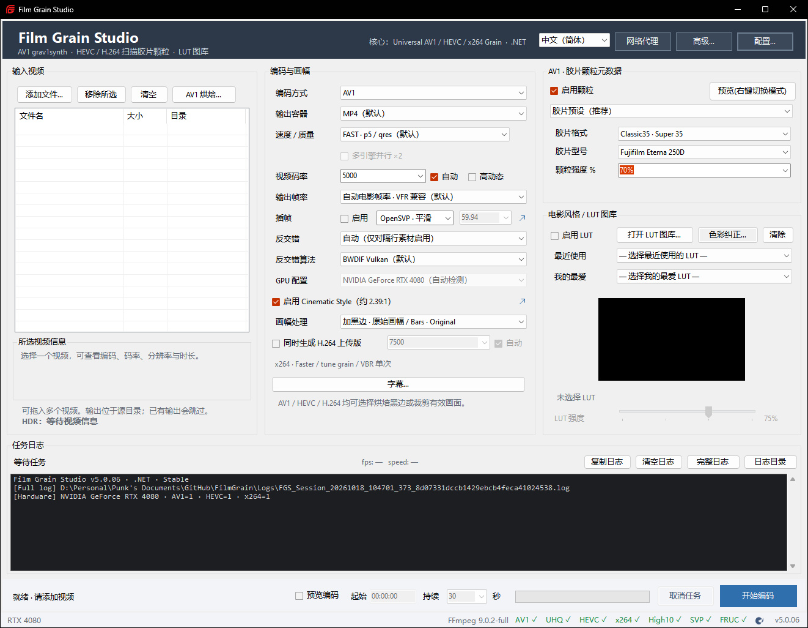
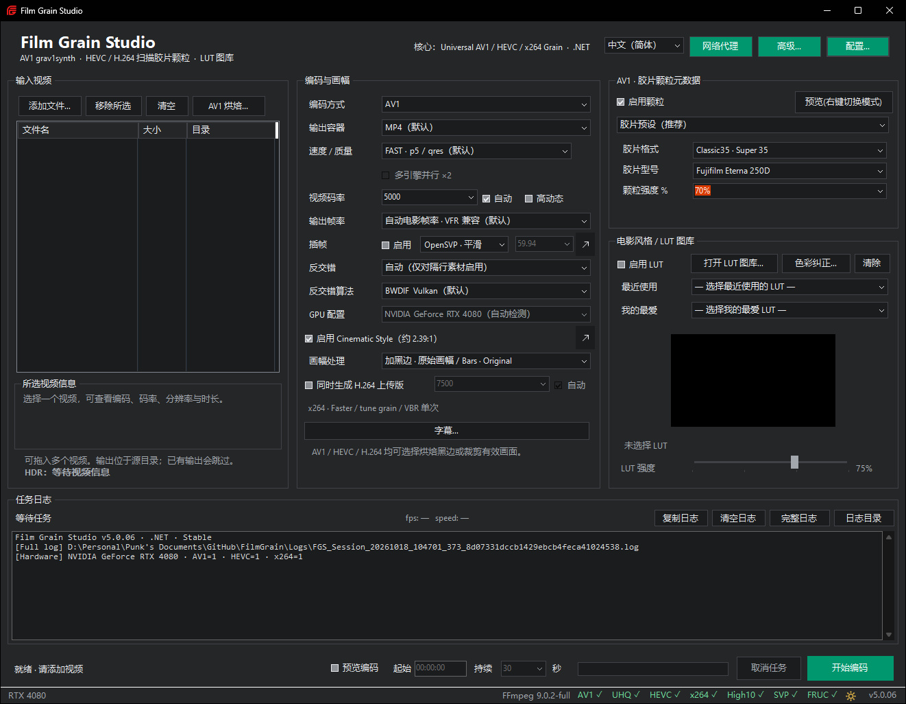
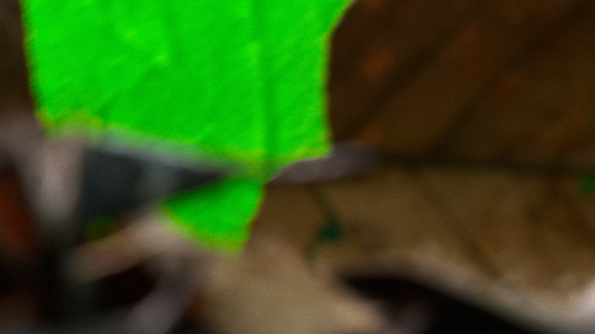

# Film Grain Studio

> **Film Grain Studio v5.0.58 · Stable · .NET Native-only。** AV1、HEVC、x264、H.264 NVENC使用当前.NET原生实现；历史版本变化见 [CHANGELOG.md](CHANGELOG.md)。

<table>
  <tr>
    <td width="50%" align="center"><a href="images/Film_Grain_Studio.jpg"></a></td>
    <td width="50%" align="center"><a href="images/Film_Grain_Studio_Dark.jpg"></a></td>
  </tr>
</table>

---

基于 **FFmpeg、NVIDIA NVENC、libx264 与 grav1synth** 的 Windows 视频处理工具。当前入口为 .NET 图形界面，支持向 EXE 传入或拖入视频文件。

Film Grain Studio 的目标不是只提供一种“加颗粒”方法，而是把几种不同思路的 Film Grain 处理方式统一到同一套工作流中：可以使用 AV1 Film Grain metadata，也可以把真实扫描 Grain Plate、数字颗粒或 GPU Film Grain 直接烘焙进像素；同时保留 HDR、LUT、反交错、插帧、字幕、Cinematic Style、自动码率和多文件处理。

主界面提供 AV1 / HEVC / H264 三个编码家族，勾选旁边 CPU 开关切换软件编码：

| 编码家族 | 硬件方式 | CPU 方式 | Film Grain |
|---|---|---|---|
| **AV1** | AV1 Main10 NVENC | SVT-AV1-HDR，10bit | 两种后端支持 Film Preset / Photon ISO / Grain Table 参数颗粒及 Digital / FGSIM；SVT 另有扫描颗粒 |
| **HEVC** | HEVC Main10 NVENC | x265，10bit | 数字颗粒、FGSIM、真实扫描 Grain Plate |
| **H264** | H.264 NVENC High，8bit | x264，可选 High10 | 数字颗粒、FGSIM、真实扫描 Grain Plate |

SVT / x265 提供 VBR 与 CRF；x264 沿用单遍／两遍／三遍 VBR。CPU 表示最终压缩编码使用软件，插帧、扫描颗粒或 HDR 转 SDR 等前处理仍可能使用 GPU。SVT / x265 支持 SDR 与 HDR 转 SDR。SVT 默认保留 HDR，已知 SDR 处理及显式转 SDR 除外，详见 HDR 章节说明；x265 同样默认保留 HDR。

默认配置为 **AV1 Main10 + MP4 + AAC 256k**，输出帧率默认「保持原帧率」。已保存预设按预设自己的帧率选择恢复。

默认统一选择 AV1 家族：支持 NVENC AV1 时使用 NVENC，否则选择 CPU·SVT。依赖缺失时明确报错。已保存的显式预设和队列选择保持原值。

### 画面缩放（Resize）

「前处理」包含「滤波」与「缩放」两页，说明文字沿用统一的次要文字配色；恢复默认值仅作用于当前页。在「缩放」页选择 720p / 1080p / 1440p / 2160p 或自定义宽高；默认关闭。使用 Vulkan/libplacebo Lanczos，缺少支持时明确报错，不自动替换算法。首次检查按 FFmpeg 文件身份缓存，不因打开设置重复探测。

保持显示宽高比默认开启：指定尺寸表示边界框，不补边、不额外裁剪。3840×1600 缩至 1080p 输出 1920×800；1080×1920 竖屏输出 608×1080。自定义尺寸取消保持比例后才允许拉伸；输出采用偶数尺寸及方形像素。现有画幅裁剪先于缩放，遮黑边坐标按比例换算。

Resize 在现有反交错、插帧和 HDR 转换阶段之后，在新增颗粒之前执行；bilateral 位于 Resize 之前，调色与 LUT 位于之后。输出文件名附带 `_RS宽x高`；自动码率、颗粒缓冲区和字幕布局使用最终尺寸。已有原片颗粒会随画面缩放，新增颗粒在输出尺寸下生成。

统一/独立配置、简单/完整预设、编码预览及四档颗粒预览共用缩放参数核心。四档 1:1 显示输出像素；旧预设没有 Resize 字段时关闭 Resize。不重编码替换 AV1 颗粒与独立颗粒烘焙不支持此变换，需使用主编码流程。

HDR 保留不额外启用 Tonemap；HDR→SDR 沿用既有处理路径。CPU 编码仍可使用 GPU 缩放。Windows 构建、典型缩放与 HEVC PQ/HLG 标签检查及用户人工验收已通过；结论限于已测组合。


主界面提供整机 CPU、GPU、物理内存及专用显存监控。CPU 优先使用任务管理器对应的 Processor Utility 口径，不可用时回退时间占用口径。GPU 优先显示当前监控显卡的 Windows 最忙引擎占用；悬停可查看设备名称和统计来源，`GPU*` 表示已回退 NVIDIA NVML 口径，与任务管理器可能存在差异。

任务日志区右侧提供实时编码监控：目标 CQ/CRF/VBR、编码器反馈 Q、FPS、Speed、ETA、视频位置、编码输出大小及当前文件耗时。反馈 Q 与设定 CQ 的含义不同，无有效反馈显示“—”。绿色曲线表示按输出字节与视频时间差计算的区间码率，保留最近 240 个采样点；码率包含当前输出流的封装数据，受写入缓冲影响，不是逐帧码率。AV1 后续写颗粒和封装阶段保留编码统计，完成后保留曲线；“编码输出”指编码阶段输出大小，可能与最终文件大小不同。

颗粒四档预览打开后自动随机选点生成画面，也可通过时间轴或精确时间重新选择片段；按当前界面语言显示，并可点击档位应用颗粒强度。

### NVENC CQ 目标质量模式

AV1 NVENC、HEVC NVENC 和 H.264 NVENC 可在主窗口的多引擎并行旁勾选 **CQ 模式**。下方的“视频码率”会切换为“目标质量 CQ”，可选择或直接输入数值。取消勾选恢复该编码器之前的 VBR 码率和自动状态；三个编码器各自保存 CQ 开关与数值，独立文件配置也分别保存。

- CQ 数值越小，目标质量越高，输出码率和体积随内容变化；它不是恒定 QP，也不保证固定体积。CQ 默认勾选现有的“自动”复选框，数值框直接显示推荐值：AV1 25、HEVC 22、H.264 20，作为兼顾画质与体积的经验起点，已有手动数值保持不变。自动推荐在高动态、启用颗粒时各降低 1；手动数值不随这些选项改变。推荐不承诺视觉无损，也不从分辨率或源码率猜测内容复杂度。
- HEVC / H.264 的FGS 数值目标为 1–51（可输入小数）；AV1 为 1–63，旧 FFmpeg 可能仅支持到 51。实际任务按所用 FFmpeg 的编码器帮助核对范围，不支持时停止并说明原因。0 在 FFmpeg 中表示自动，FGS 不将其作为数值目标。
- CQ 使用 `-rc vbr -cq N -b:v 0`，不套用 VBR 的码率策略。高级设置内，各路独立提供 CQ 码率上限普通文本框，默认开启：AV1 80、HEVC 100、H.264 120 Mbps；可修改（1–2000 Mbps）或取消勾选。启用时传入 `-maxrate NM -bufsize 2NM`，提供 2 秒 VBV 缓冲；禁用时不传自定义上限及缓冲参数。上限可能使复杂画面达不到目标质量，不保证体积或播放器兼容性。CQ 与 VBR 复用原“自动”复选框，各自保存自动状态和手动值。勾选时显示实际推荐数值，取消后恢复上次手填数值；直接输入会取消自动。CQ 列表中不包含 AUTO。
- 速度 / 质量、Multipass、SAQ / TAQ、B 帧 / B 参考、Lookahead 和 SFE 继续按各自原有能力检查与限制工作。CQ 不绕过硬件限制；手动 CQ 不因颗粒开关或 FGSIM 预设改变；自动推荐仅按通用颗粒总开关调整，不读取 FGSIM 档位。
- 每路提供 7 个可编辑数值，下面按“质量优先 → 均衡 → 小体积”列出。需要更细控制可手填合法小数；低数值用于更重视细节的素材，高数值适合更重视空间的日常视频，应先短预览。

| 编码器 | 质量优先 | 均衡起点 | 小体积 |
| --- | --- | --- | --- |
| AV1 | 20、22 | 24、25、26 | 28、30 |
| HEVC | 18、20 | 21、22、23 | 24、26 |
| H.264 | 16、18 | 19、20、21 | 22、24 |

- 输出文件以 `_CQ23` 等标识目标质量，VBR 仍以原来的 `码率k` 命名。任务日志显示模式、用户质量和实际命令。
- 旧配置未包含新设置时仍使用 VBR。x264、不重编码添加 AV1 颗粒和独立的像素烘焙功能保持原有方式；SVT / x265 的 CRF 见 CPU 设置说明。

### 高级编码：音频与 NVENC Multipass

音频策略与 MP4/MKV 容器分别选择。高级 → 音频提供：

- **跟随容器（默认）**：保留原有行为，MP4 转 AAC，MKV 复制原音轨；AAC 默认 256 kbps。
- **智能保留**：MP4 按保守兼容策略复制 AAC/MP3/AC3/EAC3，其它音轨转 AAC；MKV 保留原音轨。已有 AAC 128 kbps 可直接保留到 MP4，不会因为默认 256 kbps 再编码。
- **全部复制**：保留压缩音轨；不符合 MP4 兼容策略时停止并提示，不擅自转换。
- **全部转 AAC**：可对 MP4 或 MKV 输出 AAC；码率可选 128/160/192/256/320 kbps。

AAC 码率仅对实际重编码的音轨生效，复制音轨忽略此设置。“接近源音轨”逐条读取音频码率；缺失时最多读取 128 个音频包估算，再取相近的常用 AAC 码率。仍未知时按声道回退：单声道 64、双声道 128、多声道 384 kbps，并在任务日志说明。该选项控制码率和体积，不承诺跨编码格式同等音质；不会用整个视频文件的总码率冒充音频码率。

主输出保留原有多音轨映射；独立烘焙仍只处理第一音轨，转换时沿用双声道/48 kHz 规则。智能模式复制兼容的单/双声道音轨时保留原采样率和压缩数据；多声道独立烘焙需转换，严格复制模式会明确停止。Opus 转 AAC 是本工具面向播放器兼容性的策略，不表示所有 MP4 实现都不能容纳 Opus。

AV1、HEVC 与 H.264 NVENC 主输出可分别选择 NVENC Multipass：**FGS 推荐（默认）／关闭／四分之一分辨率／完整分辨率**。FGS 推荐：快速档优先 QRes，标准 / AV1 UHQ / 高动态优先 FullRes，并按各编码器实测能力处理；手动值仅覆盖该主编码线的 multipass，不重设其它参数。不支持的手动档位明确停止；独立烘焙维持已有视频推荐组合。NVENC multipass 是逐帧内部分析，不是 x264 整片两遍编码。

x264 插帧两遍/三遍共用一次完整渲染后的无损缓存，插帧、LUT、颗粒、字幕和画幅仅计算一次。非插帧 x264 多遍仍逐遍计算滤镜；是否增加整片缓存需要结合片长、效果负载和磁盘成本评估，目前不默认生成。

高级编码按 AV1、HEVC、H264 各占一页，每页包含对应的 NVENC 硬件与 CPU 软件设置（SVT-AV1-HDR / x265 / x264）。HEVC 与 H264 NVENC 的 Spatial AQ（默认8，0关闭）和 Temporal AQ（默认关闭）独立保存，只对该编码器支持的能力生效；不影响另一家族或 CPU 编码。音频为全部编码共用设置，单独放在“音频”页。恢复默认只重置当前页，确定后保存；取消不保存。

Lookahead 的数值是请求深度，可能受到编码器、B 帧、驱动及 FFmpeg 缓冲配置约束；不能仅凭可选数值判断实际深度，也不将 27 视为 RTX 4080 的固定上限。

### 输入文件与媒体信息

媒体信息缓存会核对文件路径、长度、最后写入时间等元数据及 FFprobe 配置。同路径文件被替换或探测工具变化后，旧信息不会继续用于任务准备。若任务执行前输入已变化，程序停止并提示重新探测；请重新选择该视频并重新准备任务，原有用户参数保留。已经打开的预览窗口提示输入变化时，请关闭窗口、重新选择视频后再打开。

### 预览与可视化画幅

颗粒四档预览默认开启“1:1 中心”。预览窗口提供时间轴，可点击/拖动选择起始位置，松开后生成四档；也可输入 HH:MM:SS 后点击生成。显示样本仍按关键帧起点取样，实际起点可能提前。

调色启用时，主界面按钮显示橙底白字“调色已启用”；关闭调色恢复普通样式，右键大界面选项保留。

Cinematic Style 的高级入口打开独立可视化窗口：时间轴选帧、精确时间输入、四边拖动、上下/左右每边像素输入、自动约 2.39:1，以及加黑边/裁剪模式。上下与左右分别对称调整，可组合使用。左右非零时，上下 0 表示不裁上下；左右与上下都为 0 时自动画幅。自动按钮清除手动值。应用保存并同步主界面，取消不保存；预览显示遮罩和有效/输出尺寸，HDR 只转换预览显示。

AV1、HEVC、x264、H.264 NVENC 与可视化窗口共用画幅几何核心。自动画幅沿用原来的偶数高度和起点取整；手动裁剪保留精确像素设置。自动码率和 ASS 字幕画布使用裁剪后的输出宽高；加黑边仍使用原输出宽高，AV1 不重编码模式不执行像素裁剪。

高级设置包含 AV1、HEVC、H264、插帧、HDR、音频、其它七页。裁剪参数在可视化窗口设置，调色窗口大小仍由调色按钮右键切换。

### LUT 强度与四档对照

普通3D CUBE的100%强度直接使用LUT结果，不再保留原图分流和逐帧混合。25%/50%/75%先生成已降低强度的临时LUT，再按100%方式应用；原LUT文件不修改，不增加视频中间文件。带一维整形表的特殊组合LUT保留原混合方式。

主界面LUT小图带1像素灰色边框，下方居中显示“目录-名称”（去掉扩展名）。小图使用图库当前参考图，缺省时使用内置参考图，并跟随强度滑杆更新；强度滑杆与百分比整体居中，提供0%/25%/50%/75%/100%，0%跳过LUT处理并显示未套LUT的参考图；后台合并快速切换请求并缓存结果。

在LUT四档对照中点击任一档确认，或在调色窗口点击确定后，最后成功预览时刻的原始视频帧成为当前主窗口的“临时参考图”。参考帧不含调色和LUT；HDR帧转换为SDR供缩略图显示。主界面切换强度、最近使用、我的最爱，或进入图库选择其他LUT返回后，均使用此图重新生成小图；再次确认其他对照帧或调色预览帧才替换。取消或没有成功预览帧时不替换。临时参考图不会修改图库参考图或配置，关闭主窗口后清理。

点击小图，从当前已探测视频随机截取一帧，生成25%、50%、75%、100%四格对照。可以拖动时间轴或输入HH:MM:SS后点击生成，也可按回车更新。默认全图缩放显示，可查看原图、切换1:1居中或点击档位回填并启用LUT。四格共用同一基础帧，仅比较LUT，不叠加颗粒和调色；隔行输入先反交错，HDR输入先应用对应HDR LUT，再转SDR供预览。调色窗口的LUT预览也使用相同临时LUT强度处理。

### 像素颗粒强度与四档对比

Digital Grain、扫描颗粒文件及 FGSIM 直接调整各自原有算法，不再提供额外相对强度或增加正式编码的干净支路混合。旧配置的 PIXEL_GRAIN_STRENGTH 不再生效。

| 模式 | 强度控制 | 四格预览 |
|---|---|---|
| Digital Grain | 0.10–1.00，步进0.01；参考说明不变 | 0.25 / 0.50 / 0.75 / 1.00 |
| 扫描颗粒文件 | 10%–100%，步进5%；直接控制原有合成强度 | 25% / 50% / 75% / 100% |
| FGSIM | Light 0.10 / Normal 0.15 / Medium 0.20 / Heavy 0.30 | 四个实际预设 |

FGSIM 在任务执行前以实际 shader 检查 GPU 输出像素，优先选择可用的 NVIDIA Vulkan 设备；未通过检查时尝试默认设备，均失败则停止并提示日志位置。Vulkan 设备编号与 NVENC 编号互不对应，不再直接认定设备 0 可用于 FGSIM。

预览分别运行每档真实参数，不使用相对强度混合近似；保留时间轴、随机选点、1:1居中、原图对照及HDR显示转换。扫描颗粒四档均可应用，准确回填主界面；滑杆按5%步进保留25%和75%。像素颗粒预览从原视频准确解码选定时间点，使用时间戳归零的临时无损片段，避免关键帧复制切片造成的开头黑屏。扫描颗粒初始值为80%，FGSIM仍默认Medium 0.20。预览仅比较颗粒，不包含LUT、调色、插帧、字幕和电影画幅；实际输出的HDR策略保持原有规则。

### AV1 颗粒强度与四档对比

- AV1 的 Film Preset、Photon ISO、Grain Table 支持 `颗粒强度 %`，界面使用10%–100%的十档滑杆，默认100%；设置自动保存。AV1 普通编码与不重编码添加/替换共用同一缩放核心。数字颗粒、FGSIM、HEVC/x264/H.264 NVENC 使用上方各自的原生强度控制。
- 强度相对当前模型：如果加载的表本身已经弱化到 75%，再选择 50%，约相当于原始曲线幅度的 37.5%；百分比描述参数幅度，不保证主观观感线性。
- 选择一个 AV1 输入，启用颗粒并选择上述模式，点击颗粒区域的“预览”。输入 `HH:MM:SS` 起始时间，点击“生成四档”，同时比较15%、40%、70%、100%，可点击应用对应强度。
- 四格使用同一关键帧样本、相同采样帧及同一模型中的种子。点击档位标题将该百分比应用回主窗口；关闭窗口不修改选择。“查看原图”临时显示关闭源合成颗粒后的参考图；“1:1 中心”检查局部纹理。
- 起始点允许按关键帧提前，完成后显示实际起点。动态颗粒表按实际起点平移，并解析继承模型；遇到无法解析的表停止并报错。窗口显示最多 8 个间隔采样帧，用于纹理对比，不能据此判断音画同步或真实运动节奏。
- 此窗口只比较颗粒，不包含 LUT、调色、插帧或字幕；HDR 使用 Hable 转 SDR 显示，最终 HDR 效果仍需检查正式输出。它与进度条前的“预览编码（默认 30 秒）”是两个不同入口。
- 100% 保留原处理流程。外部 Grain Table 低于 100% 时，先缩放所选表的强度曲线，再一次应用颗粒，省去强度调整专用的模型提取和第二次视频流重写；正常编码、不重编码及四档预览共用表缩放逻辑。内置预设低于100%也使用完整原始表先缩放、再一次应用；Photon ISO低于100%时，符合条件的普通逐行SDR、无插帧编码（grav1synth 0.2.2）从实际clean码流小前缀生成模型，先缩放小表再整片apply一次；小模型或尺寸／颜色上下文不符时，在整片apply前沿用原路线。其它ISO分支保留原处理方式；视频像素不因此重新编码。小前缀准备有固定成本，短片不保证更快。

### 高级 GPU 实时预览（独立窗口）

颗粒区域的「高级预览调整…」打开独立的 GPU 单帧交互窗口，可同时调整 **颗粒强度与 3D LUT 强度**，直接拖动滑杆观察变化。支持 AV1／SVT-AV1 的内置胶片预设及已选 Grain Table，以及 HEVC／H.264／x264／SVT 像素扫描模式使用的 Grain Plate（MOV）；也可只预览 3D LUT。AV1 参数颗粒按 1% 步进调整，扫描 Grain Plate 为 15%–100%（5% 步进），LUT 为 0%–100%（1% 步进）。点击「应用到 FGS」才回传选项，直接关闭或取消不修改主界面参数。

打开时自动选择适合当前片长的随机帧；底部可输入时间码、随机换帧或跳转到指定位置。窗口会记住上次位置、大小和最大化状态，并在多屏布局变化时避免跑出屏幕。**拖动滑杆**使用 libplacebo／D3D11 GPU 实时重绘，不重新抽取视频；**换帧**仍使用 FFmpeg 解码一次原片，扫描颗粒则同步抽取对应的循环 Grain Plate 帧。ProRes Grain Plate 支持快速循环定位，在 RTX 4080 用户测试中，颗粒抽帧从约 3–4.5 秒降至约 0.28 秒；原片抽帧时间随素材和硬件变化，不能把换帧延迟等同于滑杆渲染延迟。

当前只支持 **SDR BT.709／有限范围／逐行**，不提供 HDR、隔行源、ISO 实时模型生成、Digital Grain、FGSIM、AV1 不重编码路线或连续视频播放。纯 3D `.cube` LUT 可用，1D／复合 LUT 暂不支持。GPU 窗口用于交互判断颗粒和色调，处理顺序与正式编码存在差异，不能承诺逐像素一致；最终画质以原有编码预览和正式输出为准。原有四档颗粒／LUT 预览保留。


完整版本变化、Bug 修复与历史发布记录统一维护在 [`CHANGELOG.md`](CHANGELOG.md)。README 只介绍**当前版本的功能、工作原理、设置方式和使用建议**，不重复记录逐版本更新流水。

---

<table>
  <tr>
    <td width="50%" align="center"><a href="images/Original.png"></a><br><sub>Original Video</sub></td>
    <td width="50%" align="center"><a href="images/FGS_AV1_UHQ_11000k_GS_Modern35_2_Frame_73.png"></a><br><sub>AV1 + Native Film Grain</sub></td>
  </tr>
</table>

---

## 下载与包的区别

从 [Releases](https://github.com/rampageX/FilmGrain/releases) 下载 `FilmGrain_Studio_v版本_Stable.zip`，解压后启动根目录的 EXE，首次运行按提示指定或安装依赖。对应 `.zip.sha256` 用于校验下载文件。

Stable 不附带开发源码、Legacy 历史实现或项目截图，也不预装完整外部依赖环境；但已随包提供 `GpuAdvancedPreview/fgs_gpu_preview.exe` 及其 UCRT64 运行 DLL，无须用户安装 MSYS2。请将开发目录和日常运行副本分开；升级运行副本时保留个人配置及已安装依赖。

维护者执行 `release.bat 版本号` 后，当前开发目录会生成 Stable、Source 及各自 SHA256。Source 包含源码、构建与发布工具、项目图片及运行资源，不含编译后的 EXE；它保留在本地和 Windows runner 的工作流 Artifact 中，不作为额外附件上传到 Release 页面。GitHub 自带的 Source code 下载入口仍指向版本 Tag。

Source 与 Stable 来自同一次已提交源码归档，`SOURCE_BUILD_INFO.txt` 记录源码 commit 和对应运行 EXE 的 SHA256。当前磁盘状态的 `Working_Source_日期时间.zip` 用于开发交接，按导出规则包含未提交修改和新文件，不会自动上传为 Release 附件。

## 前处理

编码区顶部的「前处理...」打开「滤波／缩放」两页；启用后显示已用模块，例如「前处理 [bilateral] [Resize 1080p]」。字幕位于画幅处理选项前方。滤波页目前提供 CPU Bilateral；缩放页使用 Vulkan/libplacebo Lanczos，见上方「画面缩放（Resize）」。

默认关闭，启用默认值为 `sigmaS=3 / sigmaR=0.05 / planes=1`。sigmaS 控制空间范围（0–512），sigmaR 控制像素差异容忍度（0–1），planes 为通道位掩码（0–15；1=Y、2=U、4=V、6=UV、7=YUV，0=不处理）。数值越强不代表画质越好，建议先比较默认值。

CPU 双边滤波位于现有反交错、HDR 转换和插帧之后，调色/LUT及新增颗粒之前；以 `yuv420p10le` 进入滤镜，输出像素格式由原编码路线决定。原有部分 SDR 插帧、FGSIM 和数字颗粒路线的 8-bit 边界不因此升级为 10-bit。硬件解码保留原策略，CPU 滤镜可能降低速度。

前处理参与统一/独立配置、逐任务快照以及简单/完整预设。旧配置默认关闭；旧预设加载时也恢复关闭。设置窗确认后保存，取消保留原值；恢复默认值需确认后才应用。窗口位置和大小单独记忆，不进入任务或预设。

底部编码预览与正式编码使用相同生产参数。颗粒四格预览使用相同双边滤波构造；启用时，AV1 合成颗粒对照先处理一份最多 40 帧的公共底片。LUT 单项四档对照和调色工具仍按其原有用途独立显示，并非完整处理链预览。完整画质以编码预览为准。AV1 不重编码替换颗粒和独立颗粒烘焙工具不提供前处理。


## 快速开始

### 首次运行与依赖准备

首次启动 .NET 图形界面时会检查已配置的 FFmpeg / ffprobe 与 grav1synth 路径，按需打开“首次运行设置”。FFmpeg 和 ffprobe 是主编码必需工具；grav1synth 用于 AV1 Film Grain。可以指定已有程序，也可以在 FGS 副本中下载：FFmpeg 采用 gyan.dev 的 Full 构建，grav1synth 使用 [Windows 修订版发布包](https://github.com/rampageX/grav1synth/releases/latest) 的完整文件目录。新工具默认安装在 FGS 根目录的 `_Dependencies` 下。发现系统 PATH 中的 FFmpeg 时，由用户决定是否使用。

OpenSVPFlow 是可选的插帧功能，目标帧率默认 60，可使用支持的绝对帧率或倍率，需要 Python 3.12+、VapourSynth 和插件。安装时默认使用 FGS 内的 Python，只有勾选“使用系统 Python”才尝试系统现有安装；插帧的虚拟环境位于 `_OpenSVPFlow\.venv`，VapourSynth 的 Python 路径配置保存在 `_OpenSVPFlow\_UserConfig`。启用插帧但环境缺失时，.NET 界面会提示打开设置。Grain Plate 与 LUT 是自备素材目录，无须在首次运行时安装；“配置”中的两个 `[?]` 分别指向本 README 的 [扫描 Grain Plate](#hevc真实扫描-grain-plate) 和 [LUT Gallery](#lut-gallery-与-film-look) 章节。

下载与更新使用统一的网络代理设置，可选择系统代理、自定义 HTTP 代理或直连。首次运行安装由 .NET 直接完成，保留下载验证、私有 Python 环境与现有插件保护；`--setup-test=missing` 只模拟首次扫描缺失，使用独立临时配置，可测试指定路径和界面流程，不会在该模式执行安装。常规启动继续使用根目录 `FilmGrain_Config.ini`；已完成设置后仍会快速检查核心工具路径，路径失效会重新提示，耗时硬件能力检测复用有效缓存，普通主EXE替换不使缓存失效；显卡／驱动、工具及DLL／插件、相关检测规则或配置改变时仍按对应范围刷新，手动强制检测保留。检测规则更新成功写回缓存后不重复执行；请不要为升级主动清除硬件缓存。.NET只执行当前原生实现，不支持的组合、输入错误、探测未就绪、依赖不足和准备异常均说明实际原因并停止。

### GUI 图形界面

推荐直接启动根目录：

```text
FilmGrain_Studio.exe
```

支持将一个或多个视频拖到 EXE，或通过快捷方式 / 命令行传入文件；相对路径按启动工作目录解析，重复输入保留首个位置。启动只导入列表，不自动编码。请保持完整应用目录，不要只复制 EXE。

源码包本地构建后，`dotnet\build\FilmGrain_Studio_NET_Preview.exe` 与根 EXE 内容一致；正式 Stable 运行包只保留根 EXE。

启动重复 GUI 时提示切换到现有窗口。同一 Windows 会话中的根 EXE、兼容 EXE 和不同目录副本共用单实例限制，内部检测子进程不受影响。

基本流程：

1. 添加或拖入一个或多个视频。
2. 编码家族选择 AV1、HEVC 或 H264；勾选 CPU 使用 SVT-AV1-HDR、x265 或 x264；颗粒方式在下方独立选择。
3. 按需勾选或关闭“启用颗粒”，设置输出容器、码率、输出帧率和反交错方式。
4. 按需启用 Cinematic Style、LUT、字幕、OpenSVPFlow / FRUC Vulkan、HDR 处理等功能。
5. 点击“开始编码”。
6. 在任务区查看当前阶段、进度、`fps`、`speed`、`ETA` 与完整日志；Task Log 会单独保存，便于定位单次任务问题。

文件列表的长文件名按实际列宽在中间显示 `...`，保留开头和更多末尾文字，便于辨认版本号及扩展名；加宽窗口／列时自动显示更多内容。完整名称、排序依据和完整路径保持，悬停仍使用原完整路径提示。

GUI 输出默认保存在源视频所在目录，也可以在右上角“配置”中选择统一的自定义输出目录；已有同名输出时会跳过，不直接覆盖。

日志窗口聚焦阶段、结果、警告与失败原因；成功硬件探测的长段 FFmpeg 诊断、参数转储和逐行进度不再刷屏。原始内容继续写入完整 Session / Task 日志文件，任务状态区仍显示进度、fps、speed 和 ETA；未知诊断不会被一律隐藏。

FGS 运行日志保存在根目录 `Logs`。主界面的“日志目录”按钮左键用于打开该目录，右键可清理 FGS 自己生成的 `FGS_*.log`；不会删除 `Logs` 目录或其中的其他文件。配置中的“日志条目限制”控制自动保留数量，默认 `100`，可设置 `0–10000`，其中 `0` 表示不限制；创建新的 Session / Task 日志时会自动清理超出上限的旧日志。

启动成功日志保留版本、完整日志路径和显卡名称；能力状态与失败原因仍通过原能力区及完整日志查看。FRUC 启动检测详情写入完整 Session 日志；实际状态与失败原因在插帧下拉框及状态栏 tooltip 查看。日志工具栏的 fps / speed / ETA 保持单行，四个日志按钮独立显示。

高级设置各页的“恢复默认”位于确定左侧，只恢复当前页、确定后保存；插帧说明使用控件/标签tooltip，插件更新按钮仅在插帧页显示。

### 预览编码：先处理一小段

主界面底部、进度条前提供“预览编码”复选框。勾选后设置：

| 项目 | 输入 | 默认值 |
| --- | --- | --- |
| 起始 | 可编辑的 `HH:MM:SS`，例如 `01:33:20` | `00:00:00` |
| 持续 | 正整数秒，范围 1–86400 | `30` 秒 |

再点击原有“开始编码”按钮。AV1、HEVC、x264、H.264 NVENC 先共用关键帧 stream-copy 裁剪，再运行当前所选处理。开始时间不是固定值；实际片段起点和持续时间允许因关键帧、封装索引与时间戳产生偏差，不以重新编码或精确帧裁剪强行补齐。

输出名含 `_PREVIEW_HHMMSS_Ns`，其中 `Ns` 表示请求的秒数，不保证最终时长精确相等。输出位置沿用当前配置。临时裁剪片段在成功、失败或取消后清理；不勾选时继续处理全片。参数只保留在当前窗口中，不写入正式预设。多文件队列对各文件使用同一时间设置，超出任一输入时长会阻止准备。

外挂字幕根据实际复制的首个视频包校准时间偏移，内嵌字幕随源流裁剪。该功能用于检验当前处理效果，与颗粒对照、调色实时预览是不同入口。

### 高级设置快捷入口

| 主界面位置 | 点击箭头后打开 |
| --- | --- |
| HDR 输入的处理流程信息 | 独立 HDR 设置小窗 |
| AV1 / HEVC / H264 速度与质量 | 当前编码方式的独立高级小窗，仅显示当前 NVENC 或 CPU 设置 |
| 插帧 | 当前插帧方式的小窗；OpenSVP 两种模式共用参数，NVEncC FRUC 提示无独立高级参数 |
| 已启用的 Cinematic Style | 独立可视化裁剪窗口 |

“色彩纠正”按钮右键可切换“大界面”；重新打开色彩纠正窗口时生效。

### 预设配置系统

旧版 v1 预设缺少后来新增的 NVEncC AI 质量字段时，读取副本按 medium 补齐，不改写原文件；已有质量值保留。

在“独立配置”所在行选择预设可立即应用；“预设管理”左键打开管理器，右键选择五个快捷预设。管理器浏览列表不会修改当前配置，点击“应用”才生效。统一模式作用于统一设置；独立模式作用于明确选中的文件；支持 Shift 连选、Ctrl 加选后批量应用同一预设。

- **简单预设**：主界面处理流程、HDR/音频策略、裁剪数值、调色及字幕样式；不包含编码与插帧的高级调优。未包含的高级参数保持当前设置，因此不同高级设置可能得到不同输出。
- **完整预设**：增加高级编码、CQ 上限、插帧调优、色调映射等配置；不包含工具路径、资源库根目录、输出/临时目录、机器能力、界面偏好或预览编码范围。
- 支持新建、更新保存、另存为、重命名/说明、删除、导入/导出和五个快捷绑定。绑定使用稳定 ID，重命名后继续有效。
- 统一模式可从管理器或队列右键保存当前统一配置，无须启用独立配置；独立模式则保存明确选中文件的配置。
- 独立模式下，单选文件右键可复制完整处理配置，再用 Shift／Ctrl 多选目标文件批量粘贴。菜单显示目标数量，管理器列出目标文件；保存／更新预设仍要求单选来源。简单预设分别保留每个目标未包含的高级参数；整批校验通过后才修改配置。字幕具体文件/轨道属于目标视频，不跨视频复制。预设字幕策略保存“关闭”“自动匹配”，或对指定字幕使用“保留目标绑定”，并保存样式。
- LUT、颗粒表和扫描颗粒保存相对资源库引用；库外资源显式使用外部文件引用。缺失时指出具体资源并允许重新定位；重新定位后可从当前配置更新保存预设。
- `Presets/Initial` 仅存放五份随附初始方案；个人预设保存在程序目录的 `Presets\User/*.fgspreset.json`，五个快捷绑定保存在 `Presets\User/quick.json`。分享请使用管理器导出，不必复制整份 INI。请自行备份 `Presets\User`。
- 详情仅展示当前编码器和当前算法的生效参数；关闭项只显示“关闭”，备用设置仍保存在预设中。资源缺失或兼容性问题单独提示。
- 初始方案首次复制到本机预设目录；之后升级不覆盖用户修改或删除。完整说明与参数在管理器右侧详情框查看；快捷菜单与主界面选择器的悬停提示仅显示主要流程和必要问题。管理器列表不显示重复悬停提示。

### .NET 执行范围与多文件队列

AV1、HEVC、x264、H.264 NVENC 共用 .NET 串行队列。每个输入分别探测、准备并判断 Native 支持范围，再按冻结的任务参数执行；不会把上一项的预处理状态沿用到下一项。队列显示当前文件编号、实际阶段、进度与最终结果。失败或取消停止后续项，保留已成功输出；取消期间不会继续把进度更新为成功。

共享预处理按实际路线处理 FRUC、OpenSVPFlow、HDR 转 SDR、时间轴与工作文件；最终封装和验证继续保留各编码器的职责。日志显示实际原生执行阶段。只有最终验证完成后才显示成功。

四线共用的辅助功能包括硬件能力检测、LUT 图库与预览、参考图及索引同步、Grain Plate MOV 扫描、首次运行依赖安装、OpenSVPFlow 插件更新，以及 FGSIM 纹理 / hook 准备。这些入口由 .NET 原生实现执行。

Native 支持按具体组合判断。隔行 HDR 的 AUTO/OFF、HDR 保留/转换及已有输出复用沿用累计实现；隔行 OpenSVPFlow 按规则绕过光流、AUTO 输出 2x 场率，HDR 保留的渐进 HEVC/AV1 绕过 8-bit SVP。x264 HDR Preserve、隔行 FRUC 等原本不支持的组合显示原因并停止，不尝试 BAT。未知准备失败也停止并保留诊断。

AV1 不重编码添加／替换颗粒仅对已确认 AV1 的单文件开放；独立配置时按当前单选文件判断，HEVC／H.264、媒体信息未就绪、无选择或多选时不提供该选项。现有不适用的队列请求在启动前停止并提示，不把它当作普通重编码执行。

AV1 不重编码添加 / 替换颗粒由 .NET 执行独立的视频 stream-copy 工作流。Legacy GUI、CLI 保留在源码包的 Legacy 目录，与根 EXE 独立，不进入 Stable 运行包。Source 包提供 `dotnet\` C# 源码及 `build_NET_Preview.bat`；Windows 构建会同时更新两处 EXE。运行资源和实际算法依赖应保持原位置。

### 队列耗时与完成记录

任务日志上方显示全队列耗时，包含点击开始后的准备、文件间切换及收尾，切换文件不归零；结束或取消后保留，下一次开始重新计时。实时编码面板中的耗时属于当前文件；任务日志另外记录末项耗时与全队列总耗时。

文件列表下方的 **队列完成后显示详细记录** 默认关闭，按本次点击开始时的勾选状态生效。勾选后，正常结束或失败终止时显示独立记录窗口，主动取消不弹窗。记录包含各项输入与输出、状态、处理项目、实际执行阶段、完成时间和单项耗时，并汇总全队列总耗时、成功／失败／取消／未执行数量及成功输出总大小；未完成的输出只标为目标，不当作成功文件。

统一模式的流程集中显示在记录末尾；相同流程合并，因素材而异的流程注明适用队列序号。独立模式每项显示自己的流程。处理项目来自任务设置，执行阶段按实际运行顺序记录。

窗口默认 16:9，随主题显示，只读且无滚动条；可用滚轮、方向键及 Page Up／Page Down 浏览。底部居中的“复制记录”复制全文，“关闭”或 Esc 关闭；也可 Ctrl+A／Ctrl+C 复制。窗口内容固定为本次任务，不随后续设置修改。

文件列表的完整路径悬停提示仍可能偶发不显示，留待后续处理。

### 从命令行导入视频

```bat
FilmGrain_Studio.exe "D:\Videos\sample.mp4"
```

该参数只导入图形界面的输入列表，不自动编码；当前不提供旧交互CLI、Bridge BAT或旧参数兼容入口。

---


### CPU 编码（开发验证版）

主界面的编码方式为 AV1 / HEVC / H264，右侧 CPU 开关分别选择 SVT-AV1-HDR / x265 / x264。未勾选时使用原有 NVENC 路线。不重编码入口保留。

| CPU 路线 | 码率模式 | 颗粒 | 默认 preset |
| --- | --- | --- | --- |
| AV1 / SVT-AV1-HDR | CRF / 单遍目标码率 | Film Preset / ISO / Table 编码后应用参数模型；Digital / 扫描 / FGSIM 像素烘焙；内部 film-grain=0，Grain 调优另行控制 | 6 |
| HEVC / x265 | CRF / 单遍目标码率 | 同上；开启颗粒时 tune=grain | medium |
| H264 / x264 | 原有单遍／两遍／三遍 | 原有三种像素颗粒 | faster |

SVT 与 x265 的质量模式使用 CRF，不能把数值与 NVENC CQ 横向比较。默认 CRF 起点分别为 30 / 22，不保证视觉无损；自动 CRF 使用这两个起点。速度行右侧箭头打开当前实际编码方式的小窗（NVENC / SVT / x265 / x264），只保存该方式的高级选项。主界面“高级设置”保留完整七页，AV1 / HEVC / H264 各页均含对应硬件和软件选项。两种入口共用控件、配置键、默认值和校验；HDR 和插帧箭头分别打开当前功能的小窗，仅保存对应参数。

SVT 要求主 FFmpeg 实际链接 SVT-AV1-HDR；执行前用短片检查 10bit、实际参数及 HDR 分支标识，失败时停止，不换编码器。当前未提供自动下载此特殊 FFmpeg 的功能，请在路径设置中指定自己的构建。使用自定义 FRUC FFmpeg 时，实际承担编码的这个程序也必须支持所选 CPU 编码器。检查结果按程序路径、大小、修改时间与参数缓存，浏览和应用预设不触发全面硬件检测。

x265 Threaded ME 为实验开关，默认关闭。官方说明其要求至少 32 个逻辑处理器，且与 VBV 不兼容；本版仅允许 CRF 组合，条件不满足直接提示，不假装启用。高频 CPU / 4K 不保证加速；13600K / 5800H 不满足上述线程门槛。

CPU 路线支持 SDR 和 HDR 转 SDR；SVT 的 AUTO 默认保留 HDR，x265 同样默认保留 HDR。扫描颗粒、FRUC、部分反交错／FGSIM 等预处理仍可能使用 GPU，CPU 开关指最终视频压缩。GPU AV1 / HEVC 已有的 P010 HDR 路线维持原有实现。

简单预设包含 CPU 编码器及 CRF／码率模式；CPU preset、Threaded ME 为高级设置，简单预设保留目标值，完整预设保存它们。旧格式预设缺少 CPU 编码器标识时，原 slot 2 仍解释为 x264。

### SVT 外部参数颗粒

SVT 的 Film Preset / Photon ISO / Grain Table 复用 grav1synth 0.2.2 与现有强度处理，编码器内部 film-grain=0，不叠加像素颗粒。编码一次到 clean MKV，再应用参数颗粒并复制封装，音频按输出策略处理一次。Digital / FGSIM / 扫描颗粒仍使用各自的像素处理路线。配置单独特别版 FFmpeg 时，SVT 使用该已选工具，不要求启用 FRUC。

SVT 的外部参数颗粒路线接受源 AV1：源视频使用 libdav1d 软件解码并关闭原颗粒合成，只移除帧上的颗粒参数，不删除 HDR 静态信息；原有 GPU 滤镜仍可使用。随后编码一次并应用所选新模型，无额外整片媒体文件。颗粒 OFF 沿用原行为，不主动移除源颗粒；专用颗粒烘焙和独立 AV1 不重编码添加/替换功能保持原路线。OpenSVPFlow直接通过BestSource读取原AV1时，当前接口未接入关闭源颗粒合成的控制，此组合会明确说明限制；关闭OpenSVPFlow即可使用，普通缩放及FRUC仍按原能力处理。


## Film Grain 方式

FGS 当前把几种不同性质的颗粒方案放在同一项目中。它们的主要区别不是“谁更高级”，而是**颗粒最终存在哪里、如何生成、是否需要播放器参与以及适合什么场景**。

| Grain 方式 | 颗粒位置 | 主要特点 | 适用路线 |
|---|---|---|---|
| **AV1 Film Grain metadata** | AV1 码流参数，由播放器解码时合成 | 码率效率高；颗粒不直接编码进每个像素 | AV1 |
| **真实扫描 Grain Plate** | 直接烘焙进像素 | 使用真实胶片扫描素材，质感由 Grain Plate 决定 | HEVC / H.264 NVENC / x264 |
| **Digital Grain · Fast Noise** | 直接烘焙进像素 | 不依赖外部 Grain Plate；速度较高；强度连续可调 | AV1 / HEVC / H.264 NVENC / x264 |
| **GPU Film Grain (FGSIM)** | 直接烘焙进像素 | 使用 GPU shader / Vulkan 路径生成 Film Grain 效果 | AV1 / HEVC / H.264 NVENC / x264 |

四条主编码路线尽量共用同一套画幅、字幕、LUT、反交错、OpenSVPFlow 与码率策略；真正不同的部分主要集中在 Film Grain 机制和最终编码器。

H.264 NVENC 使用与 HEVC 共用的像素颗粒处理，可选 Digital Grain、真实扫描 Grain Plate 或 FGSIM；不支持 AV1 Film Grain metadata。其主输出为 High / 4:2:0 / 8-bit，HDR 素材需先转 SDR。

---

### 启用颗粒

主界面颗粒区域的“启用颗粒”默认勾选。关闭后，颗粒类型、强度、文件等控件灰显但保留原参数，重新开启即可恢复；开关状态保存到根目录 `FilmGrain_Config.ini` 的 `[General] GRAIN_ENABLED`，重启恢复，旧 INI 缺少此项时默认开启。

| 路线 | 关闭后的行为 |
|---|---|
| x264 / HEVC / H.264 NVENC | 真正跳过 Digital Grain、Grain Plate 叠加和 FGSIM 滤镜 |
| AV1 普通重新编码 | 跳过像素颗粒和 grav1synth 添加/替换 Film Grain metadata |
| 依赖及临时资源 | 不要求本任务未使用的颗粒文件、表、纹理或仅用于颗粒的 grav1synth，不生成仅供颗粒的资源 |
| x264 主输出和独立 x264 烘焙 | 取消 FGS 自动附加的 `tune grain`；preset、码率和其它质量设置保持 |
| 命名与状态 | 去掉本次添加颗粒的文件名标记，日志/状态显示“颗粒：关闭” |

插帧、调色、LUT、字幕、画幅、反交错等继续按实际设置执行，其依赖仍正常检查。HDR 自动判定只考虑实际启用的处理：关闭颗粒时，保存的 FGSIM 选择不会使输出自动转 SDR；实际调色/LUT等限制与用户明确 HDR 策略仍生效。

关闭表示“不主动添加 FGS 颗粒”，不是降噪，不清除输入已有像素颗粒。普通 AV1 重编码使用实际 FFmpeg 解码路径，输入已有 Film Grain metadata 可能在解码时合成为像素；不承诺重新编码原样保留 metadata，也不自动增加清除步骤。颗粒检测/查看独立于添加开关。

“AV1 不重编码 · 添加/替换胶片颗粒”专用模式强制启用颗粒并禁用总开关；tooltip说明原因。进入/离开该模式保留并恢复普通转码开关状态，不静默转为重新编码。

---

### AV1 / SVT 颗粒选择

默认选择 AV1 家族：支持 NVENC AV1 时使用硬件编码，否则使用 CPU·SVT。两者默认均为胶片预设（推荐），共有选择在后端切换时保留。SVT 依赖缺失时明确报错。

颗粒菜单统一按胶片预设（推荐）、感光度 ISO、扫描颗粒文件、现成 Grain Table、Digital Grain、GPU Film Grain 排列，各路线只显示已支持项目。默认值及已保存预设/队列的选择保持。切换编码或软硬后端时，颗粒菜单与强度滑杆使用缓冲刷新；重选相同编码/后端保留现有控件。NVENC AV1 和 AV1 不重编码替换当前没有扫描颗粒项。

保存前处理设置后，Grain Table 立即按有效输出尺寸刷新筛选和当前选择，沿用显示全部表及独立配置的原选择规则。SVT/x265 的 HDR 路线提示只读取相关处理选项，不依赖码率输入或颗粒文件是否已加载；正式任务仍执行完整校验。

## AV1：grav1synth Film Grain

启用metadata颗粒的AV1模式先编码相对干净的Main10视频，再由grav1synth将Film Grain参数写入AV1 bitstream；关闭颗粒时跳过该写入步骤。媒体信息检查 AV1 颗粒时，会先读取 bitstream 中的 `film_grain_params_present`；明确没有 Film Grain metadata 时直接显示“未发现 AV1 Film Grain metadata”，不调用 grav1synth inspect。只有检测到 Film Grain metadata 时才进入原有 inspect 流程。该预检查不改变 AV1 不重编码添加 / 替换 Film Grain 的独立工作流。

AV1元数据颗粒的主链为：原视频 → Main10编码为clean IVF → grav1synth写入颗粒参数 → 恢复音频和容器内容 → MP4／MKV。所需的模型提取／强度调整按模式执行，不是所有任务都额外进行整片inspect。

### 减少AV1中间文件的条件

| 路线 | 可减少的处理 | 首批条件与保留边界 |
|---|---|---|
| 颗粒OFF直接容器 | clean IVF、独立remux | 来源帧率、无插帧、逐行SDR、无像素效果／SFE，并通过已有MOV固定时间表检查 |
| FRUC直接接AV1 | FRUC的FFV1／MKV中间文件 | 同一FFmpeg、颗粒OFF、逐行SDR、固定时间表通过检查、无像素效果／SFE；普通帧率选原始，插帧目标另设，仍保留IVF／remux |
| Photon ISO非100% | 整片未缩放grain IVF、整片inspect和第二次apply | grav1synth 0.2.2、普通逐行SDR、无插帧；模型来自实际clean前缀，核对尺寸／transfer／range |

前两条不包含Bilateral、Resize、调色、LUT、画幅或字幕等像素处理。许多带B帧重排／编辑时间表的MOV／MP4和MKV来源暂时继续原路线，不代表这些输入不能正常处理。HDR、隔行、VFR、SVP及其它复杂分支保留对应的既有处理方式。

FRUC这次仅省去落盘，保留原SDR 8-bit 4:2:0和毫秒时间基边界，不因此提升为全链高位深。ISO成功采用小模型后，有效总阶段数会更新；准备失败在整片apply前选择原路线，运行中编码／apply失败仍停止，不自动重跑整片。

这里的 Grain 不会在编码阶段直接写进每一个像素。播放器解码 AV1 时，根据码流中的 Film Grain 参数实时生成颗粒。

随包 Grain Table 目录新增 `_AV1_Grain_Tables/Netflix_FGS_Dune2.txt`，可在现成颗粒表模式选择。文件保留用户提供的原始内容；其效果评价与测试结论仅针对实际使用素材。

### 中间文件与颗粒强度

SVT 参数颗粒的任务目录使用唯一随机名称，内部媒体固定短名 video.clean.mkv、video.grain.mkv、video.strength.mkv，避免重复拼接源文件长名称。正式输出仍使用原有命名。 共用关键帧预览裁剪与正式输出仍继承源名称，极深目录或极长名称加处理后缀仍可能触及 Windows/.NET 路径限制；内部短名修复不代表全程序支持任意长路径。

SVT 颗粒 OFF 为一次编码直接输出。外部参数颗粒通常为 clean MKV → 应用颗粒 MKV → 最终复制封装，Film/Table 非100%先缩放参数表。SDR ISO 非100%仅在符合原严格条件时使用小前缀建模；HDR 不符合该优化条件，可能沿用整片 grain MKV → inspect → 强度表 → strength MKV 的回退，再最终封装。不会因此增加第二次视频编码，模型应用失败不重试。

强度缩放保留待应用表的其它参数；grav1synth 写入码流时会递增 seed。ISO 回退多应用一次时，最终随机纹理并非仅对同一噪声做幅度缩放。NVENC 原有直接输出、直接 FRUC、小前缀优化及硬件缓存规则保持。

### Film Preset

内置 Film 格式：

```text
Classic35
Modern35
16mm
Super8
MaxMid
```

Classic35、Modern35 和 16mm 还可以选择 Fujifilm Eterna 250D/500T、Kodak Vision3 250D/200T。

### Photon ISO

高级模式提供：

```text
ISO 400
ISO 800
ISO 1600
ISO 3200
ISO 6400
Custom ISO
```

并可选择 `Luma only` 或 `Luma + chroma`。

### 现成 Grain Table

AV1 可直接加载 `_AV1_Grain_Tables` 中的 `.tbl` / `.txt` Grain Table。目录推荐按以下分辨率分类：

```text
_AV1_Grain_Tables\
├─ 720p\
├─ 1080p\
├─ 1440p\
└─ 2160p\
```

GUI 会根据源视频分辨率自动匹配最接近的档位：

```text
≤ 1280  → 720p
≤ 1920  → 1080p
≤ 2560  → 1440p
> 2560  → 2160p
```

也可以勾选 Grain Table 列表旁的无文字复选框显示全部分辨率。

FGS 同时支持旧式 `1080p` 命名与 `3840x2160`、`3840x1600` 等实际宽高命名；同一档位中，带实际宽高的表会按与源视频尺寸的接近程度优先排序。电影画幅素材建议优先使用**与源或最终输出宽高完全一致**的 Grain Table，其次再按 2160p / 1440p / 1080p 档位近似匹配。

示例：

```text
LOTR FOTR Remastered · Light · 1080p · B/W · AOM
Star Trek TNG · Medium · 1080p · Color · SVT · P2
16mm · ISO 1000 · Medium · 1080p · Size8 · Photon
ISO 400 · 3840×2160 · sRGB · Photon
ISO 800 · 3840×2160 · BT.2020 · Photon
```

推荐来源：

- [Boulder08 / chunknorris](https://github.com/Boulder08/chunknorris) — `av1-graintables` 中包含多种影视来源、AOM / SVT 与 Photon Noise 表。
- [nekotrix / AV1-Photon-Noise-Tables](https://github.com/nekotrix/AV1-Photon-Noise-Tables) — 提供大量按实际分辨率生成的 Photon Noise 表，尤其适合 1440p / 4K。

项目正式包中整理的 Grain Table 继续按分辨率分类，具体上游来源见 `_AV1_Grain_Tables\README.txt`。第三方表文件仍受其原项目条款约束，FGS 只负责扫描、分类、选择和调用。

选择 Grain Table 后，Film 格式、Film stock、ISO 与 Chroma 参数自动禁用，因为颗粒参数已经由表文件本身决定。

随包提供 `Netflix_FGS_Dune2.txt` 原强度表，以及 `Netflix_FGS_Dune2_Strength75.txt` 减弱版。减弱版将亮度和彩色颗粒强度曲线参数缩放到原表的 75%，保留纹理系数和分段事件；视觉感受不保证恰好减弱四分之一。两份都是动态表，AV1 不重编码时使用兼容流程。

Grain Table 支持主界面的 10%–100% 十档强度调节，100% 保持所选表原效果；低于 100% 按比例调整表内颗粒强度曲线，保留纹理系数及分段事件，并在应用前生成临时强度表，原表不改动。强度相对于当前所选表；如果使用已减弱的外部表，再调低百分比会进一步减弱。关闭颗粒请使用“启用颗粒”总开关。影视来源的表可能包含多个随时间变化的事件，降低强度不会把动态表变成静态表；AV1 不重编码时仍按实际快速条件选择路径。

### AV1 UHQ

当硬件能力探测确认当前 GPU、驱动与 FFmpeg 支持时，速度 / 质量中会出现 **UHQ**：

```text
preset：p4
tune：uhq
multipass：fullres
```

UHQ 由编码器自身进行更深入的时域分析和帧结构决策。能力探测未通过的环境不会显示该选项。

### AV1 / HEVC SFE 多引擎并行

AV1 Standard / UHQ 可选 **“多引擎并行 ×N”**，对应 NVIDIA NVENC Split Frame Encoding (SFE)。

HEVC 主编码同样支持 **“多引擎并行 ×N”**，默认关闭，按 HEVC 自身能力检测决定是否可用及引擎数量。AV1 与 HEVC 分别检查，不能以 AV1 可用推断 HEVC 可用。SFE 将一个编码任务分配给多个编码引擎，提高单任务吞吐量，可能降低压缩效率；它不会并行运行多个队列文件。H.264 NVENC 和 x264 不提供 SFE。

`×N` 由当前硬件实际编码引擎数量和能力检测决定，不按 GPU 型号硬编码。启用颗粒时SFE同时检查grav1synth **0.2.2或更高版本**兼容性；关闭颗粒时只要求实际编码器能力，不因颗粒专用grav1synth缺失阻止SFE；AV1 FAST、H.264 NVENC 与 x264 不使用该选项。HEVC 不依赖仅用于 AV1 颗粒元数据的 grav1synth；其开关与限制另见“H.264 NVENC 主编码线与 HEVC SFE”。

### AV1 Film Grain 最终验证

AV1 任务完成前会运行：

```text
grav1synth inspect
```

只有最终输出中的 Film Grain 信息通过检查，任务才计为成功。

相关项目：

- [rust-av / grav1synth](https://github.com/rust-av/grav1synth)
- [本项目使用的 Windows 修订版](https://github.com/rampageX/grav1synth)

---

## HEVC：真实扫描 Grain Plate

HEVC 主线适合将真实扫描 Grain Plate 直接合成到视频像素，再使用 Main10 NVENC 编码。

```text
原始视频 + 真实扫描 Grain Plate
            ↓
     Vulkan Overlay
            ↓
  P010 / HEVC Main10 NVENC
            ↓
        MP4 或 MKV
```

主要特点：

- 递归扫描 Grain 根目录中的 `.mov` Grain Plate；
- 支持真实 35mm、Super 35、16mm、Super 16、8mm 及自定义素材；
- Film Grain Strength 连续可调；
- 使用 Vulkan 路径完成 Grain 缩放与合成；
- 支持 LUT、Cinematic Style、反交错、自动电影帧率、字幕、OpenSVPFlow、MP4 / MKV 与多文件处理；
- HDR 输入可进入 Main10 HDR Preserve 工作流。

### HEVC AQ

`高级设置 → HEVC` 和 `高级设置 → H264` 分别提供对应 NVENC 的独立 Spatial AQ 与 Temporal AQ 控制。Spatial AQ 可选 `0 / 4 / 8 / 10 / 12 / 15`，默认 `8`，其中 `0` 表示关闭；Temporal AQ 为同行复选框并默认关闭。两线分别保存并服从各自能力检测；不会改变 AV1 原有设置，也不作用于 x264。

### Grain MOV 直接使用

扫描颗粒直接读取所选 MOV，不再生成或自动选用同名 HEVC 无损 MKV 缓存。
配置页只扫描 MOV 数量；已有缓存文件不会自动删除。

颗粒尺寸与合成画面一致时，跳过颗粒的 Vulkan 缩放；尺寸不同或尺寸探测失败时，
保留原有缩放流程。网上下载的 MOV 仍按同一流程兼容。

使用生成器时，可直接导出与目标画面匹配的 Full HD 或 4K UHD 灰底 ProRes MOV，
无需事先转码。P010 工作格式转换、帧率匹配及颗粒强度控制仍按原流程执行。

免费 Grain Plate 素材：

- [Film Grain Generator](https://github.com/rampageX/FilmGrain-Generator)：可以生成自己喜欢的颗粒效果文件，供 FGS 扫描颗粒模式使用。

- [TDCAT Free DCI 4K Film Grain Plates](https://tdcat.squarespace.com/downloads/filmgrain)
- [Cinema Tools 4K DCI 35mm Film Grain](https://www.cinematools.co/film-grain)
- [DylanJohn Film Grain](https://drive.google.com/file/d/1cog6ROibJaNNcp4krO6BeQm8_kBTy7Pc/view)
- [KestFilms Media - FILM GRAIN PACK](https://kestfilms.com/film-grain-pack)

推荐目录结构：

```text
D:\Film_Grain\
├─ CinemaTools\
├─ TDCAT-Light\
└─ TDCAT-Heavy\
```

---

## H.264：x264 Grain

H.264 x264 Grain 与 HEVC 共用真实扫描 Grain、LUT、Cinematic Style、字幕、反交错、Field-rate、OpenSVPFlow 等前处理，只在最终编码器边界切换为 libx264。

默认编码：

```text
libx264
preset faster
tune grain（仅启用颗粒时自动附加）
VBR 单次
High Profile / yuv420p
```

高级设置可选择：

```text
Preset：Faster / Medium / Slow
码率模式：VBR 单次 / VBR 2-Pass / VBR 3-Pass
```

`3-Pass` 为高级可选模式，严格执行 Pass 1 → Pass 3 → Pass 2，沿用所有现有 x264 参数；默认仍为 VBR 单次，非默认输出追加 `_3PASS` 标识。

`2-Pass` 主要用于更精确地分配给定平均码率 / 文件大小，不是颗粒保留的必要条件。启用颗粒时FGS的x264路线自动附加`tune grain`；关闭颗粒时跳过此项，仍保留用户的preset与码率。

普通 H.264 主线尽量维持 10-bit 前处理，到最终编码边界再转换为兼容性更好的 8-bit High Profile；能力探测通过时使用 error-diffusion dither。

高级设置提供 **H.264 High10（实验）**。启用并通过能力检测后，最终编码使用：

```text
yuv420p10le
High 10 Profile
```

High10 更适合本地测试和高位深链路验证；浏览器、电视、硬件解码和部分平台兼容性明显低于普通 H.264 High，该开关仅作用于 x264 主输出。

---

## Digital Grain · Fast Noise

Digital Grain 是 AV1 / HEVC / x264 / H.264 NVENC 四条主线都可调用的通用**像素颗粒引擎**。它不依赖外部 Grain Plate，也不是 AV1 Film Grain metadata；颗粒在编码前直接烘焙进像素。

强度使用连续滑杆：

```text
0.10 – 1.00
```

默认 `0.55`。当前实测参考：

| 强度 | 观感 |
|---:|---|
| 0.30 | 轻微 |
| 0.40 | 轻 |
| 0.55 | 中等 |
| 0.68 | 约接近 HEVC CT35 85% 的颗粒存在感 |
| 0.75+ | 明显 / 偏重 |

SDR 路径使用约 1.333× 分辨率的 Fast Noise 生成、形态学整形、亮度相关 Mask 后回缩到输出分辨率；相比早期 GEQ 随机颗粒参考实现，在 1080p / 1440p 实测具有明显的滤镜性能优势。

HDR Preserve 下，AV1 / HEVC 使用 10-bit 亮度颗粒路径，只修改 Y 平面，U/V 色度保持不变。HDR 与 SDR 的强度数值不要求严格视觉等效，仍建议以最终画面观感微调。

---

## GPU Film Grain (FGSIM)

GPU Film Grain (FGSIM) 是另一条**像素烘焙型** Film Grain 路线，使用已验证的 GPU shader / Vulkan / libplacebo 工作流生成颗粒。

主界面仍使用统一的 **Film Grain Strength** 控件；内部将强度映射到已经验证的 Light 0.10 / Normal 0.15 / Medium 0.20 / Heavy 0.30 四档，而不是在界面上暴露三套独立算法。

FGSIM 与 BWDIF Vulkan 共用同一个 Vulkan filter device，避免重复创建 filter device。

---

## HDR Preserve / HDR→SDR

FGS 会根据 FFprobe 结果识别 HDR10/PQ 或 HLG。HEVC Main10 与 AV1 Main10 的 HDR Preserve 路线会尽量保持源视频已有的 HDR 信号，而不是人为伪造源中不存在的 mastering metadata。

逐行、关闭颗粒与插帧的 HEVC HDR→SDR 任务，会在同一编码进程完成 HDR 转换、调色、LUT、画幅和字幕，减少中间视频读写。Hable 优先使用 Vulkan/libplacebo，能力不足时回退原 CPU 算法；手选其它算法保持原值。颗粒、插帧、隔行和 HDR 保留组合沿用各自处理路径。

当前保持与验证的项目包括：

- 实际 10-bit 视频路径；
- BT.2020 Color Primaries；
- PQ / SMPTE ST 2084，或 HLG / ARIB STD-B67；
- BT.2020 non-constant matrix；
- Limited / Full Range（按源信号）；

母版亮度、Mastering Display、MaxCLL / MaxFALL 等静态元数据尚未在所有编码／插帧路径验证完整保留，不能仅凭上述色彩标记认定它们已透传。

HEVC NVENC 会显式使用 `p010le`，避免只显示 Main 10 Profile、实际码流仍为 8-bit。AV1 Main10 继续使用 10-bit NVENC 路线。

主输出完成后会再次检查 10-bit 像素格式及 HDR Primaries / Transfer / Matrix / Range；HDR 信号不匹配时不把结果作为正常完成输出。

FGS 的原则是：

> **保留源已有的 HDR 信息，不伪造源不存在的 HDR mastering metadata。**

因此某些网络 HDR 文件只有 BT.2020 + PQ + 10-bit、没有 Mastering Display / MaxCLL / MaxFALL 时，输出也不会人为补写虚构值。

AV1／HEVC 的逐行 HDR 保留路线支持 FRUC Vulkan：插帧输入和输出使用 P010 10bit；AV1 的无损插帧中间文件使用 FFV1 10bit。首次使用会验证当前 FRUC FFmpeg 和设备的高位深处理，失败明确停止，不自动降为 8bit。PQ／BT.2020 和 HLG 可按原信号处理；SDR 调色／LUT 冲突、隔行 FRUC、H.264／x264 的 HDR 保留限制仍需遵守。此路线不代表 Dolby Vision RPU、HDR10+ 动态元数据或全部静态元数据的完整保留。

### HDR 处理策略

高级设置 → HDR 提供：

```text
自动：仅不兼容流程转 SDR
保持 HDR
强制转换为 SDR
```

自动模式下，若当前任务需要 x264 主输出、BT.709 LUT、OpenSVPFlow 或 H.264 NVENC 等 SDR-only 流程，HDR 输入会先 Tone Mapping 为 BT.709 SDR，再进入后续处理。

Tone Mapping 默认使用 **Hable**，还可选择：

```text
Mobius
Reinhard
Gamma
Linear
Clip
```

HDR→SDR 会建立随机后缀的 10-bit HEVC Main10 无损工作文件，任务结束或失败后清理。工作文件仅作为内部中间层，不改变正式输出命名策略。

当前不处理 Dolby Vision RPU 或 HDR10+ 动态 metadata；特殊 HDR、非常规 mastering metadata 与 Dolby Vision 素材建议先使用短片验证。

---

### LUT / CC 与保持 HDR

AV1 NVENC、HEVC NVENC、SVT-AV1 和 x265 在明确选择「保持 HDR」时，支持调色与 LUT，不再因启用这两项而拒绝，也不再静默跳过 LUT。AUTO 沿用原策略：启用调色/LUT 时转 SDR；明确转 SDR 的路线不变。H.264/x264 原有输出限制不变。

HDR 调色使用 16-bit YUV 信号计算对比度、亮度、饱和度、Gamma 与黑白；中性参数直接通过。它调整 PQ/HLG 编码信号，不是以尼特为单位的曝光控制，也不先做色调映射。SDR 继续使用原 eq/hue 算法。HDR LUT 经显式矩阵/范围转换进入 16-bit RGB，再返回原 HDR 颜色域；不自动识别或转换 LUT 的创作域，需选择输入与输出都匹配源 HDR 的 LUT。普通 BT.709 或 HDR→SDR LUT 可能改变颜色与亮度，不代表程序会自动重新解释为 SDR 输出。

颗粒四档生成统一显示当前档位（1/4至4/4）和对应强度，强度值不是总进度百分比。图片预览的缩放宽高按偶数对齐，避免HDR色度采样尺寸冲突。颗粒表预览忽略无时间覆盖的空事件，并保留所需模型继承。调色窗口与 LUT 四档对照在保持 HDR 时先应用同一 HDR 调色/LUT 算法，再转 SDR 显示；图片预览不是 HDR 亮度校准。四档只比较 LUT，不含 CC。LUT四档应用或调色窗口确定后，主窗LUT缩略图以返回的视频帧为参考，只展示LUT效果；不把调色或已套LUT的画面再当作原图重复处理。图库参考图保持独立，主窗缩略图仍为SDR示意。正式视频不加入显示用 SDR 转换，不增加整片中间文件或编码阶段；LUT 四档只缓存一个高位深基础帧。源 MDCV/CLLI 沿用已有保留规则，不编造、不重新测量；调色后的画面峰值不一定仍等于源静态信息。

### SVT / x265 默认保留 HDR

SVT / x265 的 AUTO 默认保留源 HDR。硬解、源编码/位深/采样、帧率、缩放、画幅、字幕及静态 metadata 缺失不再作为拒绝保留的条件。最终视频按当前 CPU 编码器的 10-bit 4:2:0 编码，沿用已知源颜色标记；这不表示源采样或位深逐字节不变。GUI、CLI、统一和独立队列使用同一策略。

明确选择转 SDR 时仍转换。AUTO在启用调色/LUT、CPU FGSIM或OpenSVPFlow时仍沿用转SDR规则。显式保持HDR可使用上节的高位深调色/LUT；其它不兼容处理仍说明具体原因。FRUC 保留已有 P010 精度检查和失败停止，不以未经测试为由增加门限。x264 的既有 HDR 策略不变。

HEVC PQ/BT.2020 源在编码前尝试读取已有 MDCV/CLLI，分别经 mastering-display/content-light 参数交给 SVT，或经原始整数单位的 master-display/max-cll 参数交给 x265；源中没有的值不编造，读取不到也不阻止保留 HDR。最终检查已知颜色标记的明确冲突；静态信息不完整不再判失败。此处不承诺所有输入格式的静态信息提取，也不承诺 Dolby Vision/HDR10+ 动态信息保留。

### NVENC AV1 静态 HDR 信息保留

HEVC HDR10 输入保持 HDR 输出时，FGS 在开始读取源中的 mastering-display（制作显示器色域／亮度）与 CLLI（MaxCLL／MaxFALL），在原有编码、颗粒处理完成后写入最终 AV1，并核对实际 metadata OBU 数值。硬解、遮黑边、缩放、插帧、预设颗粒及其强度不再让此步骤被绕过；GUI 和 CLI 共用执行核心。

读取与写入独立于画面处理及帧率选择，不要求用户为保留这些信息关闭日常功能。HEVC 输入的位深／采样不再作为元数据读取的限制；视频仍按所选 AV1 Main10 路线转换。源中没有的字段不编造：只有 mastering-display 或只有 CLLI 时分别保留，全部缺失时日志说明并继续正常编码。此操作保留源声明值，不重新测量滤镜和颗粒处理后的 MaxCLL／MaxFALL。

最终封装复用已有 IVF 和双进程管道，无新增整片中间文件或视频编码；输入／颗粒阶段的 IVF 不必已有这些静态 OBU，检查对象是最终输出。日志说明源中哪些字段存在；写入或实际值核对失败会报错。HDR→SDR 不复制这些源 HDR 信息。

帧率处理维持原规则。本次只拆开静态信息保留与帧率准入条件，没有扩大帧率修复。既有普通 SOURCE/KEEP 分支及 MP4 末包时长处理保留；NVENC HDR ISO 非100%仍沿用原 CFR。

## Cinematic Style

AV1 / HEVC / H.264 共用电影画幅：默认自动约 **2.39:1**，也可通过旁边的可视化裁剪入口手动设置上下、左右每边像素。两组分别对称，不支持单独偏移某一边。

- **加黑边**：保留原分辨率，将选定区域之外遮黑。
- **裁剪**：只输出选定有效区域。1920×1080 上下各 100、左右各 80，输出为 1760×880；相同设置的加黑边输出仍为 1920×1080。

左右非零时，上下 0 表示不裁上下；左右为 0 时，上下 0 沿用自动 2.39:1。点击“自动 2.39:1”清除手动值。不重编码模式不执行像素裁剪。

窗口可点击时间轴或精确输入时间，拖动画面四边或输入像素值；显示有效/输出尺寸。应用后保存，取消不保存。设置会记忆，换用不同尺寸素材时应重新确认边界；过大的值会在执行前拒绝。

黑边在颗粒合成之后添加。需要字幕放在黑边区域时可选加黑边，需要减少无效像素时可选裁剪。

---

每项任务结束日志显示总耗时，包含准备、I/O、处理、验证及清理；队列各项独立计时，不计排队等待。

## 自动反交错与 Field-rate

GUI 默认启用自动反交错，并根据 FFprobe 的 `field_order` 判断输入是否为隔行素材。MP4/MOV 中明确的 `fiel` 声明用于补齐 FFprobe 漏报；GUI、原生任务与自动测试共用探测和判断。

| 模式 | 定位 | Field-rate |
|---|---|---|
| BWDIF Vulkan | 可选 | `send_field` |
| BWDIF CUDA | 默认 | `send_field` |
| W3FDIF Complex | 高质量对照 | `mode=field` |
| 关闭 | 不进行反交错 | — |

当 `field_order` 为 `tt`、`bb`、`tb` 或 `bt` 时，自动反交错启用，并按“一场一帧”输出：

```text
29.97i → 59.94p
25i    → 50p
```

Field-rate 输出优先于普通电影帧率选择。progressive / unknown 素材保持正常逐行帧率逻辑。

---

## 自动电影帧率

对于逐行素材，自动模式会先把 FFprobe 返回的平均帧率分数换算为数值，再识别 VFR 和数学上等价的非标准分数，例如 `60/2` 或 `19001/317`。

| 源帧率族 | 输出 |
|---|---|
| 23.976 / 29.97 / 47.952 / 59.94 / 119.88 附近 | 23.976 CFR |
| 24 / 25 / 30 / 48 / 50 / 60 / 100 / 120 附近 | 24.000 CFR |
| 无法可靠归类的特殊帧率 | 保持源帧率 |

隔行素材启用自动反交错时直接采用 Field-rate ×2，不再走普通电影帧率转换。

特殊 VFR 素材仍建议检查音画同步。

---

## 插帧：OpenSVPFlow 与 FRUC Vulkan

主界面插帧下拉框旁的快捷按钮，仅打开当前插帧方式的高级设置小窗；两种 OpenSVP 共用参数，FRUC Vulkan 和 NVEncC AI 分别设置。NVEncC FRUC 没有独立高级参数。HDR 快捷按钮单独显示 HDR 策略与 Tone Mapping。小窗的确定、取消和恢复默认仅作用于当前功能；完整高级设置入口仍保留。

高级设置的插帧页采用左右分组：OpenSVPFlow 参数集中在左列，FRUC Vulkan 与 NVEncC AI 设置位于右列，各类型通过分隔线区分。参数说明与适用限制请悬停对应控件或标题查看。

目标帧率默认 60，支持有效绝对帧率（如 `59.94`、`60000/1001`）及倍率（如 `2x`、`2.5x`、`3x`）；实际使用必须满足所选引擎和输入的能力条件。真正执行插帧时，由插帧目标接管输出帧率，不再叠加普通电影帧率转换。

### OpenSVPFlow

在 .NET 首次运行设置中安装可选环境；私有 Python / VapourSynth 环境位于 `_OpenSVPFlow`。CPU 与 GPU/OpenCL 自检通过后才启用，不按 GPU 型号硬编码。

高级 → 插帧提供 SmoothFps Algo、Analyse Profile、Artifact Mask Area 等设置。当前推荐基线为 Algo 13、pel=1 / gpu=1 / full=true、EncodeGUI-inspired Analyse 与 cover=80 / area=100 / area_sharp=1.2。平滑使用 scene.mode=0，自动平衡使用 scene.mode=3。

OpenSVPFlow 光流内部使用 YUV420P8 SDR。逐行 HDR 请求转 SDR 后插帧时，先执行共享 Tone Mapping 并验证中间文件；不能把它视为端到端 HDR / 10-bit 光流。隔行 SDR + AUTO 按规则绕过插帧并输出场率；明确 HDR Preserve 的已覆盖 HEVC/AV1 路线绕过 SVP并保留 HDR 和源帧率。其余特殊组合按实际 Native 支持规则停止并说明原因，不回退 Legacy。

HEVC/x264/H.264 NVENC 已覆盖路线使用 VSPipe Y4M → FFmpeg 管道，AV1 使用共享 FFV1 无损预处理；不能笼统声称全部路线都没有中间视频。逐行 SDR x264 TS/M2TS/MTS 直接读取原媒体，每遍准备公共起点与视频相对延迟，不要求先手工 remux。

高级 → 插帧提供原生“更新 OpenSVPFlow 插件”：下载 / ZIP 校验、暂存自检、备份、替换和安装位置复检，失败或取消恢复原插件与版本记录。成功后重启 FGS 并重检测硬件；更新前关闭其他占用插件的进程。随包插件作为已验证基线，私有环境、缓存与插件备份属于本机运行状态。

#### 高级参数

在“高级 → 插帧”调整：

| 设置 | 可选值 | 生效方式 |
|---|---|---|
| Speed | FGS / medium / fast / faster / fastest | 调整 pel、自动块尺寸、重叠及 refine；FGS 保持已有成本设置 |
| Tuning | FGS / weak（低伪影优先）/ film / smooth / animation | weak 改为较短 coarse 搜索并在正常场景模式启用切镜混合；animation 使用 type=2、distance=-6、无 refine；film/smooth 当前同义 |
| Block Size | auto / 8 / 16 / 32 | auto 随 Speed/Tuning 选择；指定值只覆盖块尺寸 |

三项默认 `FGS / FGS / auto` 保持既有 Super、Analyse、SmoothFps 参数；旧 INI 未含新键时使用这些默认值。Algo、Mask Area、主界面场景模式与目标帧率仍独立生效。BASE 仅支持新项默认值，选择其他预设时界面明确切换并禁用 Analyse Profile 为 ENCODEGUI；手动配置非法组合则停止准备并报实际原因。

这是对前端预设的映射，不是向插件直接传入 `speed` / `tuning` API 字段。映射参考 2026-10-12 的 [OpenSVPFlow](https://github.com/Z1xus/open-svpflow) 与 [smoothie 网页](https://smoothie.z1x.us/) 实际脚本；保留 FGS 的 `full:true`、有理数帧率、cubic/linear、Algo、Mask 和场景模式。FGS Speed 配合新 Tuning 时保留 pel=1、自动 16 块（animation 除外），因此不宣称与网页整个输出完全一致。新映射保持 FGS 的 GPU 路径，本批不引入 CPU/GPU 后端切换。

#### 实验性高速分析

“高级 → 插帧”左下方提供两个独立开关：

| 开关 | 默认 | 实际参数与条件 |
|---|---|---|
| 实验性高速分析 | 关闭 | 开启后向 Analyse 传入 `gpu:1,exact:false`，允许更多 GPU 快速分析路径；关闭时保留原精确分析参数 |
| 精简 Super | 关闭 | 仅高速分析开启时可用，向 Super 增加 `lean:true`；保留现有速度档位的 `pel=1/2,gpu=1,full:true` |

高速分析可能改变运动矢量并增加显存，不承诺固定的速度或画质收益；建议按“默认 → 仅高速 → 高速＋精简”分别比较同一片段。精简 Super 可减少 CPU / 内存工作，但不保证降低整个流程的显存。关闭高速分析会同时取消精简 Super；恢复本页默认会关闭两项。

新项使用 `SVP_EXACT=true`、`SVP_LEAN=false` 作为旧配置缺省值，纳入完整预设、逐文件配置与任务快照；简易预设沿用未包含高级参数保持目标现值的规则。默认不向 DLL 添加新参数，Super / Analyse / SmoothFps 的原参数字符串保持不变。日志包含 `exact`、`lean` 和实际三个参数字符串，便于确认是否生效。

需要支持 `exact` / `lean` 的同一构建的两只 OpenSVPFlow DLL。实验模式使用精简 Super 的能力标记探测，防止旧插件静默忽略参数；能力不足时提示成对更新插件或关闭高速分析，不按版本号锁定依赖。该探测验证 svpflow1 的新功能代际；svpflow2 仍需成对匹配并以实际渲染验证。实验项只影响 OpenSVPFlow 实际执行路线，不改变 FRUC、HDR 直通、隔行旁路及 AV1 stream-copy 的既有选择。

参数依据：[OpenSVPFlow 上游 README](https://github.com/Z1xus/open-svpflow#on-top-of-svpflow)。当前接入不代表已在 RTX 4080 / T600 上确认提速；GPU 性能、显存与肉眼画质仍需实机对比。

#### 重复帧、Still 与 Peel

“高级 → 插帧”左侧保留算法、分析、Speed/Tuning/Block Size 和 FRUC 参数，右侧为以下 SVP 选项；恢复默认作用于整页，确定后保存。

| 选项 | 默认及建议 | 用途 |
|---|---|---|
| 重复帧阈值 dedup | 0 关闭；建议开启值 0.5，范围 0–10 | 按采样亮度差判断孤立重复帧，将后续运动跨两个帧时长展开 |
| 保护静止文字 / Logo（Still） | 关闭；limit 4.5、edge 5、tolerance 30 | GPU 静止遮罩，减少固定文字与 Logo 拖影 |
| 剥离 HUD 后重合成（Peel） | 关闭；limit 6 | GPU HUD 剥离再合成 |

所有新选项默认关闭，保留既有插帧参数。dedup 不重建逐帧时间戳，不是 VFR 或音画同步修复；也不能处理任意连续重复帧。当前脚本输入为 YUV420P8，采用普通 SmoothFps/OpenCL；HDR 直通、隔行旁路及 FRUC 保持原有行为。

原配套插件为 `nightly-20261011-deadbadae0d9`，现已取消新选项对固定 DLL 哈希的限制，可使用其它构建或更新插件。仍检查插件文件是否存在；插件加载或参数不兼容时，由实际运行返回错误。建议先分别启用选项比较效果，再组合使用。

### FRUC Vulkan

FRUC 使用含 `fruc_vulkan` 滤镜的 FFmpeg 构建，可在配置中沿用主 FFmpeg 或指定独立程序；普通 FFmpeg 未包含此滤镜时不可使用。高级 → 插帧提供 perf（slow / medium / fast，默认 medium）和 grid（auto / 1 / 2 / 4 / 8，默认 auto）。

常规硬件检测同时探测实际 FRUC FFmpeg 滤镜及 Vulkan 光流运行能力。不可用时下拉项置灰，选择后显示简明原因并恢复原选项；完整检测信息保留在诊断日志。状态栏显示红色叉，悬浮提示区分 FFmpeg 滤镜 / 版本限制、设备 / 驱动 / 网格限制及其他失败原因。能力检查必须针对当前设置；例如网格 8 而 support mask 为 0x7 时提示不支持，不能只因其他网格可用就放行。

AV1、HEVC、x264、H.264 NVENC 的已覆盖逐行 SDR 路线接入共享 FRUC 预处理。时间轴按音视频共同起点归一并恢复视频相对延迟；AV1 封装使用实际 IVF 探测结果。不叠加额外输出 -r/CFR 去补齐延迟首帧。不同容器、VFR、负起点或剪辑源仍应按具体素材验证，未测组合不能推断为同步通过。


#### 能力诊断

共享预检核对实际构建的 fps/perf/grid 选项及性能常量，保留设备 0 的小样本运行证据与错误；成功不等于实际输入或编码组合通过。任务日志保留 FFmpeg 版本、请求参数及实际返回的设备/网格，未报告的信息不推测。插帧选择与 FRUC 硬件状态 tooltip 共用简短摘要，不显示完整诊断日志或路径；失败时提示查看任务日志。参数默认仍 medium/auto；auto 由 FGS 解析为最大可用网格，时间轴策略保持。

FGS 的 auto 采用速度优先策略：检测当前设备支持集合后，选择最大可用网格，并以明确数值传给 FFmpeg。例如支持 1/2/4 时选择 4；FFmpeg 原生 auto 的“最细网格”语义不再直接使用。高级界面显示 AUTO 的解析值并隐藏已知不支持项；旧配置的不支持值会标注并要求改选。任务日志显示支持集合和实际选值。较粗网格减少向量与内存开销，画质影响因素材而异，可手选更细网格。没有增加上游未暴露的 hint 或 sc_threshold，也没有假定 Vulkan 可直接交给 NVENC。

---

## 色彩纠正与 LUT 实时预览

主界面 **电影风格 / LUT 图库** 区域提供独立的 **色彩纠正** 按钮。选择单个输入视频后，可以直接用视频实际帧调整：

- 对比度：-2.00–2.00，默认 1.00；
- 亮度：-1.00–1.00，默认 0.00；
- 饱和度：0.00–3.00，默认 1.00；
- Gamma：0.01–3.00，默认 1.00；
- 黑白模式：独立开关；
- 所有数值步进均为 0.01；双击任一调整滑杆可单独恢复默认值。

默认预览画面为 **720×480**。时间线支持单击向所点方向逐帧移动、双击直接跳转到所点位置，以及拖动滑块连续定位；“按住查看原图”可临时旁路色彩纠正和 LUT，方便比较。

预览窗口直接复用现有 LUT Gallery，并提供 0% / 25% / 50% / 75% / 100% 强度（0%关闭LUT效果），因此可以实时查看 **色彩纠正 → 黑白模式 → LUT** 的最终叠加效果。点击“确定”后，LUT 路径、启用状态和强度同步回主界面；点击“取消”不会覆盖主界面原设置。

右键主界面的 **色彩纠正** 按钮选择 **大界面**，此时视频预览扩大为 960×540；默认仍使用紧凑界面。色彩纠正参数与该界面选项都保存在 `FilmGrain_Config.ini`。启用色彩纠正的输出文件增加 `_CC` 标识。

---

## LUT Gallery 与 Film Look

默认 LUT 根目录：

```text
E:\Adobe Portable\LUTs
```

.NET 配置页和图库内的预览操作直接调度 FFmpeg，生成缩略图与Gallery索引。纯1D CUBE明确标记不支持，不送入lut3d。

Gallery 支持：

- 全部 LUT、最近使用和我的最爱；
- 搜索、文件夹筛选与缩略图；
- 页码下拉、上一页 / 下一页、PageUp / PageDown；
- 右键菜单、收藏、双击选择、Enter 确认与 Esc 取消；
- 0% / 25% / 50% / 75% / 100% LUT 强度，0%关闭效果；
- Resolve CUBE 兼容处理与 tetrahedral 插值。

### 参考图

出厂参考图：

```text
_LUT_Tools\LUT_Reference_Default.jpg
```

在 Gallery 中选择“更换参考图”后，会生成：

```text
_LUT_Tools\LUT_Reference_Current.jpg
```

之后 Gallery 全量重建、GUI 配置页补建缺失缩略图以及独立预览生成器都优先使用当前参考图；不存在时才回退默认图。

`LUT_Reference_Current.jpg` 属于用户运行时状态，正式发布包默认不预置。

### 更新预览图

Gallery 可以直接同步预览：

- 只补建新增或缺失的 LUT 预览；
- 已存在的有效预览不重复生成；
- 对已删除源 LUT 的对应生成预览执行受限清理，仅处理预期生成目录和命名，不扫描删除无关文件；
- 不递归删除预览目录；
- 更新后立即刷新匹配数量和当前总数。

### 智能过滤

智能过滤的目标是从大型 LUT 库中**隐藏高置信度的纯技术转换 LUT**，而不是删除任何文件。

分类结果：

```text
Technical
Combined
Creative
Keep
```

只有 `Technical` 会被隐藏；`Combined / Creative / Keep` 继续显示。

判断会综合 `.cube` 文件头、文件名和目录上下文，例如：

```text
Input / Output Color Space
Utility / Technical / Transform / Conversion
CST / IDT / ODT
Log → Rec.709
Tone Map / Gamut Map
Full / Legal Range
Shaper
```

同时会跨文件识别 Creative Family：同一个创意 Look 如果同时有 S-Log3、V-Log、LogC、Rec.709 等多个输入适配版本，则优先判为 Combined 并保留，避免把内部包含技术转换的创意 LUT 当成纯 Utility LUT。

智能过滤：

- 不移动 LUT；
- 不删除 LUT；
- 不重命名 LUT；
- 只改变 Gallery 当前显示；
- 报告写入 `<LUT_ROOT>\_LUT_PREVIEWS\_LUT_SMART_FILTER_REPORT.csv`。

### 最近使用与我的最爱

LUT Gallery 是 Recent / Favorites 数据的主要维护界面。Studio 主界面的两个下拉列表读取这些数据并复用 Gallery 缩略图。

Recent 保持去重并限制数量；从 Gallery 正式选择 LUT 时更新 Recent，从 Studio 的 Favorites 选择 LUT 后则在实际开始编码时登记 Recent。

---

## 字幕

字幕直接烧写进所选主编码输出。

处理逻辑：

- HEVC：字幕直接烧写进主 HEVC 处理链；
- AV1：字幕烧写进 Main10 基础画面，再注入 Film Grain metadata；
- H.264 x264 Grain：字幕在前处理阶段完成后进入最终 x264 编码；
- 带字幕的主输出文件名增加 `_SUB`。

字幕来源支持：

- 内嵌文本字幕；
- 同目录同名 `.srt / .ass / .ssa / .vtt`；
- 浏览外部字幕文件；
- 多文件任务自动匹配。

外部字幕会优先按 Unicode BOM / 严格 UTF-8 识别；不是合法 UTF-8 时自动回退 **GB18030**，兼容常见 GBK / ANSI 中文字幕。

默认样式：

```text
字体：huiwen-mincho
字号：69（1920×1080 基准）
颜色：白色
Outline / Shadow：黑色 1 / 1
距最终输出底部：5 px
对齐：水平居中
```

字号、边距、描边和阴影可在 GUI 中调整，并按输出宽度相对 1920 px 等比缩放。

字幕位置始终以**最终输出画面的底边**为基准。启用 Cinematic 黑边时，字幕自然落在下黑边；不启用黑边时则直接位于视频底部。

---

## 自动码率与高动态

AV1 NVENC / HEVC NVENC / H.264 NVENC / x264 共用可见的 VBR 自动码率策略。H.264 NVENC（`h264_nvenc`）采用与 x264 相同的普通／高动态推荐档位；CQ 模式使用目标质量设置，不套用下表的平均码率。主界面的“视频码率”直接显示计算后的 kbps，不是隐藏黑盒；编码开始后日志会再次输出分辨率档位、60 fps 基准、最终 FPS、FPS 系数、`b:v`、`maxrate` 与 `bufsize`。

### 60 fps 码率基准

| 输出档位 | AV1 普通 | HEVC 普通 | x264 普通 | H.264 NVENC 普通 | AV1 高动态 | HEVC 高动态 | x264 高动态 | H.264 NVENC 高动态 |
|---|---:|---:|---:|---:|---:|---:|---:|---:|
| 720p | 3500k | 4000k | 5000k | 5000k | 6000k | 7000k | 10000k | 10000k |
| 1080p | 5000k | 6000k | 7500k | 7500k | 9000k | 11000k | 15000k | 15000k |
| 1440p | 7000k | 8000k | 10000k | 10000k | 12000k | 15000k | 20000k | 20000k |
| 2160p | 10000k | 12000k | 15000k | 15000k | 18000k | 22000k | 30000k | 30000k |

分辨率档位按最终输出画面长边选择：

```text
≤ 1280 → 720p
≤ 1920 → 1080p
≤ 2560 → 1440p
其余   → 2160p
```

最终码率再按最终输出 FPS 使用平滑系数：

```text
24 fps  ≈ 0.60
25 fps  ≈ 0.62
30 fps  ≈ 0.70
50 fps  ≈ 0.90
60 fps  = 1.00
120 fps ≈ 1.65
```

中间帧率线性插值，并按 500 kbps 步进取整。Field-rate 与 OpenSVPFlow 产生的最终 FPS 都会参与计算。

统一 VBV：

```text
maxrate = 平均码率 × 3
bufsize = 平均码率 × 6
```

### 高动态

“高动态”指高速运动 / 高复杂度画面，**不是 HDR**。

启用后除了提高自动码率，还会在能力探测允许时启用更适合复杂运动的编码器参数。取消“自动”后可以直接输入自定义 kbps；程序不会因为切换高动态而覆盖手动平均码率，但仍会按该值计算 3× / 6× VBV。

---

## 容器与音频

### MP4

默认输出容器。

主输出音频转换为：

```text
AAC 256 kbps
```

并启用 `faststart`。MP4 兼容模式不写入不兼容的字幕、附件和数据流。

### MKV

尽量复制并保留：

- 原始音频；
- 字幕；
- 附件；
- 数据流；
- 章节；
- metadata。

更适合完整归档。

---

### 剪切 TS 与音画起点

普通无颗粒x264/HEVC转码保留音视频共同起点，在LUT等局部时钟处理后恢复视频相对延迟；AV1临时IVF使用局部视频时钟，最终封装恢复相对延迟。无颗粒HEVC＋SVP的TS/MTS/M2TS管道复用x264的共享时间轴处理，保留前导音频。

以上说明适用于无颗粒路线；启用颗粒的时间轴组合需按实际输出检查音画起点。

---

## 输出文件命名

输出名称按 GUI 面板顺序组织：原名 → 编码方式 → 速度 / 非默认多遍参数 → 码率 / 位深 → 帧率 / 反交错 / 画幅 → 颗粒及参数 → LUT → HDR / 字幕等其它标识。

- `Nature_AV1_UHQ_6000k_24p_GS_Classic35.mp4`
- `Nature_X264_SLOW_3PASS_18000k_24p_FG_DG68.mp4`
- `Nature_HEVC_FAST_12000k_24p_FG_CT35_STR85.mp4`

AV1 无重编码替换兼容旧版与当前名称，只更新颗粒部分，并保留单个 `_REPLACED` / `_ADDED`。旧顺序文件不会自动改名；新任务按当前名称判断是否已存在。

---

## AV1 颗粒烘焙与 H.264 上传母版

视频平台通常会重新编码上传文件，因此 AV1 Film Grain metadata 很可能无法继续保留。可选择独立 H.264 NVENC 主编码线；已有 AV1 也可使用下方独立颗粒烘焙工具。

### 将已有 AV1 的颗粒烘焙为兼容副本

输入列表旁的 **AV1 烘焙...** 是已有 AV1 成片的快捷转码入口，可将源内现有 AV1 Film Grain 合成进输出像素，转成 HEVC / H.264 MP4；没有 Film Grain metadata 时也可以直接转码，不额外制造颗粒。不调用 grav1synth 重新生成模型，也不应用主界面的插帧、LUT、调色、字幕、电影画幅或其它颗粒引擎设置。

可选 **HEVC NVENC Main10、H.264 NVENC 8-bit、CPU x265 Main10、CPU x264 8-bit**。各编码器使用独立的烘焙 CQ/CRF 或 VBR 参数，支持自动／手动码率，NVENC 的 Preset、Multipass、B 帧、B 参考、Lookahead、AQ 及 HEVC SFE 按对应真实能力显示／校验；x265/x264 高级项复用现有编码核心。x264 烘焙当前只支持单遍 8-bit，不开放不兼容的两遍／High10。编码器切换及重新打开窗口尽量保留各自参数。

支持偶数尺寸、逐行、4:2:0 8/10-bit AV1 输入。SDR 可输出上述四种编码；**HDR10 AV1 仅保留至 HEVC NVENC／x265 Main10**，不强制 HDR→SDR。源中已有的 PQ、BT.2020、Mastering Display、MaxCLL/MaxFALL 尽量保留，并在提交成片前核对实际 HEVC 码流；源缺失的静态信息不伪造。H.264 8-bit 路线不提供 HDR 保留。普通 SDR 的 BT.709 等明确色彩标签同样保留，缺失标签不擅自补齐。

软件解码默认使用 `libdav1d -filmgrain 1`。可勾选实验性 **NVDEC 硬解**：必须逐文件通过真实 CUDA 解码及短编码预检，失败不静默回退。HEVC NVENC Main10 支持 10-bit 源的 CUDA P010 路线，以及 8-bit 源经 `scale_cuda` 在 GPU 上 NV12→P010 转换；8-bit 提升为 10-bit 不增加原始细节，也不使 SDR 变成 HDR。CPU x265 的 NVDEC 路线仍限 10-bit 输入，H.264 8-bit 输出不接受 10-bit 源的 NVDEC 路线。NVDEC 与 libdav1d 的颗粒画面仍建议在相同编码设置下连续播放对比。

输出目录沿用全局设置，文件名包含 `_BAKED_`、编码器、Main10（若适用）、CQ／码率及 NVDEC（若启用）标识。默认音频为 AAC 256 kbps／双声道／48 kHz；原音频策略仍按设置处理。单／多文件沿用主界面队列计时、进度、详细记录开关、失败／取消清理；先编码到唯一临时文件，验证成功后才提交正式输出，不覆盖已有文件。HEVC NVENC 会先验证 `bf=4`，不支持时再预检 `bf=0`，两组均失败则停止，绝不自动切到其它编码器。

HEVC Main10 需要播放器具备 HEVC 10-bit 解码能力；Windows 系统播放器可能需要 HEVC 扩展，见 [Microsoft 支持说明](https://support.microsoft.com/en-us/windows/apps/photos/photos-app-video-editor-error-can-t-view-this-file-type)。MP4 `hvc1` 不保证所有浏览器、电视或二次转码平台都支持；上传平台未确认支持时优先选 H.264 High 8-bit/AAC。HEVC 质量与首尾同步需播放确认，有损输出不要求与源逐像素相同。

H.264 NVENC 使用真实参数预检，不可用时提示改选 x264，不静默降低参数或更换编码器；HEVC 的 B 帧兼容方案按上文单独验证。x264、x265 和 NVENC 输出均为有损编码，颗粒合成正确性与编码后的视觉保留需要分别验证。

### H.264 NVENC 主编码线与 HEVC SFE

H.264 NVENC 与 AV1、HEVC、x264 同级，共用 HEVC 的 LUT、调色、颗粒、字幕、画幅、反交错、OpenSVPFlow、FRUC 与音频处理流程。附加上传副本功能已移除，每个普通任务只生成所选编码器的一个主输出。

H.264 NVENC 使用 High / 4:2:0 / 8-bit，Fast P5、Standard P7，按本编码器实测能力选择 Multipass、B帧、B参考帧、Lookahead 和 AQ。高级设置可分别覆盖 H.264 / HEVC 的 Multipass、B帧、B参考帧和 Lookahead；FGS 推荐 B 帧为 4、B 参考为 middle；Lookahead 为快速 16 / 标准 27 / 高动态 32，需对应编码器支持。悬停各控件或标签可查看具体推荐与限制。不支持的手动设置明确停止。

H.264 自动码率采用与 x264 相同的推荐档位。HDR 输入在 AUTO / 转SDR下转为 BT.709，保留HDR10会停止。x264 High10 开关仅作用于 x264。

HEVC 多引擎并行使用 NVENC Split Frame Encoding（SFE），默认关闭；按 HEVC 独立查询引擎数量并进行真实 FFmpeg 小样本预检，允许后才启用选项。H.264 不支持 SFE。SFE 提高单任务吞吐量，可能降低压缩效率；已在 RTX 4080 上通过码流切片检查确认实际分帧。

---

## 为现有 AV1 免重编码添加或替换 Film Grain

输入列表只有一个 AV1 文件、媒体探测完成后，在编码方式中选择“AV1 不重编码 · 添加/替换胶片颗粒”。该模式固定启用颗粒，并禁用码率、速度、反交错、LUT、Cinematic等需要重新编码的功能。

没有 Film Grain metadata 时添加，已有时替换；视频流始终不重新编码。输出名称使用 `_ADDED` / `_REPLACED`，连续替换不会无限累积颗粒标签。MKV 尽量保留源音频、字幕、附件、数据流、章节和元数据；MP4 按高级编码的音频策略复制兼容音轨或转 AAC（默认沿用 AAC 256 kbps），不保留字幕、附件和数据流。失败记录实际原因并清理未完成输出和任务临时文件。

### 自动快速处理与兼容流程

符合条件时直接让 grav1synth 读取源 MP4，省去整片 IVF 提取；随后沿用原来的源流映射和输出封装。其它输入先提取 IVF，再添加/替换颗粒并封装。`compatibility` 表示选择了原处理流程，不表示任务失败。

| 颗粒模式 | 快速处理条件 |
|---|---|
| 内置预设 | 常规 MP4、视频零起点、均匀帧时间；无非零 composition offset 或复杂编辑列表 |
| Photon ISO | 满足上述时间轴条件，并且开头四包 IVF 的尺寸、传递函数和色彩范围与源探测结果一致 |
| Grain Table | 满足上述时间轴条件，且表只有一个启用事件，从零开始并覆盖整个视频 |

MKV、VFR、非零或未知起点、复杂编辑列表及动态外部颗粒表保留兼容流程。无重编码裁剪的 MP4 可能藏有播放器不显示的前置视频包；即使 FFprobe 显示起点为零，也不保证满足快速条件。选择关键帧重新裁样本可改善时间轴，但可能丢掉开头画面，不能用强制归零代替同步检查。

ISO 首次出现“核对原 IVF 色彩条件后选择处理路径”；后续 `fast` 或 `compatibility` 日志才是最终路径。缺少 FFprobe、核对失败/超时或色彩不一致时保留兼容流程。核对成功可在同一次 FGS 运行中复用，源文件、工具或探测色彩信息变化后重新核对，重启也会重新核对；不新增磁盘缓存。首次核对有开销，短视频不保证更快。

### 颗粒预览与输出检查

AV1 内置预设、ISO 和 Grain Table 四档预览均可使用其它编码的片源：先准确截取最多 40 帧、保持分辨率转为一段临时 AV1，四档共用这段基底。优先复用已检测到的 AV1 NVENC 能力；不支持时使用 libaom-av1 软件转换。AV1 片源继续使用原有复制路径。外部表按实际片段起点偏移，不修改原表；短片段编码仅用于颗粒比较，不代表最终编码画质，也不包含 LUT、插帧等主流程效果。

颗粒区域的“预览(右键切换模式)”左键打开对照预览，右键设置自动快速路径和完整颗粒检查，设置保存到配置文件。

预览打开后自动生成，左右使用同一帧比较无颗粒画面与实际解码合成的颗粒效果；最多显示八张采样图，支持滑块、播放和 1:1 中心裁切。默认跳过开头近黑帧，底部显示跳过数量；可关闭该项后重新生成。全黑内容会保留并提示，加载失败显示原因。HDR 预览仅为显示而转换，不改正式输出的 HDR 策略。预览复用 FFmpeg / libdav1d，不新增 Python 或 VapourSynth 依赖。

默认对内置预设、ISO 和静态表检查开头 sequence header；动态外部颗粒表保留完整输出检查。需要时可从预览按钮右键开启完整检查。任务日志记录各处理阶段耗时。

---

## 多语言界面

GUI 使用独立语言资源文件：

```text
Lang\zh-CN.ini
Lang\en-US.ini
```

其中：

- `zh-CN.ini`：简体中文，同时作为缺失翻译的 fallback；
- `en-US.ini`：English；

右上角可以选择界面语言。保存后重新打开 Film Grain Studio 生效。

多语言只影响 GUI 显示文字，不改变：

- 原生任务执行判断；
- 编码器内部 ID；
- 码率模式；
- 配置协议；
- 输出命名。

简体中文保持原来的主窗口布局；English 使用更宽的默认 / 最小窗口宽度，以避免较长英文文本压缩右侧控件。未来新增语言时，也可以在语言文件中定义适合该语言的窗口宽度。

---

## 环境与统一路径配置

外部路径统一保存在根目录：

```text
FilmGrain_Config.ini
```

GUI 右上角的 **配置** 可以修改并保存。当前GUI、原生任务及实际辅助功能读取同一份配置。

FilmGrain_Config.ini 同时是 FGS 唯一的用户自定义配置文件，不再使用独立的语言偏好配置文件。除外部工具路径外，还保存临时目录与输出目录策略、当前 GUI 语言、LUT Gallery“智能过滤”状态、“高级设置”中的全部可修改项目，以及色彩纠正参数。高级设置界面保留“编码 / 插帧 / HDR”三页，每页的“恢复默认”只影响当前页面。自定义画幅在 Cinematic Style 的可视化裁剪窗口设置；调色窗口大小在色彩纠正按钮右键设置。

主要配置分组：

- [Paths]：FFmpeg、grav1synth、Grain、LUT 路径，以及临时目录、输出目录模式与自定义路径；
- [General]：GUI语言、统一网络代理、日志限制、颗粒总开关GRAIN_ENABLED；
- [LUTGallery]：智能过滤状态；
- [Advanced.RateControl]：三个 NVENC 编码器独立的 VBR / CQ 模式、CQ 手动数值、自动推荐开关，以及可选 CQ 码率上限；
- [Advanced.Encoding]：H.264 High10、x264 Preset / VBR 模式、HEVC Spatial AQ / Temporal AQ；
- [Advanced.Interpolation]：插帧目标 FPS / 倍率、FRUC perf / grid、SmoothFps Algo、Analyse Profile、Artifact Mask Area；
- [Advanced.HDR]：HDR 输入处理、Tone Mapping；
- [Advanced.Other]：Cinematic Style 自定义画幅、色彩调整 1280×700 大界面；
- [ColorCorrection]：色彩纠正启用状态、对比度、亮度、饱和度、Gamma 与黑白模式。

升级旧版本时，如果检测到旧的 Lang\FilmGrain_Language.ini，启动时会自动把语言选择迁移到 FilmGrain_Config.ini。

默认值：

```text
GPU：NVIDIA GPU 自动检测
FFmpeg 目录：E:\EnCoder\FFMpeg\x64\bin
grav1synth：E:\EnCoder\FFMpeg\grav1synth\grav1synth.exe
HEVC Grain 库：D:\Film_Grain
LUT 根目录：E:\Adobe Portable\LUTs
临时目录：视频当前目录；可选系统临时目录或自定义目录
输出目录：视频当前目录；可选自定义目录
```

配置界面中：

- Grain 与 LUT 路径标签旁的 `[?]` 使用系统默认浏览器打开项目 README 的对应说明；
- FFmpeg / FFprobe 显示版本；
- grav1synth 显示版本；
- Grain 根目录统计 MOV 颗粒文件，直接使用所选 MOV；
- LUT 根目录统计 `.cube` LUT 与 Gallery 预览；
- 临时目录与输出目录分别检查目录创建、写入权限与可用空间；
- 浏览选择后立即检测；
- 手工输入后由用户点击 `↻` 再检测；
- 保存时不重新执行长时间扫描。

`FilmGrain_Config.ini` 使用UTF-8无BOM，由当前.NET配置层读写，支持中文、空格及特殊字符路径。

#### 临时目录与输出目录

Film Grain Studio 支持独立配置运行时临时文件位置与最终输出位置。

临时目录可选择源视频目录、系统临时目录或自定义目录。使用系统临时目录或自定义目录时，中间文件统一放入对应位置的 `FilmGrain_Studio` 子目录。

最终输出默认仍保存在源视频所在目录，也可以指定自定义输出目录。

相关设置统一保存到根目录 `FilmGrain_Config.ini`，当前原生任务共用，并应用于 AV1、HEVC、x264、H.264 NVENC以及 AV1 不重编码添加/替换颗粒流程。

任务开始前会检查相关目录的有效性、写入条件和可用空间；批量任务会按预计总输出需求进行空间判断。


开始任务前，FGS 会根据输入文件大小和实际处理路线分别估算临时空间与输出空间，并额外保留安全余量。批量任务按目标磁盘汇总或取峰值检查；检测到空间可能不足时会先提示，由用户决定是否继续。

### grav1synth 0.2.2+

启用AV1 Film Grain metadata处理时使用 **grav1synth 0.2.2 或更高版本**；关闭颗粒的普通AV1编码/SFE不要求仅用于颗粒的grav1synth。0.2.2 修复 NVENC Split Frame Encoding 输出中 standalone `OBU_FRAME_HEADER / OBU_TILE_GROUP` 的兼容问题。

下载最新版：

[rampageX / grav1synth Releases](https://github.com/rampageX/grav1synth/releases/latest)

---

## 硬件能力自动探测

.NET界面直接执行受控的短编码、设备与子进程探测。

通过小型实际编码测试判断当前 GPU、NVIDIA 驱动与 FFmpeg 的真实能力，而不是根据 GPU 型号写死参数。

| 能力 | 自动处理 |
|---|---|
| AV1 / HEVC / H.264 NVENC + x264 Grain | 实际验证编码路径；不可用时禁用相关选择或明确停止 |
| Main10 / High10 | 验证 AV1 / HEVC 10-bit、x264 High10 与 10→8bit dither |
| B-frame / B-reference | 不支持时不传递相关参数 |
| Spatial AQ / Temporal AQ | 分别探测并按能力启用 |
| Lookahead / Multipass | 按 fullres / qres 实际支持情况选择 |
| NVDEC CUDA / Vulkan | 只在实际路径通过后启用 |
| AV1 UHQ | `-tune uhq` 微型编码成功时才显示 |
| AV1 / HEVC SFE | 分别检测对应编码器引擎数量并预检 `-split_encode_mode N`；H.264 不提供 |
| FRUC Vulkan | 独立检查实际 FFmpeg 滤镜、Vulkan 光流运行和当前 perf / grid；不可用时说明原因 |
| OpenSVPFlow GPU/OpenCL | 本地 VSPipe、插件与 GPU/OpenCL smoke test 均通过后才启用 |

检测结果缓存到：

```text
Utils\_HardwareCaps_NET.json（.NET）
```

GPU、驱动、FFmpeg、相关依赖或探测规则变化后会重新检测；符合签名条件时复用缓存，FRUC 仍独立复查。可主动重检测，任务运行时延后刷新。当前两处 .NET EXE 路径参与缓存签名，切换根目录 / build 入口可能触发重检测；这不表示硬件实际能力被清空。

.NET 底部状态栏使用独立绿色勾 / 红色叉显示编码与插帧能力；完整版本、驱动、缓存状态及不可用原因在悬浮提示中查看。

---

## 当前默认设置

| 项目 | 默认值 |
|---|---|
| 编码与 Grain 方式 | AV1 Main10 + grav1synth |
| 启用颗粒 | 开启；旧INI缺少GRAIN_ENABLED时同样开启 |
| 输出容器 | MP4 |
| 音频 | 默认 AAC 256 kbps，可在高级编码中调整 |
| 速度模式 | FAST：p5 / qres multipass / lookahead 16 |
| Cinematic Style | 开启；加黑边、保留原分辨率 |
| 反交错 | 自动；BWDIF Vulkan |
| 输出帧率 | 隔行 Field-rate ×2；逐行自动电影帧率 |
| 插帧 | 关闭；目标默认 60 fps，可设置有效帧率或倍率 |
| GPU | 自动检测 |
| LUT | 关闭 |
| AV1 Grain | Film Preset |
| AV1 Film Preset | Classic35 / Fujifilm Eterna 250D |
| 视频码率 | 自动推荐并直接显示 |
| 高动态 | 关闭 |
| x264 Preset | Faster |
| x264 码率模式 | VBR 单次 |
| H.264 High10 | 关闭 |
| 界面语言 | 简体中文 |
| 日志条目限制 | 100；`0` 表示不限制 |

---

## 工具包结构

以下为 Source／开发仓库的目录示意；Stable 只携带必需运行文件和 `GpuAdvancedPreview/`，不包含 `dotnet/`、`experiments/`、`images/` 或 `Legacy/`。

```text
FilmGrain_Studio.exe
GpuAdvancedPreview/（独立实时预览 EXE、运行 DLL、第三方许可）
FilmGrain_Config.default.ini
FilmGrain_Config.ini（用户生成；交付包不携带）
README.md / CHANGELOG.md
README_FilmGrain_Studio.txt / README_Toolkit.txt
STABLE_BASELINE.txt（原始基线与当前验收说明）
dotnet/（C# 源码、build_NET_Preview.bat、build/兼容 EXE）
experiments/GpuSingleFrame/（GPU 预览 C 源码与 UCRT64 构建、测试；仅 Source 包）
Lang/（zh-CN.ini、en-US.ini）
Utils/（FGS.ico、_FilmGrainSimplified/模板与备用纹理）
_LUT_Tools/（LUT 参考图；Current 为用户生成）
_AV1_Grain_Tables/（颗粒表）
_OpenSVPFlow/（.vpy、Plugins；私有环境按需安装）
Legacy/
    FilmGrain_Universal_CLI.bat
    FilmGrain_Universal_GUI.bat
    Utils/（旧 Bridge、不重编码 BAT、旧 GUI 和助手）
    _LUT_Tools/（旧图库 PS1）
    _OpenSVPFlow/（旧安装/更新脚本）
    dotnet/Setup_Dependencies.ps1
Tests_Shared/（仅本地测试；不提交、不进入正式 Stable ZIP）
```

根 .NET EXE 运行时保持配置、`Lang`、`Utils` 资源、`_LUT_Tools` 参考图、`_AV1_Grain_Tables` 和 `_OpenSVPFlow` 运行资源的相对位置。`Legacy` 是可选独立归档目录，移走它不会让 .NET 改用脚本；缺少真正依赖时显示实际原因。

---

## FFmpeg 与 NVIDIA 驱动

当前已验证环境使用：

```text
NVIDIA Driver 617.14
FFmpeg 9.0.2
```

默认 FFmpeg / FFprobe 目录：

```text
E:\EnCoder\FFMpeg\x64\bin
```

项目不根据固定 GPU 型号或 NVENC API 版本直接决定功能开关，实际可用能力仍由启动时的小型编码测试决定。最低驱动要求取决于当前 FFmpeg 构建采用的 NVENC API / `nv-codec-headers`。

更换 GPU、升级 NVIDIA 驱动或替换 FFmpeg 后，能力缓存会自动失效并重新检测。

混合显卡机器上的 Vulkan 序号与 NVENC/CUDA 序号互不等同。FGS 的 Vulkan 处理统一按现有检测识别的 NVIDIA 显卡名称选择设备，相关能力检查与编码／预览共用策略；不因独显初始化失败改用核显。任务日志中的 `[GPU] requested Vulkan adapter=...` 记录请求设备，FFmpeg 详细报告中的 `Using device:` 可核实实际设备。

底部仅展示 NVENC 能力，以及安装／更换组件后可扩展 FGS 的能力，顺序为 `H.264 / HEVC / AV1 / AV1-UHQ | FRUC / SVP-GPU | SVT-AV1`。组间以分隔符区分，无分类标题；悬停查看依赖与不可用原因。SVT-AV1 项检查本项目所需的特殊 10-bit SVT 构建及参数，不承诺 HDR 元数据保留。普通 x264／High10 不再占用底部空间，也不再执行启动时的五项 x264 能力测试；High10 高级选项仍在实际使用前校验，软件编码不会因旧硬件能力缓存被禁用。


需要人工检查时可以使用：

```bat
ffmpeg -hide_banner -encoders | findstr /i "hevc_nvenc av1_nvenc"
ffmpeg -hide_banner -filters  | findstr /i "blend_vulkan scale_vulkan bwdif bwdif_vulkan bwdif_cuda w3fdif"
ffmpeg -hide_banner -hwaccels | findstr /i "cuda vulkan"
ffmpeg -hide_banner -h decoder=libdav1d
```

升级驱动或 FFmpeg 后建议至少重新测试：

- HEVC / AV1 Main10；
- 29.97i → 59.94p、25i → 50p；
- Vulkan Grain 合成；
- 23.976 / 24 fps 转换后的时长与音画同步；
- MP4 / MKV 音频、字幕、附件与章节行为；
- AV1 最终 `grav1synth inspect`；
- 实际编码速度。

不要把外部 FFmpeg 目录中的 DLL 覆盖到 grav1synth 目录，两者的运行时依赖应保持独立。

---

## 已知限制

- 当前应用面向 Windows / .NET Framework WinForms；
- HEVC/AV1 NVENC需要NVIDIA GPU；x264使用CPU，实际CUDA/Vulkan/插帧能力另按所选功能检查；AV1、UHQ、B-frame、AQ和NVDEC等取决于GPU、驱动及FFmpeg组合；
- HEVC / H.264 扫描 Grain 会增加编码压力和码率需求；
- H.264 x264 Grain 使用 CPU 编码，选择 Medium / Slow 或 2-Pass 会显著增加耗时；
- AV1 Film Grain 的显示依赖播放器和解码器正确实现 Film Grain Synthesis；
- 部分平台和转码软件会移除 AV1 Film Grain metadata；
- MP4 兼容模式不会保留字幕、附件和数据流；
- 启用 LUT 时，部分处理链会转为软件滤镜路径，速度可能下降；
- 自动反交错依赖 FFprobe `field_order`，异常标记素材需要人工确认；
- OpenSVPFlow 光流仅处理逐行 SDR，默认目标 60 fps；隔行 SDR 和明确 HDR Preserve 按规则绕过，其他特殊组合按门控处理；
- OpenSVPFlow 当前内部为 YUV420P8 SDR，不是端到端 HDR / 10-bit 插帧；
- H.264 High10 为实验功能，兼容性明显低于标准 H.264 High 8-bit；
- HDR Preserve 的 AV1 静态 HDR10 核验限于前述明确准入路线；HEVC Main10 沿用现有处理。Dolby Vision RPU 与 HDR10+ 动态 metadata 不在当前处理范围；
- LUT 智能过滤属于保守启发式分类，不保证能从任意 `.cube` 数值表完全推断创作者意图；
- 特殊 HDR、VFR、多视频流和非常规容器建议先使用短片验证；
- 强制取消任务可能留下未完成输出或 `__AV1GS_TMP_*` 临时目录；
- 重要素材应保留原文件，并在归档前检查画面、音频、时长、流信息和 Film Grain 验证结果。

---

## 如何选择

**AV1 + grav1synth**  
适合重视低码率效率、批量处理，以及希望在较低码率下仍保留明显 Film Grain 的场景。Film Grain 由播放器解码时合成。

**HEVC + 真实扫描 Grain**  
适合重视真实 Grain Plate 质感、10-bit 主输出和 NVENC 编码速度的场景。

**H.264 x264 Grain**  
适合需要真实像素颗粒，同时更重视 H.264 平台兼容性和 `tune grain` 颗粒保留的场景。

**Digital Grain**  
适合不想准备 Grain Plate、希望直接使用连续强度控制和较高处理速度的场景。

**GPU Film Grain (FGSIM)**  
适合希望使用 GPU shader 路线生成颗粒的场景。

当前默认：

> **AV1 Main10 + grav1synth Film Grain，输出 MP4 / AAC 256k。**

需要上传到会二次转码的视频平台时，再额外生成一份将 Grain 烘焙到像素的 H.264 / AAC 上传母版。

## 构建与发布

本地构建运行 `dotnet\build_NET_Preview.bat`。正式 Stable 由 Windows runner 从同一源码构建两处 EXE，并执行 Microsoft Framework API 成品审计；审计失败会停止构建或发布。

维护者使用 `release.bat --dry-run <版本号>` 检查发布准备，通过后执行 `release.bat <版本号>`。版本变化与验证范围见 [CHANGELOG.md](CHANGELOG.md)。


### HDR 转 SDR：GPU 默认与兼容回退

默认 Hable 转换在共享预处理开始前实际检查 Vulkan/libplacebo 能力，支持时使用 GPU；不支持时自动沿用 CPU 并在任务日志说明原因。其他色调映射算法保持原实现。HDR 保留不受影响。源码发布准备包需先完成 Windows 编译。

可视化裁剪窗口的“自动 2.39:1 / Auto”：左键恢复自动 2.39:1；右键将两轴归零并恢复完整原始画幅，不裁剪也不加黑边。点击“应用”保存，取消不保存；重新打开保留选择。手动修改裁剪值后退出原始画幅重置状态。

### 界面主题

高级设置各分页在显示前完成主题底色、目标页控件与布局准备，并使用背景缓冲；快捷入口直接打开对应页。

应用内确认、信息、警告和错误提示统一使用暗色弹框；宽度为 400 逻辑像素，随 DPI 缩放，高度随文字增长，按钮整组居中。文字与框体同底色；超出屏幕可容纳高度的长消息使用暗色滚动条，支持选择和 Ctrl+C 复制。文件和目录选择仍使用系统窗口。

普通设置窗和高级设置快捷小窗使用统一的子控件合成绘制与背景缓冲；列表、日志及图片预览保留独立更新，仅对适合的操作区应用局部缓冲。

程序自身的确认、信息、警告和错误弹框统一使用暗色窗口、现有主题控件及 FGS 图标；按钮含义、默认焦点和返回结果沿用原调用。长内容可滚动，Ctrl+C 复制标题和消息。文件及文件夹选择器使用 Windows 原生窗口。

状态栏太阳/月亮单击切换浅色或暗色，并固定为手动选择；右键选择“跟随系统／浅色／暗色”，菜单显示当前模式，悬停提示显示实际生效主题。选择自动保存，首次无配置启动默认跟随 Windows 应用主题；升级保留原有浅色或暗色选择及其他个人参数。

跟随系统时，启动读取 Windows 默认应用模式，并在运行期间响应系统变化；手动指定时不受系统变化影响。系统读取失败使用浅色，监听失败保留启动读取结果。恢复路径或编码参数默认值不改变主题；恢复主题默认请右键选择“跟随系统”。

统一主题覆盖主界面、网络代理、AV1 颗粒烘焙、路径配置、高级设置、依赖向导、工具任务、字幕设置、颗粒预览、裁剪、调色及 LUT 图库。已打开与随后打开的应用窗口、应用右键菜单随主题更新，窗体统一使用 FGS 图标。视频、缩略图、颗粒纹理及字幕色块保持实际内容。

工具提示跟随当前窗口的深浅主题，长文本自动换行并限制宽度。主窗口、设置、字幕、LUT 图库、资源监控、工具栏、文件列表与底部硬件状态标签共用提示绘制。提示在鼠标附近显示，靠近屏幕边缘时自动调整到当前显示器工作区内；包括高级设置中的 Lookahead 与 OpenSVPFlow 调教预设。

系统文件、颜色、字体和消息对话框、系统菜单及标题栏采用 Windows 自身外观，部分原生控件边缘与焦点显示受 Windows 版本影响。完整日志通过系统关联程序打开，外部程序外观由其自身决定。

主界面百分比颗粒强度从 15% 起、每步 5%，四档对比统一为 15% / 40% / 70% / 100%，选中值原样同步；FGSIM 保留命名档位；预览时长提供 30/60/120 秒，可手动输入 1～86400 整数秒。文件列表列宽适配窗口，完整路径可通过悬停提示查看；日志自动换行，保留垂直滚动。

### 文件队列设置模式

文件区提供“独立配置”勾选框，启动时默认不勾选，即统一设置模式。统一模式为列表中所有文件使用当前设置；独立模式下单选文件即可在原主界面和高级窗口编辑，切换文件会保留该文件的设置。多选用于批量应用预设或粘贴配置，不把主界面手动编辑自动广播给所有选中文件。切回统一模式不会删除已有独立配置，再次进入独立模式会恢复。

首次进入独立模式及新加入的文件，先从进入该模式时的统一设置创建独立副本；首次手动选中尚未设置的文件时，继承上一文件当前流程。返回已设置文件则恢复自身配置；显式应用预设或粘贴的配置保留。工具路径、输出/临时目录、主题、代理和硬件能力仍为应用全局设置。文件队列与独立配置仅在当前会话中保留。点击开始后冻结本轮配置，按列表顺序执行。

文件列表显示文件名、大小和状态（等待、处理中、结束、失败、已取消或未执行）；完整路径保留在悬停提示中。开始执行后自动选中正在处理的文件并滚动到该行，完成后跟随下一项。

底部“预览编码／起始／持续”为当前主窗口共用设置。切换文件、切换统一或独立模式、队列自动选择下一项时均保留当前值，只有主动编辑才改变；开始时仍将这组值冻结到本轮任务。

### CPU Grain 调优

SVT、x265、x264 的高级选项均提供 Grain 调优：自动（默认，随添加颗粒）、开启（不添加新颗粒也针对源视频颗粒调优）、关闭（不使用调优，仍可添加颗粒）。三个编码器分别保存；完整窗口与速度／质量旁小窗共用设置。此项属于高级参数，完整预设保存，简单预设保留目标当前值。旧配置缺失此项按自动处理。

### SVT 调校方案

高级设置提供 FGS 推荐、HandBrake 调教。主动选择方案才填入参考值：FGS 为 preset 6 / RF30 / 自动 Grain；HandBrake 为截图 preset 4 / RF30.5 / VQ。随后可修改 preset、质量或切换 VBR；重新打开窗口不恢复参考值。底层参数固定、只读且可复制，不能输入任意命令。HandBrake 使用截图的 variance boost、QM、ac-bias、tf-strength、qp-scale-compress-strength、sharpness 六项均为1；keyint=10s 按实际编码输出帧率换算成 FFmpeg 的帧数 GOP（四舍五入）。FGS 两方案都固定 hbd-mds=1、film-grain=0，Grain 调优仍可独立覆盖 tune。名称表示截图参考组合，不承诺与不同版本 HandBrake 输出完全一致。方案属高级设置，完整预设保存、简单预设保留目标当前值；旧配置默认 FGS。

### CPU 依赖与高级入口

主 FFmpeg 路径指向同时包含 ffmpeg.exe、ffprobe.exe 的目录；SVT 路线需编译了 SVT-AV1-HDR 的版本，普通 libsvtav1 不能仅凭编码器名称视为兼容。执行前进行短编码验证并缓存结果；不支持参数时停止。若指定了独立 FRUC FFmpeg，相关路线使用的该构建也必须支持所选 CPU 编码器。

速度／质量旁的小箭头只显示当前实际编码方式的高级设置；原高级按钮保留 AV1 / HEVC / H264 / 插帧 / HDR / 音频 / 其它七页。两入口使用同一组参数；小窗恢复默认只影响当前方式，完整窗口恢复默认作用于当前页，确定后保存，取消不保存。

x265 默认 medium，可选 tune=grain。实验性 Threaded ME 默认关闭，当前要求 CRF、至少32个逻辑处理器；VBR 或处理器不足时停止并说明，不静默丢弃选择。它不保证加速。

旧版根目录 UserPresets 在首次使用预设时自动迁移到 Presets\User，预设ID与五个快捷绑定一起保留。新目录已有用户数据且旧目录非空时停止预设操作并列出两处路径，不自动覆盖或合并；旧目录损坏也会停止迁移并保留原件。


### 剪切文件的音画时间轴

FGS 保留输入的音视频时间关系。非零起点、音频提前（包括 TS 关键帧前保留的音频）不单独视为文件损坏，无需先把播放器显示的负延迟归零。处理后的视频出现前可能仍有一段声音。

普通 SDR 的 CPU / NVENC 任务在共同入口绑定时间轴；AV1 最终封装、HDR、反交错及插帧复用各自已有的共享处理，不重复添加普通补偿。FGS 不为此额外执行整片重封装、转码，也不主动裁掉开头有效音频。探测失败会停止；缺失或跳变时间戳、素材内容本身失步等情况需要保留原文件和日志另行检查，不能视为本轮修复已经覆盖。

日志中的 `source_common`、`video_delay`、`audio_shift` 以及 AV1 的 `coded_video_origin` 用于核对时间轴来源与补偿。任务结束的 `[Timeline probes] unique=... reused=...` 仅统计时间轴专用探测：同一任务内文件身份未变时复用，文件改变则重新探测，不跨任务缓存。该数字不代表所有媒体、硬件或帧率探测次数。


### 批量队列的媒体信息读取

添加多个文件后，FGS 在后台按队列顺序串行读取媒体信息。选中或多选文件只更新界面，不取消其它文件正在进行的读取；已完成且文件身份未变化的结果直接复用。主 FFmpeg 或输入文件改变时，已有结果会失效。

编码开始前会检查本轮未完成的队列文件。若还有文件正在读取，界面显示剩余数量，不冻结不完整的逐文件配置；就绪后再次点击开始。真正读取失败的文件会汇总提示，可将对应文件移除后重新添加来重试。普通/独立队列共用此就绪检查。日志的 `[Media probe] start/complete` 用于核对实际读取次数，不增加编码或硬件检测。

### 独立模式连续设置
首次选中尚未独立设置的文件时，继承当前文件的处理流程，便于连续只改一两项。再次选中已设置的文件会恢复其自身配置；预设和粘贴明确分配的配置也会保留。字幕绑定仍属于目标文件，预览开关、起点和时长继续共用。未选中过的队列文件仍保留原始默认配置，继承仅发生于手动选中时。


### 特殊版 FFmpeg 能力检测
FRUC 与 CPU SVT 共用特殊版 FFmpeg 路径。配置中的刷新按钮分别报告 fruc_vulkan 和 SVT-AV1-HDR；状态栏以 SVT-AV1 显示所需特殊构建的支持状态，悬停查看路径与依据，点击刷新能力。SVT 检测使用 64×64 单帧 10-bit、hbd-mds=1 / tune=6 微型编码，结果随工具签名缓存；不修改编码配置，不承诺 HDR 元数据保留。状态栏显示完整 FFmpeg 版本标识（含 git 后缀）。旧缓存首次使用会刷新一次，之后继续复用。

### 队列失败、续跑与重新处理
高级 → 其它 → **跳过队列中失败的文件**：默认关闭；开启后，执行失败保留“失败”状态并继续下一项。该选项属于整个队列，在开始时固定，不跟随逐文件配置或预设变化；用户取消始终停止整个队列。存在失败时，最终结果仍报告失败，日志保留逐项结果。启动前的配置、媒体信息和空间检查仍须通过。

再次点击开始时，跳过当前列表中已完成的文件，按原列表顺序重试失败、取消和未执行项；移除失败项后可直接继续剩余项。完成状态保留到重置状态、移除或清空列表，不跨程序重启保存。需要重做文件时，选中后右键选择“重置状态”，状态恢复为“等待”，再点击开始即可。支持单选、多选及统一/独立模式；只重置所选文件的队列状态，不改变配置、预设、字幕绑定、裁剪、预览范围或已生成的文件。队列运行期间不可重置。修改配置本身不会自动重做已完成文件。

AV1 颗粒百分比处理兼容 grav1synth inspect 对无色度颗粒平面输出的短零系数：仅补齐不参与渲染的色度零系数，保持事件时间、随机种子和有效 AR 系数；100% 仍走原路线。


### 图库固定模式与收藏位置
固定界面按当前卡片尺寸与实际可用区域判断整页容量，不以 1610×950 等固定外框尺寸为门槛。固定状态下滚轮继续循环翻页；最小化及布局调整的短暂尺寸变化不解除固定。关闭后保存内容区域尺寸，重新打开时恢复；旧外框尺寸仍兼容。

普通目录和最近使用中，点击星标仅更新收藏状态，保留目录、搜索、页码与当前卡片；在“我的最爱”取消收藏后仍停留当前页，末页为空时退到最后一个有效页。目录弹出列表与滚动条跟随深浅主题。


收藏后星标显示黄色实心星，取消收藏恢复空心星。主界面右下角版本号可点击打开项目 GitHub 主页。配置页主 FFmpeg 与特殊版 FFmpeg 标签旁的 `[?]` 分别打开 Windows Stable 和 FRUC / SVT-AV1-HDR 推荐下载页面，悬停可查看网址。

### 任务栏处理进度

任务栏图标同步主界面处理进度：无明确百分比时显示滚动动画，有明确进度后显示进度条。多文件沿用现有队列总进度，统一/独立模式均支持；完成、失败、取消及启动失败后清除。最小化后仍可查看，不增加媒体探测或改变编码流程。

长任务可见日志与数值进度每 100 ms 合并刷新，仅保留近期可见内容；逐帧信息仍写入完整任务日志。此改动不改变编码参数。

### 自动选择界面语言

语言下拉提供自动、中文、English 三档，保存后重新打开生效。新配置默认 AUTO，按 Windows 当前显示语言选择（中文系统使用中文，其它使用英文），不依据地区格式或键盘语言。已有手动设置保留。中文日志字体为 Microsoft YaHei UI 9 pt，英文为 Consolas 9 pt；外部工具原始日志保持原文。

### 内置预设百分比强度
非100%的内置胶片预设使用与 grav1synth v0.2.2 一致的完整原始表，先缩放强度、再向视频应用一次；普通编码和不重编码添加/替换共用此路径。100%保留原 --preset 路径。预设四档预览直接使用完整原表生成各档，不再提取模型；ISO保留原处理。原始表压缩内置在程序中，无需安装额外表文件。更新 grav1synth 或自定义其内置预设时需同时核对这些表；本轮测试脚本比较14种预设的实际输出。

### AV1 颗粒烘焙的自动码率

烘焙窗口按所选烘焙编码器、源分辨率和源帧率采用普通档推荐，不使用主界面的输出帧率或高动态选项。自动模式显示目标码率（kbps）；多文件目标不同时显示范围。VBR 实际平均码率可能与目标不同。


### NVEncC 可选 SDR 插帧

配置窗口可设置包含 `NVEncC64.exe` 的 **NVEncC 目录**。插帧新增 `NVEncC FRUC` 和 `NVEncC AI`，现有 OpenSVP/FRUC Vulkan 保留。未配置、未通过可选工具版本/帮助检查或已知硬件不支持时显示灰色，选择时说明原因。目录可留空，不影响其他功能。

可选工具的版本、帮助和设备列表在配置检查、打开插帧菜单或实际执行时按需读取，并按 NVEncC 路径/文件签名缓存。FGS EXE 更新不使该缓存失效，不增加启动硬件检测。通过此检查只表示功能入口存在，DLL 和实际输入的可用性由真实运行确认；失败停止，不更换引擎。

两条新增路线仅开放 8-bit SDR；HDR 保留、高位深 SDR 和隔行输入明确停止，不静默降精度。HDR 选择 AUTO/转 SDR 时，沿用原有 HDR→SDR 前处理完成后再进入 NVEncC。当前 NVEncC 生产端明确使用软件解码 `avsw`，GPU 硬解开关不代表其已经通过硬解验证，日志记录软件回退。

NVEncC FRUC 使用现有目标帧率。AI 插帧只允许源帧率整数 2～8 倍，例如 `2x`、`3x`；23.976→60 等非整数倍率停止并提示，不用重复/丢帧补齐。高级→插帧提供 AI low/medium/high，默认 medium，切镜检测开启。预设、统一/独立队列和编码预览共用原生准备入口及设置快照。源 AV1 转 SVT 并替换外部参数颗粒的组合尚未验证 NVEncC 关闭源颗粒合成，因此该组合停止；不改变既有路线。

NVEncC 通过未压缩 **NUT 二进制内存管道**交回原编码核心，不做最终有损编码，也不添加测速用的 raw/NUT 整片落盘。HEVC/H.264/CPU 单次编码直接消费管道；AV1 原有 FFV1 插帧缓存、CPU 多遍编码原有渲染缓存及 HDR→SDR 原有工作文件仍沿用并在任务后清理。此处并不承诺所有编码路线都没有中间文件。

状态条的 NVEncC 为独立分隔组，显示可选工具版本和检测状态；悬停查看 FRUC / AI 各自结果，点击仅刷新 NVEncC，不触发整机硬件重测。未配置显示灰色，启动只读取已有缓存。
