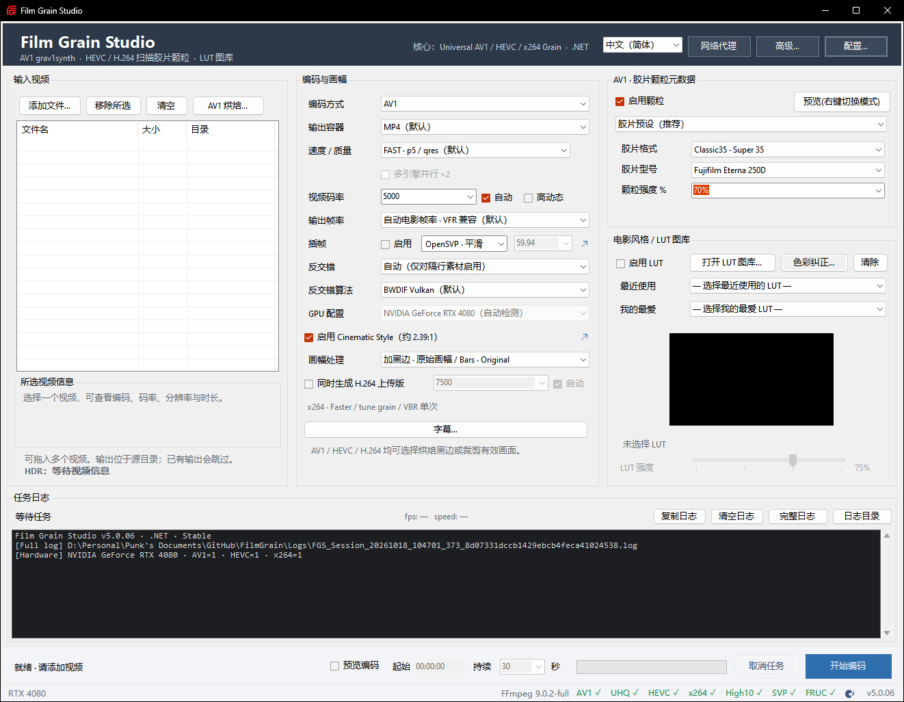
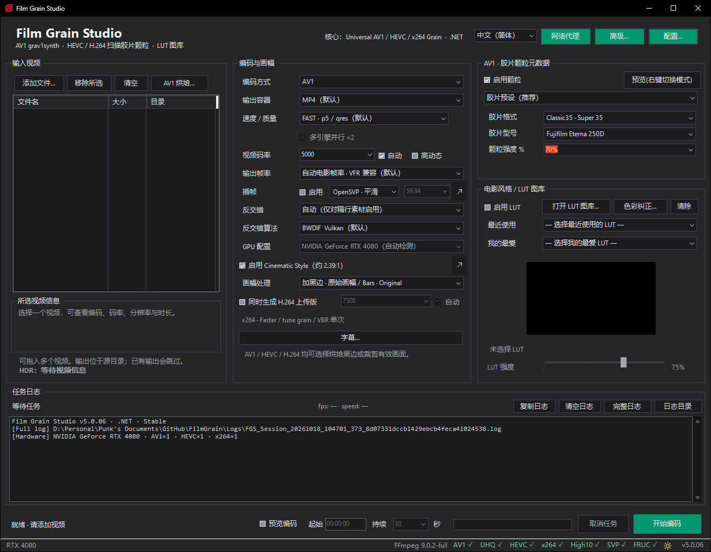
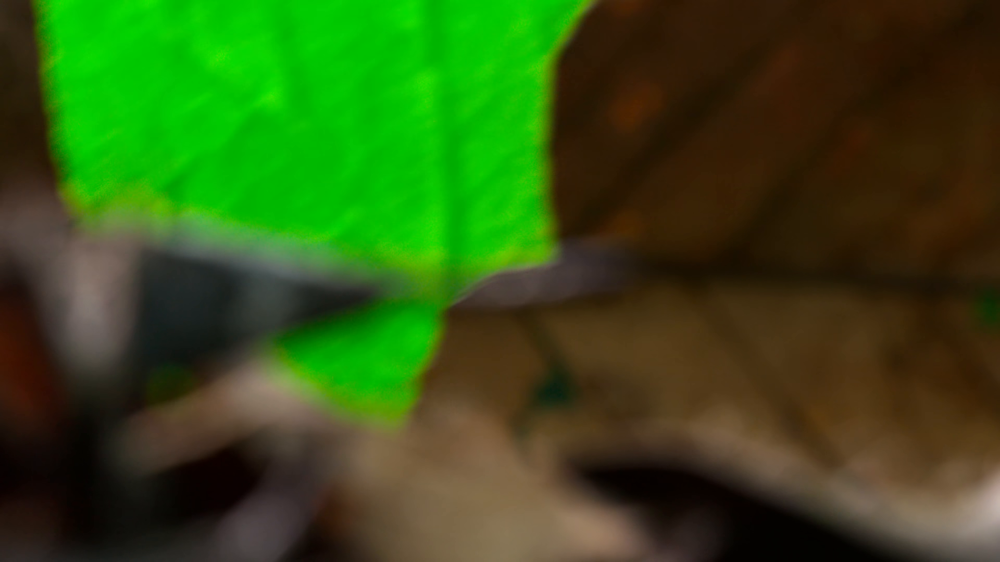

# Film Grain Studio

> **Film Grain Studio v5.0.15 · Stable · .NET Native-only。** AV1、HEVC、x264使用当前.NET原生实现；历史版本变化见 [CHANGELOG.md](CHANGELOG.md)。

---

<table>
  <tr>
    <td width="50%" align="center"><a href="images/Film_Grain_Studio.jpg"></a></td>
    <td width="50%" align="center"><a href="images/Film_Grain_Studio_Dark.jpg"></a></td>
  </tr>
</table>

---

基于 **FFmpeg、NVIDIA NVENC、libx264 与 grav1synth** 的 Windows 视频处理工具。当前入口为 .NET 图形界面，支持向 EXE 传入或拖入视频文件。

Film Grain Studio 的目标不是只提供一种“加颗粒”方法，而是把几种不同思路的 Film Grain 处理方式统一到同一套工作流中：可以使用 AV1 Film Grain metadata，也可以把真实扫描 Grain Plate、数字颗粒或 GPU Film Grain 直接烘焙进像素；同时保留 HDR、LUT、反交错、插帧、字幕、Cinematic Style、自动码率和多文件处理。

当前提供三条同级主编码路线：

| 主编码路线 | Film Grain 重点 | 最终编码 |
|---|---|---|
| **AV1 Main10 + grav1synth** | AV1 Film Grain metadata、Film Preset、Photon ISO、现成 Grain Table；也可选择像素颗粒 | AV1 Main10 NVENC |
| **HEVC Main10** | 真实扫描 Grain Plate、Digital Grain、GPU Film Grain (FGSIM) | HEVC Main10 NVENC |
| **H.264 x264 Grain** | 真实扫描 Grain Plate、Digital Grain、GPU Film Grain (FGSIM) | libx264；启用颗粒时附加 `tune grain` |

默认配置为 **AV1 Main10 + MP4 + AAC 256k**。

主界面提供整机 CPU、GPU、物理内存及专用显存监控。CPU 优先使用任务管理器对应的 Processor Utility 口径，不可用时回退时间占用口径。GPU 优先显示当前监控显卡的 Windows 最忙引擎占用；悬停可查看设备名称和统计来源，`GPU*` 表示已回退 NVIDIA NVML 口径，与任务管理器可能存在差异。

颗粒四档预览打开后自动随机选点生成画面，也可通过时间轴或精确时间重新选择片段；按当前界面语言显示，并可点击档位应用颗粒强度。

### 高级编码：音频与 NVENC Multipass

音频策略与 MP4/MKV 容器分别选择。高级 → 编码提供：

- **跟随容器（默认）**：保留原有行为，MP4 转 AAC，MKV 复制原音轨；AAC 默认 256 kbps。
- **智能保留**：MP4 按保守兼容策略复制 AAC/MP3/AC3/EAC3，其它音轨转 AAC；MKV 保留原音轨。已有 AAC 128 kbps 可直接保留到 MP4，不会因为默认 256 kbps 再编码。
- **全部复制**：保留压缩音轨；不符合 MP4 兼容策略时停止并提示，不擅自转换。
- **全部转 AAC**：可对 MP4 或 MKV 输出 AAC；码率可选 128/160/192/256/320 kbps。

AAC 码率仅对实际重编码的音轨生效，复制音轨忽略此设置。“接近源音轨”逐条读取音频码率；缺失时最多读取 128 个音频包估算，再取相近的常用 AAC 码率。仍未知时按声道回退：单声道 64、双声道 128、多声道 384 kbps，并在任务日志说明。该选项控制码率和体积，不承诺跨编码格式同等音质；不会用整个视频文件的总码率冒充音频码率。

主输出保留原有多音轨映射；上传副本和独立烘焙仍只处理第一音轨，转换时沿用双声道/48 kHz 规则。智能模式复制兼容的单/双声道音轨时保留原采样率和压缩数据；多声道上传需转换，严格复制模式会明确停止。Opus 转 AAC 是本工具面向播放器兼容性的策略，不表示所有 MP4 实现都不能容纳 Opus。

AV1 与 HEVC 主输出可分别选择 NVENC Multipass：**FGS 推荐（默认）／关闭／四分之一分辨率／完整分辨率**。默认保留原速度、质量与高动态推荐组合；手动值仅覆盖该主编码线的 multipass，不重设其它参数。不支持的手动档位明确停止；上传和独立烘焙维持已有视频推荐组合。NVENC multipass 是逐帧内部分析，不是 x264 整片两遍编码。

### 输入文件与媒体信息

媒体信息缓存会核对文件路径、长度、最后写入时间等元数据及 FFprobe 配置。同路径文件被替换或探测工具变化后，旧信息不会继续用于任务准备。若任务执行前输入已变化，程序停止并提示重新探测；请重新选择该视频并重新准备任务，原有用户参数保留。已经打开的预览窗口提示输入变化时，请关闭窗口、重新选择视频后再打开。

### 预览与可视化画幅

颗粒四档预览默认开启“1:1 中心”。预览窗口提供时间轴，可点击/拖动选择起始位置，松开后生成四档；也可输入 HH:MM:SS 后点击生成。显示样本仍按关键帧起点取样，实际起点可能提前。

调色启用时，主界面按钮显示橙底白字“调色已启用”；关闭调色恢复普通样式，右键大界面选项保留。

Cinematic Style 的高级入口打开独立可视化窗口：时间轴选帧、精确时间输入、四边拖动、上下/左右每边像素输入、自动约 2.39:1，以及加黑边/裁剪模式。上下与左右分别对称调整，可组合使用。左右非零时，上下 0 表示不裁上下；左右与上下都为 0 时自动画幅。自动按钮清除手动值。应用保存并同步主界面，取消不保存；预览显示遮罩和有效/输出尺寸，HDR 只转换预览显示。

AV1、HEVC、x264 与可视化窗口共用画幅几何核心。自动画幅沿用原来的偶数高度和起点取整；手动裁剪保留精确像素设置。自动码率和 ASS 字幕画布使用裁剪后的输出宽高；加黑边仍使用原输出宽高，上传副本按实际处理路线继承画幅。AV1 不重编码模式不执行像素裁剪。

高级设置包含编码、插帧、HDR 三页。裁剪参数在可视化窗口设置，调色窗口大小仍由调色按钮右键切换。

### LUT 强度与四档对照

普通3D CUBE的100%强度直接使用LUT结果，不再保留原图分流和逐帧混合。25%/50%/75%先生成已降低强度的临时LUT，再按100%方式应用；原LUT文件不修改，不增加视频中间文件。带一维整形表的特殊组合LUT保留原混合方式。

主界面LUT小图带1像素灰色边框，下方居中显示“目录-名称”（去掉扩展名）。小图使用图库当前参考图，缺省时使用内置参考图，并跟随强度滑杆更新；强度滑杆与百分比整体居中，提供0%/25%/50%/75%/100%，0%跳过LUT处理并显示未套LUT的参考图；后台合并快速切换请求并缓存结果。

在LUT四档对照中点击任一档确认后，该次对照的原始视频帧成为当前主窗口的“临时参考图”。主界面切换强度、最近使用、我的最爱，或进入图库选择其他LUT返回后，均使用此图重新生成小图；再次确认其他对照帧才替换。仅关闭对照窗口不替换。临时参考图不会修改图库参考图或配置，关闭主窗口后清理。

点击小图，从当前已探测视频随机截取一帧，生成25%、50%、75%、100%四格对照。可以拖动时间轴或输入HH:MM:SS后点击生成，也可按回车更新。默认全图缩放显示，可查看原图、切换1:1居中或点击档位回填并启用LUT。四格共用同一基础帧，仅比较LUT，不叠加颗粒和调色；隔行输入先反交错，HDR输入先转SDR供预览。调色窗口的LUT预览也使用相同临时LUT强度处理。

### 像素颗粒强度与四档对比

Digital Grain、扫描颗粒文件及 FGSIM 直接调整各自原有算法，不再提供额外相对强度或增加正式编码的干净支路混合。旧配置的 PIXEL_GRAIN_STRENGTH 不再生效。

| 模式 | 强度控制 | 四格预览 |
|---|---|---|
| Digital Grain | 0.10–1.00，步进0.01；参考说明不变 | 0.25 / 0.50 / 0.75 / 1.00 |
| 扫描颗粒文件 | 10%–100%，十档，步进10%；直接控制原有合成强度 | 25% / 50% / 75% / 100% |
| FGSIM | Light 0.10 / Normal 0.15 / Medium 0.20 / Heavy 0.30 | 四个实际预设 |

预览分别运行每档真实参数，不使用相对强度混合近似；保留时间轴、随机选点、1:1居中、原图对照及HDR显示转换。扫描颗粒的25%和75%为对比档，不属于十档滑杆，标注“仅对比”；其余可应用档位直接回填主界面。扫描颗粒初始值为80%，FGSIM仍默认Medium 0.20。预览仅比较颗粒，不包含LUT、调色、插帧、字幕和电影画幅；实际输出的HDR策略保持原有规则。

### AV1 颗粒强度与四档对比

- AV1 的 Film Preset、Photon ISO、Grain Table 支持 `颗粒强度 %`，界面使用10%–100%的十档滑杆，默认100%；设置自动保存。AV1 普通编码与不重编码添加/替换共用同一缩放核心。数字颗粒、FGSIM、HEVC/x264 使用上方各自的原生强度控制。
- 强度相对当前模型：如果加载的表本身已经弱化到 75%，再选择 50%，约相当于原始曲线幅度的 37.5%；百分比描述参数幅度，不保证主观观感线性。
- 选择一个 AV1 输入，启用颗粒并选择上述模式，点击颗粒区域的“预览”。输入 `HH:MM:SS` 起始时间，点击“生成四档”，同时比较20%、40%、70%、100%，均为十档滑杆中的可应用档。
- 四格使用同一关键帧样本、相同采样帧及同一模型中的种子。点击档位标题将该百分比应用回主窗口；关闭窗口不修改选择。“查看原图”临时显示关闭源合成颗粒后的参考图；“1:1 中心”检查局部纹理。
- 起始点允许按关键帧提前，完成后显示实际起点。动态颗粒表按实际起点平移，并解析继承模型；遇到无法解析的表停止并报错。窗口显示最多 8 个间隔采样帧，用于纹理对比，不能据此判断音画同步或真实运动节奏。
- 此窗口只比较颗粒，不包含 LUT、调色、插帧或字幕；HDR 使用 Hable 转 SDR 显示，最终 HDR 效果仍需检查正式输出。它与进度条前的“预览编码（默认 30 秒）”是两个不同入口。
- 非100%时就地提示“选择非100%强度可能会导致性能损失。”；100%保留原处理流程。低于100%目前会额外读取模型并重写一次颗粒元数据，处理时间和临时空间会增加，视频像素不重编码。预设/ISO/动态表均按实际生成的模型缩放，不使用近似噪点。


完整版本变化、Bug 修复与历史发布记录统一维护在 [`CHANGELOG.md`](CHANGELOG.md)。README 只介绍**当前版本的功能、工作原理、设置方式和使用建议**，不重复记录逐版本更新流水。

---

<table>
  <tr>
    <td width="50%" align="center"><a href="images/Original.png"></a><br><sub>Original Video</sub></td>
    <td width="50%" align="center"><a href="images/FGS_AV1_UHQ_11000k_GS_Modern35_2_Frame_73.png"></a><br><sub>AV1 + Native Film Grain</sub></td>
  </tr>
</table>

---

## 快速开始

### 首次运行与依赖准备

首次启动 .NET 图形界面时会检查已配置的 FFmpeg / ffprobe 与 grav1synth 路径，按需打开“首次运行设置”。FFmpeg 和 ffprobe 是主编码必需工具；grav1synth 用于 AV1 Film Grain。可以指定已有程序，也可以在 FGS 副本中下载：FFmpeg 采用 gyan.dev 的 Full 构建，grav1synth 使用 [Windows 修订版发布包](https://github.com/rampageX/grav1synth/releases/latest) 的完整文件目录。新工具默认安装在 FGS 根目录的 `_Dependencies` 下。发现系统 PATH 中的 FFmpeg 时，由用户决定是否使用。

OpenSVPFlow 是可选的插帧功能，目标帧率默认 60，可使用支持的绝对帧率或倍率，需要 Python 3.12+、VapourSynth 和插件。安装时默认使用 FGS 内的 Python，只有勾选“使用系统 Python”才尝试系统现有安装；插帧的虚拟环境位于 `_OpenSVPFlow\.venv`，VapourSynth 的 Python 路径配置保存在 `_OpenSVPFlow\_UserConfig`。启用插帧但环境缺失时，.NET 界面会提示打开设置。Grain Plate 与 LUT 是自备素材目录，无须在首次运行时安装；“配置”中的两个 `[?]` 分别指向本 README 的 [扫描 Grain Plate](#hevc真实扫描-grain-plate) 和 [LUT Gallery](#lut-gallery-与-film-look) 章节。

下载与更新使用统一的网络代理设置，可选择系统代理、自定义 HTTP 代理或直连。首次运行安装由 .NET 直接完成，保留下载验证、私有 Python 环境与现有插件保护；`--setup-test=missing` 只模拟首次扫描缺失，使用独立临时配置，可测试指定路径和界面流程，不会在该模式执行安装。常规启动继续使用根目录 `FilmGrain_Config.ini`；已完成设置后仍会快速检查核心工具路径，路径失效会重新提示，耗时硬件能力检测沿用现有缓存。.NET只执行当前原生实现，不支持的组合、输入错误、探测未就绪、依赖不足和准备异常均说明实际原因并停止。

### GUI 图形界面

推荐直接启动根目录：

```text
FilmGrain_Studio.exe
```

支持将一个或多个视频拖到 EXE，或通过快捷方式 / 命令行传入文件；相对路径按启动工作目录解析，重复输入保留首个位置。启动只导入列表，不自动编码。请保持完整应用目录，不要只复制 EXE。

同源构建入口 `dotnet\build\FilmGrain_Studio_NET_Preview.exe` 使用同一界面和配置；与根 EXE 内容一致。

启动重复 GUI 时提示切换到现有窗口。同一 Windows 会话中的根 EXE、兼容 EXE 和不同目录副本共用单实例限制，内部检测子进程不受影响。

基本流程：

1. 添加或拖入一个或多个视频。
2. 编码方式选择 AV1、HEVC 或 x264；颗粒方式在下方独立选择。
3. 按需勾选或关闭“启用颗粒”，设置输出容器、码率、输出帧率和反交错方式。
4. 按需启用 Cinematic Style、LUT、字幕、OpenSVPFlow / FRUC Vulkan、HDR 处理等功能。
5. 点击“开始编码”。
6. 在任务区查看当前阶段、进度、`fps`、`speed`、`ETA` 与完整日志；Task Log 会单独保存，便于定位单次任务问题。

GUI 输出默认保存在源视频所在目录，也可以在右上角“配置”中选择统一的自定义输出目录；已有同名输出时会跳过，不直接覆盖。

日志窗口聚焦阶段、结果、警告与失败原因；成功硬件探测的长段 FFmpeg 诊断、参数转储和逐行进度不再刷屏。原始内容继续写入完整 Session / Task 日志文件，任务状态区仍显示进度、fps、speed 和 ETA；未知诊断不会被一律隐藏。

FGS 运行日志保存在根目录 `Logs`。主界面的“日志目录”按钮左键用于打开该目录，右键可清理 FGS 自己生成的 `FGS_*.log`；不会删除 `Logs` 目录或其中的其他文件。配置中的“日志条目限制”控制自动保留数量，默认 `100`，可设置 `0–10000`，其中 `0` 表示不限制；创建新的 Session / Task 日志时会自动清理超出上限的旧日志。

启动日志保留版本、完整日志路径和简短硬件摘要。FRUC 启动检测详情写入完整 Session 日志；实际状态与失败原因在插帧下拉框及状态栏 tooltip 查看。日志工具栏的 fps / speed / ETA 保持单行，四个日志按钮独立显示。

高级设置各页的“恢复默认”位于确定左侧，只恢复当前页、确定后保存；插帧说明使用控件/标签tooltip，插件更新按钮仅在插帧页显示。

### 预览编码：先处理一小段

主界面底部、进度条前提供“预览编码”复选框。勾选后设置：

| 项目 | 输入 | 默认值 |
| --- | --- | --- |
| 起始 | 可编辑的 `HH:MM:SS`，例如 `01:33:20` | `00:00:00` |
| 持续 | 正整数秒，范围 1–86400 | `30` 秒 |

再点击原有“开始编码”按钮。AV1、HEVC、x264 先共用关键帧 stream-copy 裁剪，再运行当前所选处理。开始时间不是固定值；实际片段起点和持续时间允许因关键帧、封装索引与时间戳产生偏差，不以重新编码或精确帧裁剪强行补齐。

输出名含 `_PREVIEW_HHMMSS_Ns`，其中 `Ns` 表示请求的秒数，不保证最终时长精确相等。输出位置沿用当前配置。临时裁剪片段在成功、失败或取消后清理；不勾选时继续处理全片。参数只保留在当前窗口中，不写入正式预设。多文件队列对各文件使用同一时间设置，超出任一输入时长会阻止准备。

外挂字幕根据实际复制的首个视频包校准时间偏移，内嵌字幕随源流裁剪。该功能用于检验当前处理效果，与颗粒对照、调色实时预览是不同入口。

### 高级设置快捷入口

| 主界面位置 | 点击箭头后打开 |
| --- | --- |
| HDR 输入的处理流程信息 | 高级－HDR |
| HEVC/x264 速度与质量 | 高级－编码 |
| 插帧 | 高级－插帧 |
| 已启用的 Cinematic Style | 独立可视化裁剪窗口 |

“色彩纠正”按钮右键可切换“大界面”；重新打开色彩纠正窗口时生效。

### .NET 执行范围与多文件队列

AV1、HEVC、x264 共用 .NET 串行队列。每个输入分别探测、准备并判断 Native 支持范围，再按冻结的任务参数执行；不会把上一项的预处理状态沿用到下一项。队列显示当前文件编号、实际阶段、进度与最终结果。失败或取消停止后续项，保留已成功输出；取消期间不会继续把进度更新为成功。

共享预处理按实际路线处理 FRUC、OpenSVPFlow、HDR 转 SDR、时间轴与工作文件；上传副本、最终封装和验证继续保留各编码器的职责。日志显示实际原生执行阶段。只有最终验证完成后才显示成功。

三线共用的辅助功能包括硬件能力检测、LUT 图库与预览、参考图及索引同步、Grain Plate MOV 验证缓存、首次运行依赖安装、OpenSVPFlow 插件更新，以及 FGSIM 纹理 / hook 准备。这些入口由 .NET 原生实现执行。

Native 支持按具体组合判断。隔行 HDR 的 AUTO/OFF、HDR 保留/转换及已有输出复用沿用累计实现；隔行 OpenSVPFlow 按规则绕过光流、AUTO 输出 2x 场率，HDR 保留的渐进 HEVC/AV1 绕过 8-bit SVP。x264 HDR Preserve、隔行 FRUC 等原本不支持的组合显示原因并停止，不尝试 BAT。未知准备失败也停止并保留诊断。

AV1 不重编码添加 / 替换颗粒由 .NET 执行独立的视频 stream-copy 工作流。Legacy GUI、CLI 归档在 Legacy 目录，与根 EXE 独立；可移走 Legacy，不要移动共享资源和实际算法依赖。随包提供 `dotnet\` C# 源码及 `build_NET_Preview.bat`；Windows 构建会同时更新两处 EXE。

### 从命令行导入视频

```bat
FilmGrain_Studio.exe "D:\Videos\sample.mp4"
```

该参数只导入图形界面的输入列表，不自动编码；当前不提供旧交互CLI、Bridge BAT或旧参数兼容入口。

---

## Film Grain 方式

FGS 当前把几种不同性质的颗粒方案放在同一项目中。它们的主要区别不是“谁更高级”，而是**颗粒最终存在哪里、如何生成、是否需要播放器参与以及适合什么场景**。

| Grain 方式 | 颗粒位置 | 主要特点 | 适用路线 |
|---|---|---|---|
| **AV1 Film Grain metadata** | AV1 码流参数，由播放器解码时合成 | 码率效率高；颗粒不直接编码进每个像素 | AV1 |
| **真实扫描 Grain Plate** | 直接烘焙进像素 | 使用真实胶片扫描素材，质感由 Grain Plate 决定 | HEVC / x264 |
| **Digital Grain · Fast Noise** | 直接烘焙进像素 | 不依赖外部 Grain Plate；速度较高；强度连续可调 | AV1 / HEVC / x264 |
| **GPU Film Grain (FGSIM)** | 直接烘焙进像素 | 使用 GPU shader / Vulkan 路径生成 Film Grain 效果 | AV1 / HEVC / x264 |

三条主编码路线尽量共用同一套画幅、字幕、LUT、反交错、OpenSVPFlow 与码率策略；真正不同的部分主要集中在 Film Grain 机制和最终编码器。

---

### 启用颗粒

主界面颗粒区域的“启用颗粒”默认勾选。关闭后，颗粒类型、强度、文件等控件灰显但保留原参数，重新开启即可恢复；开关状态保存到根目录 `FilmGrain_Config.ini` 的 `[General] GRAIN_ENABLED`，重启恢复，旧 INI 缺少此项时默认开启。

| 路线 | 关闭后的行为 |
|---|---|
| x264 / HEVC | 真正跳过 Digital Grain、Grain Plate 叠加和 FGSIM 滤镜 |
| AV1 普通重新编码 | 跳过像素颗粒和 grav1synth 添加/替换 Film Grain metadata |
| 依赖及临时资源 | 不要求本任务未使用的颗粒文件、表、纹理或仅用于颗粒的 grav1synth，不生成仅供颗粒的资源 |
| x264 主输出及实际 libx264 上传副本 | 取消 FGS 自动附加的 `tune grain`；preset、码率和其它质量设置保持 |
| 命名与状态 | 去掉本次添加颗粒的文件名标记，日志/状态显示“颗粒：关闭” |

插帧、调色、LUT、字幕、画幅、反交错等继续按实际设置执行，其依赖仍正常检查。HDR 自动判定只考虑实际启用的处理：关闭颗粒时，保存的 FGSIM 选择不会使输出自动转 SDR；实际调色/LUT等限制与用户明确 HDR 策略仍生效。

关闭表示“不主动添加 FGS 颗粒”，不是降噪，不清除输入已有像素颗粒。普通 AV1 重编码使用实际 FFmpeg 解码路径，输入已有 Film Grain metadata 可能在解码时合成为像素；不承诺重新编码原样保留 metadata，也不自动增加清除步骤。颗粒检测/查看独立于添加开关。

“AV1 不重编码 · 添加/替换胶片颗粒”专用模式强制启用颗粒并禁用总开关；tooltip说明原因。进入/离开该模式保留并恢复普通转码开关状态，不静默转为重新编码。

---

## AV1：grav1synth Film Grain

启用metadata颗粒的AV1模式先编码相对干净的Main10视频，再由grav1synth将Film Grain参数写入AV1 bitstream；关闭颗粒时跳过该写入步骤。媒体信息检查 AV1 颗粒时，会先读取 bitstream 中的 `film_grain_params_present`；明确没有 Film Grain metadata 时直接显示“未发现 AV1 Film Grain metadata”，不调用 grav1synth inspect。只有检测到 Film Grain metadata 时才进入原有 inspect 流程。该预检查不改变 AV1 不重编码添加 / 替换 Film Grain 的独立工作流。

```text
原始视频
    ↓
AV1 Main10 NVENC
    ↓
IVF 临时视频流
    ↓
grav1synth 写入 Film Grain metadata
    ↓
恢复音频及容器内容
    ↓
grav1synth inspect 验证
    ↓
MP4 或 MKV
```

这里的 Grain 不会在编码阶段直接写进每一个像素。播放器解码 AV1 时，根据码流中的 Film Grain 参数实时生成颗粒。

随包 Grain Table 目录新增 `_AV1_Grain_Tables/Netflix_FGS_Dune2.txt`，可在现成颗粒表模式选择。文件保留用户提供的原始内容；其效果评价与测试结论仅针对实际使用素材。

### Film Preset

内置 Film 格式：

```text
Classic35
Modern35
16mm
Super8
MaxMid
```

Classic35、Modern35 和 16mm 还可以选择 Fujifilm Eterna 250D/500T、Kodak Vision3 250D/200T。

### Photon ISO

高级模式提供：

```text
ISO 400
ISO 800
ISO 1600
ISO 3200
ISO 6400
Custom ISO
```

并可选择 `Luma only` 或 `Luma + chroma`。

### 现成 Grain Table

AV1 可直接加载 `_AV1_Grain_Tables` 中的 `.tbl` / `.txt` Grain Table。目录推荐按以下分辨率分类：

```text
_AV1_Grain_Tables\
├─ 720p\
├─ 1080p\
├─ 1440p\
└─ 2160p\
```

GUI 会根据源视频分辨率自动匹配最接近的档位：

```text
≤ 1280  → 720p
≤ 1920  → 1080p
≤ 2560  → 1440p
> 2560  → 2160p
```

也可以勾选 Grain Table 列表旁的无文字复选框显示全部分辨率。

FGS 同时支持旧式 `1080p` 命名与 `3840x2160`、`3840x1600` 等实际宽高命名；同一档位中，带实际宽高的表会按与源视频尺寸的接近程度优先排序。电影画幅素材建议优先使用**与源或最终输出宽高完全一致**的 Grain Table，其次再按 2160p / 1440p / 1080p 档位近似匹配。

示例：

```text
LOTR FOTR Remastered · Light · 1080p · B/W · AOM
Star Trek TNG · Medium · 1080p · Color · SVT · P2
16mm · ISO 1000 · Medium · 1080p · Size8 · Photon
ISO 400 · 3840×2160 · sRGB · Photon
ISO 800 · 3840×2160 · BT.2020 · Photon
```

推荐来源：

- [Boulder08 / chunknorris](https://github.com/Boulder08/chunknorris) — `av1-graintables` 中包含多种影视来源、AOM / SVT 与 Photon Noise 表。
- [nekotrix / AV1-Photon-Noise-Tables](https://github.com/nekotrix/AV1-Photon-Noise-Tables) — 提供大量按实际分辨率生成的 Photon Noise 表，尤其适合 1440p / 4K。

项目正式包中整理的 Grain Table 继续按分辨率分类，具体上游来源见 `_AV1_Grain_Tables\README.txt`。第三方表文件仍受其原项目条款约束，FGS 只负责扫描、分类、选择和调用。

选择 Grain Table 后，Film 格式、Film stock、ISO 与 Chroma 参数自动禁用，因为颗粒参数已经由表文件本身决定。

随包提供 `Netflix_FGS_Dune2.txt` 原强度表，以及 `Netflix_FGS_Dune2_Strength75.txt` 减弱版。减弱版将亮度和彩色颗粒强度曲线参数缩放到原表的 75%，保留纹理系数和分段事件；视觉感受不保证恰好减弱四分之一。两份都是动态表，AV1 不重编码时使用兼容流程。

当前 Grain Table 没有百分比强度控件；减弱效果需选择已调整强度的外部表。影视来源的表可能包含多个随时间变化的事件，降低强度不会把动态表变成静态表；AV1 不重编码时仍按实际快速条件选择路径。

### AV1 UHQ

当硬件能力探测确认当前 GPU、驱动与 FFmpeg 支持时，速度 / 质量中会出现 **UHQ**：

```text
preset：p4
tune：uhq
multipass：fullres
```

UHQ 由编码器自身进行更深入的时域分析和帧结构决策。能力探测未通过的环境不会显示该选项。

### AV1 SFE 多引擎并行

AV1 Standard / UHQ 可选 **“多引擎并行 ×N”**，对应 NVIDIA NVENC Split Frame Encoding (SFE)。

`×N` 由当前硬件实际编码引擎数量和能力检测决定，不按 GPU 型号硬编码。启用颗粒时SFE同时检查grav1synth **0.2.2或更高版本**兼容性；关闭颗粒时只要求实际编码器能力，不因颗粒专用grav1synth缺失阻止SFE；AV1 FAST、HEVC 与 x264 不使用该选项。

### AV1 Film Grain 最终验证

AV1 任务完成前会运行：

```text
grav1synth inspect
```

只有最终输出中的 Film Grain 信息通过检查，任务才计为成功。

相关项目：

- [rust-av / grav1synth](https://github.com/rust-av/grav1synth)
- [本项目使用的 Windows 修订版](https://github.com/rampageX/grav1synth)

---

## HEVC：真实扫描 Grain Plate

HEVC 主线适合将真实扫描 Grain Plate 直接合成到视频像素，再使用 Main10 NVENC 编码。

```text
原始视频 + 真实扫描 Grain Plate
            ↓
     Vulkan Overlay
            ↓
  P010 / HEVC Main10 NVENC
            ↓
        MP4 或 MKV
```

主要特点：

- 递归扫描 Grain 根目录中的 `.mov` Grain Plate；
- 支持真实 35mm、Super 35、16mm、Super 16、8mm 及自定义素材；
- Film Grain Strength 连续可调；
- 使用 Vulkan 路径完成 Grain 缩放与合成；
- 支持 LUT、Cinematic Style、反交错、自动电影帧率、字幕、OpenSVPFlow、MP4 / MKV 与多文件处理；
- HDR 输入可进入 Main10 HDR Preserve 工作流。

### HEVC AQ

`高级设置 → 编码` 提供 HEVC Spatial AQ 与 Temporal AQ 控制。Spatial AQ 可选 `0 / 4 / 8 / 10 / 12 / 15`，默认 `8`，其中 `0` 表示关闭；Temporal AQ 为独立复选框并默认开启。两项设置仅作用于 HEVC 主编码，并继续服从硬件能力检测，不支持的功能不会被强制启用。

### Grain Cache

FGS 会自动查找与原始 Grain MOV 同目录、同名的缓存：

```text
*_1080p_HEVC_Lossless.mkv
*_HEVC_Lossless.mkv
```

选择规则：

```text
≤ 1920×1080 → 优先使用 1080p Cache
> 1920×1080 → 优先使用原分辨率 Cache
找不到适用 Cache → 回退到原始 Grain MOV
```

GUI 的“配置 → Grain 根目录”会检查 Cache 完整度，缺失时可通过当前原生功能补建而不覆盖已有文件。

Cache 校验采用实际 10-bit sample-exact 思路：从与 NVENC 相同的 P010 帧流中分出参考路径，规范化为 `yuv420p10le` 后计算 SHA-256，再与 HEVC 解码结果比较，从而避免不同 GPU / 驱动对 P010 低位填充实现差异造成假失败。

免费 Grain Plate 素材：

- [TDCAT Free DCI 4K Film Grain Plates](https://tdcat.squarespace.com/downloads/filmgrain)
- [Cinema Tools 4K DCI 35mm Film Grain](https://www.cinematools.co/film-grain)
- [DylanJohn Film Grain](https://drive.google.com/file/d/1cog6ROibJaNNcp4krO6BeQm8_kBTy7Pc/view)
- [KestFilms Media - FILM GRAIN PACK](https://kestfilms.com/film-grain-pack)

推荐目录结构：

```text
D:\Film_Grain\
├─ CinemaTools\
├─ TDCAT-Light\
└─ TDCAT-Heavy\
```

---

## H.264：x264 Grain

H.264 x264 Grain 与 HEVC 共用真实扫描 Grain、LUT、Cinematic Style、字幕、反交错、Field-rate、OpenSVPFlow 与 Grain Cache 等前处理，只在最终编码器边界切换为 libx264。

默认编码：

```text
libx264
preset faster
tune grain（仅启用颗粒时自动附加）
VBR 单次
High Profile / yuv420p
```

高级设置可选择：

```text
Preset：Faster / Medium / Slow
码率模式：VBR 单次 / VBR 2-Pass / VBR 3-Pass
```

`3-Pass` 为高级可选模式，严格执行 Pass 1 → Pass 3 → Pass 2，沿用所有现有 x264 参数；默认仍为 VBR 单次，非默认输出追加 `_3PASS` 标识。

`2-Pass` 主要用于更精确地分配给定平均码率 / 文件大小，不是颗粒保留的必要条件。启用颗粒时FGS的x264路线自动附加`tune grain`；关闭颗粒时跳过此项，仍保留用户的preset与码率。

普通 H.264 主线尽量维持 10-bit 前处理，到最终编码边界再转换为兼容性更好的 8-bit High Profile；能力探测通过时使用 error-diffusion dither。

高级设置提供 **H.264 High10（实验）**。启用并通过能力检测后，最终编码使用：

```text
yuv420p10le
High 10 Profile
```

High10 更适合本地测试和高位深链路验证；浏览器、电视、硬件解码和部分平台兼容性明显低于普通 H.264 High，因此不会用于附加 H.264 上传副本。

---

## Digital Grain · Fast Noise

Digital Grain 是 AV1 / HEVC / x264 三条主线都可调用的通用**像素颗粒引擎**。它不依赖外部 Grain Plate，也不是 AV1 Film Grain metadata；颗粒在编码前直接烘焙进像素。

强度使用连续滑杆：

```text
0.10 – 1.00
```

默认 `0.55`。当前实测参考：

| 强度 | 观感 |
|---:|---|
| 0.30 | 轻微 |
| 0.40 | 轻 |
| 0.55 | 中等 |
| 0.68 | 约接近 HEVC CT35 85% 的颗粒存在感 |
| 0.75+ | 明显 / 偏重 |

SDR 路径使用约 1.333× 分辨率的 Fast Noise 生成、形态学整形、亮度相关 Mask 后回缩到输出分辨率；相比早期 GEQ 随机颗粒参考实现，在 1080p / 1440p 实测具有明显的滤镜性能优势。

HDR Preserve 下，AV1 / HEVC 使用 10-bit 亮度颗粒路径，只修改 Y 平面，U/V 色度保持不变。HDR 与 SDR 的强度数值不要求严格视觉等效，仍建议以最终画面观感微调。

---

## GPU Film Grain (FGSIM)

GPU Film Grain (FGSIM) 是另一条**像素烘焙型** Film Grain 路线，使用已验证的 GPU shader / Vulkan / libplacebo 工作流生成颗粒。

主界面仍使用统一的 **Film Grain Strength** 控件；内部将强度映射到已经验证的 Light 0.10 / Normal 0.15 / Medium 0.20 / Heavy 0.30 四档，而不是在界面上暴露三套独立算法。

FGSIM 与 BWDIF Vulkan 共用同一个 Vulkan filter device，避免重复创建 filter device。

### HEVC + FGSIM 码率

HEVC + FGSIM 默认仍使用正常的自动或手动 VBR。对于少数纯色渐变、天空等容易出现色带的素材，可在视频码率中主动尝试：

```text
Standard CQ27 / QP18-26
High Quality CQ23 / QP18-24
```

CQ 不是默认模式，而是针对色带问题的可选解决方案。界面提示保持为：

> HEVC+FGSIM 模式下, 若画面出现色带，请在视频码率中尝试 Standard CQ27 或 High Quality CQ23 方案。

---

## HDR Preserve / HDR→SDR

FGS 会根据 FFprobe 结果识别 HDR10/PQ 或 HLG。HEVC Main10 与 AV1 Main10 的 HDR Preserve 路线会尽量保持源视频已有的 HDR 信号，而不是人为伪造源中不存在的 mastering metadata。

逐行、关闭颗粒与插帧的 HEVC HDR→SDR 任务，会在同一编码进程完成 HDR 转换、调色、LUT、画幅和字幕，减少中间视频读写。Hable 优先使用 Vulkan/libplacebo，能力不足时回退原 CPU 算法；手选其它算法保持原值。颗粒、插帧、隔行和 HDR 保留组合沿用各自处理路径。

当前保持与验证的项目包括：

- 实际 10-bit 视频路径；
- BT.2020 Color Primaries；
- PQ / SMPTE ST 2084，或 HLG / ARIB STD-B67；
- BT.2020 non-constant matrix；
- Limited / Full Range（按源信号）；
- 源文件本来存在的 Mastering Display、MaxCLL、MaxFALL 等 HDR10 静态元数据。

HEVC NVENC 会显式使用 `p010le`，避免只显示 Main 10 Profile、实际码流仍为 8-bit。AV1 Main10 继续使用 10-bit NVENC 路线。

主输出完成后会再次检查 HDR Primaries / Transfer / Matrix / Range；HDR 信号不匹配时不把结果作为正常完成输出。

FGS 的原则是：

> **保留源已有的 HDR 信息，不伪造源不存在的 HDR mastering metadata。**

因此某些网络 HDR 文件只有 BT.2020 + PQ + 10-bit、没有 Mastering Display / MaxCLL / MaxFALL 时，输出也不会人为补写虚构值。

### HDR 处理策略

高级设置 → HDR 提供：

```text
自动：仅不兼容流程转 SDR
保持 HDR
强制转换为 SDR
```

自动模式下，若当前任务需要 x264 主输出、BT.709 LUT、OpenSVPFlow 或 H.264 上传版等 SDR-only 流程，HDR 输入会先 Tone Mapping 为 BT.709 SDR，再进入后续处理。

Tone Mapping 默认使用 **Hable**，还可选择：

```text
Mobius
Reinhard
Gamma
Linear
Clip
```

HDR→SDR 会建立随机后缀的 10-bit HEVC Main10 无损工作文件，任务结束或失败后清理。工作文件仅作为内部中间层，不改变正式输出命名策略。

当前不处理 Dolby Vision RPU 或 HDR10+ 动态 metadata；特殊 HDR、非常规 mastering metadata 与 Dolby Vision 素材建议先使用短片验证。

---

## Cinematic Style

AV1 / HEVC / H.264 共用电影画幅：默认自动约 **2.39:1**，也可通过旁边的可视化裁剪入口手动设置上下、左右每边像素。两组分别对称，不支持单独偏移某一边。

- **加黑边**：保留原分辨率，将选定区域之外遮黑。
- **裁剪**：只输出选定有效区域。1920×1080 上下各 100、左右各 80，输出为 1760×880；相同设置的加黑边输出仍为 1920×1080。

左右非零时，上下 0 表示不裁上下；左右为 0 时，上下 0 沿用自动 2.39:1。点击“自动 2.39:1”清除手动值。不重编码模式不执行像素裁剪。

窗口可点击时间轴或精确输入时间，拖动画面四边或输入像素值；显示有效/输出尺寸。应用后保存，取消不保存。设置会记忆，换用不同尺寸素材时应重新确认边界；过大的值会在执行前拒绝。

黑边在颗粒合成之后添加。需要字幕放在黑边区域时可选加黑边，需要减少无效像素时可选裁剪。

---

每项任务结束日志显示总耗时，包含准备、I/O、处理、验证及清理；队列各项独立计时，不计排队等待。

## 自动反交错与 Field-rate

GUI 默认启用自动反交错，并根据 FFprobe 的 `field_order` 判断输入是否为隔行素材。MP4/MOV 中明确的 `fiel` 声明用于补齐 FFprobe 漏报；GUI、原生任务与自动测试共用探测和判断。

| 模式 | 定位 | Field-rate |
|---|---|---|
| BWDIF Vulkan | 可选 | `send_field` |
| BWDIF CUDA | 默认 | `send_field` |
| W3FDIF Complex | 高质量对照 | `mode=field` |
| 关闭 | 不进行反交错 | — |

当 `field_order` 为 `tt`、`bb`、`tb` 或 `bt` 时，自动反交错启用，并按“一场一帧”输出：

```text
29.97i → 59.94p
25i    → 50p
```

Field-rate 输出优先于普通电影帧率选择。progressive / unknown 素材保持正常逐行帧率逻辑。

---

## 自动电影帧率

对于逐行素材，自动模式会先把 FFprobe 返回的平均帧率分数换算为数值，再识别 VFR 和数学上等价的非标准分数，例如 `60/2` 或 `19001/317`。

| 源帧率族 | 输出 |
|---|---|
| 23.976 / 29.97 / 47.952 / 59.94 / 119.88 附近 | 23.976 CFR |
| 24 / 25 / 30 / 48 / 50 / 60 / 100 / 120 附近 | 24.000 CFR |
| 无法可靠归类的特殊帧率 | 保持源帧率 |

隔行素材启用自动反交错时直接采用 Field-rate ×2，不再走普通电影帧率转换。

特殊 VFR 素材仍建议检查音画同步。

---

## 插帧：OpenSVPFlow 与 FRUC Vulkan

目标帧率默认 60，支持有效绝对帧率（如 `59.94`、`60000/1001`）及倍率（如 `2x`、`2.5x`、`3x`）；实际使用必须满足所选引擎和输入的能力条件。真正执行插帧时，由插帧目标接管输出帧率，不再叠加普通电影帧率转换。

### OpenSVPFlow

在 .NET 首次运行设置中安装可选环境；私有 Python / VapourSynth 环境位于 `_OpenSVPFlow`。CPU 与 GPU/OpenCL 自检通过后才启用，不按 GPU 型号硬编码。

高级 → 插帧提供 SmoothFps Algo、Analyse Profile、Artifact Mask Area 等设置。当前推荐基线为 Algo 13、pel=1 / gpu=1 / full=true、EncodeGUI-inspired Analyse 与 cover=80 / area=100 / area_sharp=1.2。平滑使用 scene.mode=0，自动平衡使用 scene.mode=3。

OpenSVPFlow 光流内部使用 YUV420P8 SDR。逐行 HDR 请求转 SDR 后插帧时，先执行共享 Tone Mapping 并验证中间文件；不能把它视为端到端 HDR / 10-bit 光流。隔行 SDR + AUTO 按规则绕过插帧并输出场率；明确 HDR Preserve 的已覆盖 HEVC/AV1 路线绕过 SVP并保留 HDR 和源帧率。其余特殊组合按实际 Native 支持规则停止并说明原因，不回退 Legacy。

HEVC/x264 已覆盖路线使用 VSPipe Y4M → FFmpeg 管道，AV1 使用共享 FFV1 无损预处理；不能笼统声称全部路线都没有中间视频。逐行 SDR x264 TS/M2TS/MTS 直接读取原媒体，每遍准备公共起点与视频相对延迟，不要求先手工 remux。

高级 → 插帧提供原生“更新 OpenSVPFlow 插件”：下载 / ZIP 校验、暂存自检、备份、替换和安装位置复检，失败或取消恢复原插件与版本记录。成功后重启 FGS 并重检测硬件；更新前关闭其他占用插件的进程。随包插件作为已验证基线，私有环境、缓存与插件备份属于本机运行状态。

#### 高级参数

在“高级 → 插帧”调整：

| 设置 | 可选值 | 生效方式 |
|---|---|---|
| Speed | FGS / medium / fast / faster / fastest | 调整 pel、自动块尺寸、重叠及 refine；FGS 保持已有成本设置 |
| Tuning | FGS / weak（低伪影优先）/ film / smooth / animation | weak 改为较短 coarse 搜索并在正常场景模式启用切镜混合；animation 使用 type=2、distance=-6、无 refine；film/smooth 当前同义 |
| Block Size | auto / 8 / 16 / 32 | auto 随 Speed/Tuning 选择；指定值只覆盖块尺寸 |

三项默认 `FGS / FGS / auto` 保持既有 Super、Analyse、SmoothFps 参数；旧 INI 未含新键时使用这些默认值。Algo、Mask Area、主界面场景模式与目标帧率仍独立生效。BASE 仅支持新项默认值，选择其他预设时界面明确切换并禁用 Analyse Profile 为 ENCODEGUI；手动配置非法组合则停止准备并报实际原因。

这是对前端预设的映射，不是向插件直接传入 `speed` / `tuning` API 字段。映射参考 2026-10-12 的 [OpenSVPFlow](https://github.com/Z1xus/open-svpflow) 与 [smoothie 网页](https://smoothie.z1x.us/) 实际脚本；保留 FGS 的 `full:true`、有理数帧率、cubic/linear、Algo、Mask 和场景模式。FGS Speed 配合新 Tuning 时保留 pel=1、自动 16 块（animation 除外），因此不宣称与网页整个输出完全一致。新映射保持 FGS 的 GPU 路径，本批不引入 CPU/GPU 后端切换。

#### 重复帧、Still 与 Peel

“高级 → 插帧”左侧保留算法、分析、Speed/Tuning/Block Size 和 FRUC 参数，右侧为以下 SVP 选项；恢复默认作用于整页，确定后保存。

| 选项 | 默认及建议 | 用途 |
|---|---|---|
| 重复帧阈值 dedup | 0 关闭；建议开启值 0.5，范围 0–10 | 按采样亮度差判断孤立重复帧，将后续运动跨两个帧时长展开 |
| 保护静止文字 / Logo（Still） | 关闭；limit 4.5、edge 5、tolerance 30 | GPU 静止遮罩，减少固定文字与 Logo 拖影 |
| 剥离 HUD 后重合成（Peel） | 关闭；limit 6 | GPU HUD 剥离再合成 |

所有新选项默认关闭，保留既有插帧参数。dedup 不重建逐帧时间戳，不是 VFR 或音画同步修复；也不能处理任意连续重复帧。当前脚本输入为 YUV420P8，采用普通 SmoothFps/OpenCL；HDR 直通、隔行旁路及 FRUC 保持原有行为。

原配套插件为 `nightly-20261011-deadbadae0d9`，现已取消新选项对固定 DLL 哈希的限制，可使用其它构建或更新插件。仍检查插件文件是否存在；插件加载或参数不兼容时，由实际运行返回错误。建议先分别启用选项比较效果，再组合使用。

### FRUC Vulkan

FRUC 使用含 `fruc_vulkan` 滤镜的 FFmpeg 构建，可在配置中沿用主 FFmpeg 或指定独立程序；普通 FFmpeg 未包含此滤镜时不可使用。高级 → 插帧提供 perf（slow / medium / fast，默认 medium）和 grid（auto / 1 / 2 / 4 / 8，默认 auto）。

常规硬件检测同时探测实际 FRUC FFmpeg 滤镜及 Vulkan 光流运行能力。不可用时下拉项禁用，状态栏显示红色叉，悬浮提示区分 FFmpeg 滤镜 / 版本限制、设备 / 驱动 / 网格限制及其他失败原因。能力检查必须针对当前设置；例如网格 8 而 support mask 为 0x7 时提示不支持，不能只因其他网格可用就放行。

AV1、HEVC、x264 的已覆盖逐行 SDR 路线接入共享 FRUC 预处理。时间轴按音视频共同起点归一并恢复视频相对延迟；AV1 封装使用实际 IVF 探测结果。不叠加额外输出 -r/CFR 去补齐延迟首帧。不同容器、VFR、负起点或剪辑源仍应按具体素材验证，未测组合不能推断为同步通过。


#### 能力诊断

共享预检核对实际构建的 fps/perf/grid 选项及性能常量，保留设备 0 的小样本运行证据与错误；成功不等于实际输入或编码组合通过。任务日志保留 FFmpeg 版本、请求参数及实际返回的设备/网格，未报告的信息不推测。插帧选择与 FRUC 硬件状态 tooltip 共用简短摘要，不显示完整诊断日志或路径；失败时提示查看任务日志。参数默认仍 medium/auto；auto 由 FGS 解析为最大可用网格，时间轴策略保持。

FGS 的 auto 采用速度优先策略：检测当前设备支持集合后，选择最大可用网格，并以明确数值传给 FFmpeg。例如支持 1/2/4 时选择 4；FFmpeg 原生 auto 的“最细网格”语义不再直接使用。高级界面显示 AUTO 的解析值并隐藏已知不支持项；旧配置的不支持值会标注并要求改选。任务日志显示支持集合和实际选值。较粗网格减少向量与内存开销，画质影响因素材而异，可手选更细网格。没有增加上游未暴露的 hint 或 sc_threshold，也没有假定 Vulkan 可直接交给 NVENC。
---

## 色彩纠正与 LUT 实时预览

主界面 **电影风格 / LUT 图库** 区域提供独立的 **色彩纠正** 按钮。选择单个输入视频后，可以直接用视频实际帧调整：

- 对比度：-2.00–2.00，默认 1.00；
- 亮度：-1.00–1.00，默认 0.00；
- 饱和度：0.00–3.00，默认 1.00；
- Gamma：0.01–3.00，默认 1.00；
- 黑白模式：独立开关；
- 所有数值步进均为 0.01；双击任一调整滑杆可单独恢复默认值。

默认预览画面为 **720×480**。时间线支持单击向所点方向逐帧移动、双击直接跳转到所点位置，以及拖动滑块连续定位；“按住查看原图”可临时旁路色彩纠正和 LUT，方便比较。

预览窗口直接复用现有 LUT Gallery，并提供 0% / 25% / 50% / 75% / 100% 强度（0%关闭LUT效果），因此可以实时查看 **色彩纠正 → 黑白模式 → LUT** 的最终叠加效果。点击“确定”后，LUT 路径、启用状态和强度同步回主界面；点击“取消”不会覆盖主界面原设置。

右键主界面的 **色彩纠正** 按钮选择 **大界面**，此时视频预览扩大为 960×540；默认仍使用紧凑界面。色彩纠正参数与该界面选项都保存在 `FilmGrain_Config.ini`。启用色彩纠正的输出文件增加 `_CC` 标识。

---

## LUT Gallery 与 Film Look

默认 LUT 根目录：

```text
E:\Adobe Portable\LUTs
```

.NET 配置页和图库内的预览操作直接调度 FFmpeg，生成缩略图与Gallery索引。纯1D CUBE明确标记不支持，不送入lut3d。

Gallery 支持：

- 全部 LUT、最近使用和我的最爱；
- 搜索、文件夹筛选与缩略图；
- 页码下拉、上一页 / 下一页、PageUp / PageDown；
- 右键菜单、收藏、双击选择、Enter 确认与 Esc 取消；
- 0% / 25% / 50% / 75% / 100% LUT 强度，0%关闭效果；
- Resolve CUBE 兼容处理与 tetrahedral 插值。

### 参考图

出厂参考图：

```text
_LUT_Tools\LUT_Reference_Default.jpg
```

在 Gallery 中选择“更换参考图”后，会生成：

```text
_LUT_Tools\LUT_Reference_Current.jpg
```

之后 Gallery 全量重建、GUI 配置页补建缺失缩略图以及独立预览生成器都优先使用当前参考图；不存在时才回退默认图。

`LUT_Reference_Current.jpg` 属于用户运行时状态，正式发布包默认不预置。

### 更新预览图

Gallery 可以直接同步预览：

- 只补建新增或缺失的 LUT 预览；
- 已存在的有效预览不重复生成；
- 对已删除源 LUT 的对应生成预览执行受限清理，仅处理预期生成目录和命名，不扫描删除无关文件；
- 不递归删除预览目录；
- 更新后立即刷新匹配数量和当前总数。

### 智能过滤

智能过滤的目标是从大型 LUT 库中**隐藏高置信度的纯技术转换 LUT**，而不是删除任何文件。

分类结果：

```text
Technical
Combined
Creative
Keep
```

只有 `Technical` 会被隐藏；`Combined / Creative / Keep` 继续显示。

判断会综合 `.cube` 文件头、文件名和目录上下文，例如：

```text
Input / Output Color Space
Utility / Technical / Transform / Conversion
CST / IDT / ODT
Log → Rec.709
Tone Map / Gamut Map
Full / Legal Range
Shaper
```

同时会跨文件识别 Creative Family：同一个创意 Look 如果同时有 S-Log3、V-Log、LogC、Rec.709 等多个输入适配版本，则优先判为 Combined 并保留，避免把内部包含技术转换的创意 LUT 当成纯 Utility LUT。

智能过滤：

- 不移动 LUT；
- 不删除 LUT；
- 不重命名 LUT；
- 只改变 Gallery 当前显示；
- 报告写入 `<LUT_ROOT>\_LUT_PREVIEWS\_LUT_SMART_FILTER_REPORT.csv`。

### 最近使用与我的最爱

LUT Gallery 是 Recent / Favorites 数据的主要维护界面。Studio 主界面的两个下拉列表读取这些数据并复用 Gallery 缩略图。

Recent 保持去重并限制数量；从 Gallery 正式选择 LUT 时更新 Recent，从 Studio 的 Favorites 选择 LUT 后则在实际开始编码时登记 Recent。

---

## 字幕

字幕功能独立于 H.264 上传副本，可以直接烧写进主 AV1、HEVC 或 H.264 输出。

处理逻辑：

- HEVC：字幕直接烧写进主 HEVC 处理链；
- AV1：字幕烧写进 Main10 基础画面，再注入 Film Grain metadata；
- H.264 x264 Grain：字幕在前处理阶段完成后进入最终 x264 编码；
- 同时生成 H.264 上传副本时，副本继承同一套字幕设置，不重复烧写；
- 带字幕的主输出文件名增加 `_SUB`。

字幕来源支持：

- 内嵌文本字幕；
- 同目录同名 `.srt / .ass / .ssa / .vtt`；
- 浏览外部字幕文件；
- 多文件任务自动匹配。

外部字幕会优先按 Unicode BOM / 严格 UTF-8 识别；不是合法 UTF-8 时自动回退 **GB18030**，兼容常见 GBK / ANSI 中文字幕。

默认样式：

```text
字体：huiwen-mincho
字号：69（1920×1080 基准）
颜色：白色
Outline / Shadow：黑色 1 / 1
距最终输出底部：5 px
对齐：水平居中
```

字号、边距、描边和阴影可在 GUI 中调整，并按输出宽度相对 1920 px 等比缩放。

字幕位置始终以**最终输出画面的底边**为基准。启用 Cinematic 黑边时，字幕自然落在下黑边；不启用黑边时则直接位于视频底部。

---

## 自动码率与高动态

AV1 / HEVC / H.264 共用可见的自动码率策略。主界面的“视频码率”直接显示计算后的 kbps，不是隐藏黑盒；编码开始后日志会再次输出分辨率档位、60 fps 基准、最终 FPS、FPS 系数、`b:v`、`maxrate` 与 `bufsize`。

### 60 fps 码率基准

| 输出档位 | AV1 普通 | HEVC 普通 | x264 普通 | AV1 高动态 | HEVC 高动态 | x264 高动态 |
|---|---:|---:|---:|---:|---:|---:|
| 720p | 3500k | 4000k | 5000k | 6000k | 7000k | 10000k |
| 1080p | 5000k | 6000k | 7500k | 9000k | 11000k | 15000k |
| 1440p | 7000k | 8000k | 10000k | 12000k | 15000k | 20000k |
| 2160p | 10000k | 12000k | 15000k | 18000k | 22000k | 30000k |

分辨率档位按最终输出画面长边选择：

```text
≤ 1280 → 720p
≤ 1920 → 1080p
≤ 2560 → 1440p
其余   → 2160p
```

最终码率再按最终输出 FPS 使用平滑系数：

```text
24 fps  ≈ 0.60
25 fps  ≈ 0.62
30 fps  ≈ 0.70
50 fps  ≈ 0.90
60 fps  = 1.00
120 fps ≈ 1.65
```

中间帧率线性插值，并按 500 kbps 步进取整。Field-rate 与 OpenSVPFlow 产生的最终 FPS 都会参与计算。

统一 VBV：

```text
maxrate = 平均码率 × 3
bufsize = 平均码率 × 6
```

### 高动态

“高动态”指高速运动 / 高复杂度画面，**不是 HDR**。

启用后除了提高自动码率，还会在能力探测允许时启用更适合复杂运动的编码器参数。取消“自动”后可以直接输入自定义 kbps；程序不会因为切换高动态而覆盖手动平均码率，但仍会按该值计算 3× / 6× VBV。

---

## 容器与音频

### MP4

默认输出容器。

主输出音频转换为：

```text
AAC 256 kbps
```

并启用 `faststart`。MP4 兼容模式不写入不兼容的字幕、附件和数据流。

### MKV

尽量复制并保留：

- 原始音频；
- 字幕；
- 附件；
- 数据流；
- 章节；
- metadata。

更适合完整归档。

---

### 剪切 TS 与音画起点

普通无颗粒x264/HEVC转码保留音视频共同起点，在LUT等局部时钟处理后恢复视频相对延迟；AV1临时IVF使用局部视频时钟，最终封装恢复相对延迟。无颗粒HEVC＋SVP的TS/MTS/M2TS管道复用x264的共享时间轴处理，保留前导音频；上传副本沿用主输出时间轴。

以上说明适用于无颗粒路线；启用颗粒的时间轴组合需按实际输出检查音画起点。

---

## 输出文件命名

输出名称按 GUI 面板顺序组织：原名 → 编码方式 → 速度 / 非默认多遍参数 → 码率 / 位深 → 帧率 / 反交错 / 画幅 → 颗粒及参数 → LUT → HDR / 字幕等其它标识。

- `Nature_AV1_UHQ_6000k_24p_GS_Classic35.mp4`
- `Nature_X264_SLOW_3PASS_18000k_24p_FG_DG68.mp4`
- `Nature_HEVC_FAST_12000k_24p_FG_CT35_STR85.mp4`

AV1 无重编码替换兼容旧版与当前名称，只更新颗粒部分，并保留单个 `_REPLACED` / `_ADDED`。上传副本以实际 X264 参数开头，末尾标识来源。旧顺序文件不会自动改名；新任务按当前名称判断是否已存在。

---

## AV1 颗粒烘焙与 H.264 上传母版

视频平台通常会重新编码上传文件，因此 AV1 Film Grain metadata 很可能无法继续保留。FGS 可额外生成 H.264/AAC 上传副本；启用颗粒时按实际路线保留或烘焙颗粒，关闭颗粒时不主动添加颗粒。

### 将已有 AV1 的颗粒烘焙为兼容副本

输入列表旁的 **AV1 烘焙...** 将列表内已有 AV1 直接重新编码为 H.264 或 HEVC / AAC MP4，不重新生成 AV1 主成片，也不调用 grav1synth 添加或替换颗粒。它使用软件 `libdav1d`、明确开启 Film Grain 合成；源无颗粒 metadata 时正常转码，不额外添加噪声。独立烘焙不应用主界面的插帧、LUT、调色、字幕、电影画幅或颗粒引擎设置。

可选 **x264 单次 VBR**、**H.264 NVENC P7/VBR** 或 **HEVC NVENC Main10 P7/VBR**；自动码率沿用所选 FGS 编码线推荐，也可输入手动码率。输出目录沿用全局输出设置，命名为 `_BAKED_H264_X264_码率k.mp4`、`_BAKED_H264_NVENC_码率k.mp4` 或 `_BAKED_HEVC_MAIN10_NVENC_码率k.mp4`。复用原任务日志、进度、队列和取消机制；唯一临时文件验证完成后才提交最终输出，不覆盖已有文件。

当前仅支持偶数尺寸、逐行、4:2:0 8/10-bit 普通 SDR AV1；最终 H.264 为 High 8-bit 4:2:0，音频默认 AAC 256 kbps/stereo/48 kHz，可在高级编码中选择音频策略和 AAC 码率。HDR/BT.2020 直接烘焙尚不支持。源中明确的 SDR 色彩标签保留；缺失标签不擅自补齐。H.264/HEVC 像素颗粒均不依赖 AV1 Film Grain metadata，但平台再次压制仍可能削弱颗粒。

HEVC 烘焙使用 4:2:0 Main10、P010、AAC stereo 48 kHz 和 MP4 `hvc1`。10-bit 源保留编码位深；8-bit 源转换为 10-bit，不增加原始细节，也不代表 HDR。P7/VBR、fullres multipass、Spatial AQ=8、Temporal AQ=OFF、Lookahead=27 固定；实际编码预检先验证 `bf=4`，失败后验证 `bf=0`，采用哪一组会写入日志。两组均失败则停止，不改用其他编码器。T600 按实际预检结果处理，不按型号强制 B 帧。

HEVC Main10 需要播放器具备 HEVC 10-bit 解码能力；Windows 系统播放器可能需要 HEVC 扩展，见 [Microsoft 支持说明](https://support.microsoft.com/en-us/windows/apps/photos/photos-app-video-editor-error-can-t-view-this-file-type)。MP4 `hvc1` 不保证所有浏览器、电视或二次转码平台都支持；上传平台未确认支持时优先选 H.264 High 8-bit/AAC。HEVC 质量与首尾同步需播放确认，有损输出不要求与源逐像素相同。

H.264 NVENC 使用真实参数预检，不可用时提示改选 x264，不静默降低参数或更换编码器；HEVC 的 B 帧兼容方案按上文单独验证。当前仍用软件解码；NVDEC 尚未接入。x264 和 NVENC 输出均有损，颗粒合成正确性与编码后的视觉保留分别验证。

### 主流程附加上传版

AV1 与 HEVC 主线都可启用 **“同时生成 H.264 上传版”**，OpenSVPFlow 60 fps 插帧开启时同样可用。

上传版默认：

```text
libx264 / High / yuv420p
preset faster
tune grain（仅启用颗粒时自动附加）
VBR 单次
AAC 256 kbps / stereo / 48 kHz
```

上传版使用独立的视频码率框与“自动”开关，但自动码率策略与主线 x264 Grain 一致。Preset 和 VBR 单次 / 2-Pass 则与主线共享高级设置。

上传版始终保持标准 H.264 High 8-bit，以平台兼容性为优先；H.264 High10 只作用于 H.264 x264 Grain 主输出。

AV1 上传版会从最终 AV1 主成片读取，并通过明确开启颗粒合成的 `libdav1d` 将 Film Grain metadata 合成为真实颗粒像素后再压制。上传版复选框右键可选择 **x264（默认）** 或 **H.264 NVENC**；该选择只作用于 AV1 上传副本，HEVC 上传副本沿用 x264。

NVENC 固定单次 FFmpeg 编码，使用 P7/VBR/fullres、Spatial AQ 8、Temporal AQ 关闭、B-frames 3、lookahead 27；高级设置中的 x264 preset 和 2/3-Pass 仍保留，切回 x264 后继续生效。NVENC 上传副本文件名使用 `_H264_NVENC_P7`，避免与已存在的 x264 副本混淆。已有 AV1 主输出复用和 HDR Preserve 跳过上传副本的策略保持。

HEVC 上传副本按实际路线读取最终主输出，或在启用 Grain Plate 且不插帧的路线复用原处理链。关闭颗粒时读取主输出并保留时间轴，不重复添加颗粒或插帧。

---

## 为现有 AV1 免重编码添加或替换 Film Grain

输入列表只有一个 AV1 文件、媒体探测完成后，在编码方式中选择“AV1 不重编码 · 添加/替换胶片颗粒”。该模式固定启用颗粒，并禁用码率、速度、反交错、LUT、Cinematic、上传版等需要重新编码的功能。

没有 Film Grain metadata 时添加，已有时替换；视频流始终不重新编码。输出名称使用 `_ADDED` / `_REPLACED`，连续替换不会无限累积颗粒标签。MKV 尽量保留源音频、字幕、附件、数据流、章节和元数据；MP4 按高级编码的音频策略复制兼容音轨或转 AAC（默认沿用 AAC 256 kbps），不保留字幕、附件和数据流。失败记录实际原因并清理未完成输出和任务临时文件。

### 自动快速处理与兼容流程

符合条件时直接让 grav1synth 读取源 MP4，省去整片 IVF 提取；随后沿用原来的源流映射和输出封装。其它输入先提取 IVF，再添加/替换颗粒并封装。`compatibility` 表示选择了原处理流程，不表示任务失败。

| 颗粒模式 | 快速处理条件 |
|---|---|
| 内置预设 | 常规 MP4、视频零起点、均匀帧时间；无非零 composition offset 或复杂编辑列表 |
| Photon ISO | 满足上述时间轴条件，并且开头四包 IVF 的尺寸、传递函数和色彩范围与源探测结果一致 |
| Grain Table | 满足上述时间轴条件，且表只有一个启用事件，从零开始并覆盖整个视频 |

MKV、VFR、非零或未知起点、复杂编辑列表及动态外部颗粒表保留兼容流程。无重编码裁剪的 MP4 可能藏有播放器不显示的前置视频包；即使 FFprobe 显示起点为零，也不保证满足快速条件。选择关键帧重新裁样本可改善时间轴，但可能丢掉开头画面，不能用强制归零代替同步检查。

ISO 首次出现“核对原 IVF 色彩条件后选择处理路径”；后续 `fast` 或 `compatibility` 日志才是最终路径。缺少 FFprobe、核对失败/超时或色彩不一致时保留兼容流程。核对成功可在同一次 FGS 运行中复用，源文件、工具或探测色彩信息变化后重新核对，重启也会重新核对；不新增磁盘缓存。首次核对有开销，短视频不保证更快。

### 颗粒预览与输出检查

颗粒区域的“预览(右键切换模式)”左键打开对照预览，右键设置自动快速路径和完整颗粒检查，设置保存到配置文件。

预览打开后自动生成，左右使用同一帧比较无颗粒画面与实际解码合成的颗粒效果；最多显示八张采样图，支持滑块、播放和 1:1 中心裁切。默认跳过开头近黑帧，底部显示跳过数量；可关闭该项后重新生成。全黑内容会保留并提示，加载失败显示原因。HDR 预览仅为显示而转换，不改正式输出的 HDR 策略。预览复用 FFmpeg / libdav1d，不新增 Python 或 VapourSynth 依赖。

默认对内置预设、ISO 和静态表检查开头 sequence header；动态外部颗粒表保留完整输出检查。需要时可从预览按钮右键开启完整检查。任务日志记录各处理阶段耗时。

---

## 多语言界面

GUI 使用独立语言资源文件：

```text
Lang\zh-CN.ini
Lang\en-US.ini
```

其中：

- `zh-CN.ini`：简体中文，同时作为缺失翻译的 fallback；
- `en-US.ini`：English；

右上角可以选择界面语言。保存后重新打开 Film Grain Studio 生效。

多语言只影响 GUI 显示文字，不改变：

- 原生任务执行判断；
- 编码器内部 ID；
- 码率模式；
- 配置协议；
- 输出命名。

简体中文保持原来的主窗口布局；English 使用更宽的默认 / 最小窗口宽度，以避免较长英文文本压缩右侧控件。未来新增语言时，也可以在语言文件中定义适合该语言的窗口宽度。

---

## 环境与统一路径配置

外部路径统一保存在根目录：

```text
FilmGrain_Config.ini
```

GUI 右上角的 **配置** 可以修改并保存。当前GUI、原生任务及实际辅助功能读取同一份配置。

FilmGrain_Config.ini 同时是 FGS 唯一的用户自定义配置文件，不再使用独立的语言偏好配置文件。除外部工具路径外，还保存临时目录与输出目录策略、当前 GUI 语言、LUT Gallery“智能过滤”状态、“高级设置”中的全部可修改项目，以及色彩纠正参数。高级设置界面保留“编码 / 插帧 / HDR”三页，每页的“恢复默认”只影响当前页面。自定义画幅在 Cinematic Style 的可视化裁剪窗口设置；调色窗口大小在色彩纠正按钮右键设置。

主要配置分组：

- [Paths]：FFmpeg、grav1synth、Grain、LUT 路径，以及临时目录、输出目录模式与自定义路径；
- [General]：GUI语言、统一网络代理、日志限制、颗粒总开关GRAIN_ENABLED；
- [LUTGallery]：智能过滤状态；
- [Advanced.Encoding]：H.264 High10、x264 Preset / VBR 模式、HEVC Spatial AQ / Temporal AQ；
- [Advanced.Interpolation]：插帧目标 FPS / 倍率、FRUC perf / grid、SmoothFps Algo、Analyse Profile、Artifact Mask Area；
- [Advanced.HDR]：HDR 输入处理、Tone Mapping；
- [Advanced.Other]：Cinematic Style 自定义画幅、色彩调整 1280×700 大界面；
- [ColorCorrection]：色彩纠正启用状态、对比度、亮度、饱和度、Gamma 与黑白模式。

升级旧版本时，如果检测到旧的 Lang\FilmGrain_Language.ini，启动时会自动把语言选择迁移到 FilmGrain_Config.ini。

默认值：

```text
GPU：NVIDIA GPU 自动检测
FFmpeg 目录：E:\EnCoder\FFMpeg\x64\bin
grav1synth：E:\EnCoder\FFMpeg\grav1synth\grav1synth.exe
HEVC Grain 库：D:\Film_Grain
LUT 根目录：E:\Adobe Portable\LUTs
临时目录：视频当前目录；可选系统临时目录或自定义目录
输出目录：视频当前目录；可选自定义目录
```

配置界面中：

- Grain 与 LUT 路径标签旁的 `[?]` 使用系统默认浏览器打开项目 README 的对应说明；
- FFmpeg / FFprobe 显示版本；
- grav1synth 显示版本；
- Grain 根目录统计原始 MOV、原分辨率 Cache 与 1080p Cache；
- LUT 根目录统计 `.cube` LUT 与 Gallery 预览；
- 临时目录与输出目录分别检查目录创建、写入权限与可用空间；
- 浏览选择后立即检测；
- 手工输入后由用户点击 `↻` 再检测；
- 保存时不重新执行长时间扫描。

`FilmGrain_Config.ini` 使用UTF-8无BOM，由当前.NET配置层读写，支持中文、空格及特殊字符路径。

#### 临时目录与输出目录

Film Grain Studio 支持独立配置运行时临时文件位置与最终输出位置。

临时目录可选择源视频目录、系统临时目录或自定义目录。使用系统临时目录或自定义目录时，中间文件统一放入对应位置的 `FilmGrain_Studio` 子目录。

最终输出默认仍保存在源视频所在目录，也可以指定自定义输出目录。

相关设置统一保存到根目录 `FilmGrain_Config.ini`，当前原生任务共用，并应用于 AV1、HEVC、x264、H.264 上传版以及 AV1 不重编码添加/替换颗粒流程。

任务开始前会检查相关目录的有效性、写入条件和可用空间；批量任务会按预计总输出需求进行空间判断。


开始任务前，FGS 会根据输入文件大小和实际处理路线分别估算临时空间与输出空间，并额外保留安全余量。批量任务按目标磁盘汇总或取峰值检查；检测到空间可能不足时会先提示，由用户决定是否继续。

### grav1synth 0.2.2+

启用AV1 Film Grain metadata处理时使用 **grav1synth 0.2.2 或更高版本**；关闭颗粒的普通AV1编码/SFE不要求仅用于颗粒的grav1synth。0.2.2 修复 NVENC Split Frame Encoding 输出中 standalone `OBU_FRAME_HEADER / OBU_TILE_GROUP` 的兼容问题。

下载最新版：

[rampageX / grav1synth Releases](https://github.com/rampageX/grav1synth/releases/latest)

---

## 硬件能力自动探测

.NET界面直接执行受控的短编码、设备与子进程探测。

通过小型实际编码测试判断当前 GPU、NVIDIA 驱动与 FFmpeg 的真实能力，而不是根据 GPU 型号写死参数。

| 能力 | 自动处理 |
|---|---|
| AV1 / HEVC NVENC + x264 Grain | 实际验证编码路径；不可用时禁用相关选择或明确停止 |
| Main10 / High10 | 验证 AV1 / HEVC 10-bit、x264 High10 与 10→8bit dither |
| B-frame / B-reference | 不支持时不传递相关参数 |
| Spatial AQ / Temporal AQ | 分别探测并按能力启用 |
| Lookahead / Multipass | 按 fullres / qres 实际支持情况选择 |
| NVDEC CUDA / Vulkan | 只在实际路径通过后启用 |
| AV1 UHQ | `-tune uhq` 微型编码成功时才显示 |
| AV1 SFE | 检测 NVENC 编码引擎数量并验证 `-split_encode_mode N` |
| FRUC Vulkan | 独立检查实际 FFmpeg 滤镜、Vulkan 光流运行和当前 perf / grid；不可用时说明原因 |
| OpenSVPFlow GPU/OpenCL | 本地 VSPipe、插件与 GPU/OpenCL smoke test 均通过后才启用 |

检测结果缓存到：

```text
Utils\_HardwareCaps_NET.json（.NET）
```

GPU、驱动、FFmpeg、相关依赖或探测规则变化后会重新检测；符合签名条件时复用缓存，FRUC 仍独立复查。可主动重检测，任务运行时延后刷新。当前两处 .NET EXE 路径参与缓存签名，切换根目录 / build 入口可能触发重检测；这不表示硬件实际能力被清空。

.NET 底部状态栏使用独立绿色勾 / 红色叉显示编码与插帧能力；完整版本、驱动、缓存状态及不可用原因在悬浮提示中查看。

---

## 当前默认设置

| 项目 | 默认值 |
|---|---|
| 编码与 Grain 方式 | AV1 Main10 + grav1synth |
| 启用颗粒 | 开启；旧INI缺少GRAIN_ENABLED时同样开启 |
| 输出容器 | MP4 |
| 音频 | 默认 AAC 256 kbps，可在高级编码中调整 |
| 速度模式 | FAST：p5 / qres multipass / lookahead 16 |
| Cinematic Style | 开启；加黑边、保留原分辨率 |
| 反交错 | 自动；BWDIF Vulkan |
| 输出帧率 | 隔行 Field-rate ×2；逐行自动电影帧率 |
| 插帧 | 关闭；目标默认 60 fps，可设置有效帧率或倍率 |
| GPU | 自动检测 |
| LUT | 关闭 |
| AV1 Grain | Film Preset |
| AV1 Film Preset | Classic35 / Fujifilm Eterna 250D |
| 视频码率 | 自动推荐并直接显示 |
| 高动态 | 关闭 |
| x264 Preset | Faster |
| x264 码率模式 | VBR 单次 |
| H.264 High10 | 关闭 |
| H.264 上传副本 | 关闭 |
| 界面语言 | 简体中文 |
| 日志条目限制 | 100；`0` 表示不限制 |

---

## 工具包结构

```text
FilmGrain_Studio.exe
FilmGrain_Config.default.ini
FilmGrain_Config.ini（用户生成；交付包不携带）
README.md / CHANGELOG.md
README_FilmGrain_Studio.txt / README_Toolkit.txt
STABLE_BASELINE.txt（原始基线与当前验收说明）
dotnet/（C# 源码、build_NET_Preview.bat、build/兼容 EXE）
Lang/（zh-CN.ini、en-US.ini）
Utils/（FGS.ico、_FilmGrainSimplified/模板与备用纹理）
_LUT_Tools/（LUT 参考图；Current 为用户生成）
_AV1_Grain_Tables/（颗粒表）
_OpenSVPFlow/（.vpy、Plugins；私有环境按需安装）
Legacy/
    FilmGrain_Universal_CLI.bat
    FilmGrain_Universal_GUI.bat
    Utils/（旧 Bridge、不重编码 BAT、旧 GUI 和助手）
    _LUT_Tools/（旧图库 PS1）
    _OpenSVPFlow/（旧安装/更新脚本）
    dotnet/Setup_Dependencies.ps1
Tests_Shared/（仅本地测试；不提交、不进入正式 Stable ZIP）
```

根 .NET EXE 运行时保持配置、`Lang`、`Utils` 资源、`_LUT_Tools` 参考图、`_AV1_Grain_Tables` 和 `_OpenSVPFlow` 运行资源的相对位置。`Legacy` 是可选独立归档目录，移走它不会让 .NET 改用脚本；缺少真正依赖时显示实际原因。

---

## FFmpeg 与 NVIDIA 驱动

当前已验证环境使用：

```text
NVIDIA Driver 616.86
FFmpeg 9.0.1
```

默认 FFmpeg / FFprobe 目录：

```text
E:\EnCoder\FFMpeg\x64\bin
```

项目不根据固定 GPU 型号或 NVENC API 版本直接决定功能开关，实际可用能力仍由启动时的小型编码测试决定。最低驱动要求取决于当前 FFmpeg 构建采用的 NVENC API / `nv-codec-headers`。

更换 GPU、升级 NVIDIA 驱动或替换 FFmpeg 后，能力缓存会自动失效并重新检测。

需要人工检查时可以使用：

```bat
ffmpeg -hide_banner -encoders | findstr /i "hevc_nvenc av1_nvenc"
ffmpeg -hide_banner -filters  | findstr /i "blend_vulkan scale_vulkan bwdif bwdif_vulkan bwdif_cuda w3fdif"
ffmpeg -hide_banner -hwaccels | findstr /i "cuda vulkan"
ffmpeg -hide_banner -h decoder=libdav1d
```

升级驱动或 FFmpeg 后建议至少重新测试：

- HEVC / AV1 Main10；
- 29.97i → 59.94p、25i → 50p；
- Vulkan Grain 合成；
- 23.976 / 24 fps 转换后的时长与音画同步；
- MP4 / MKV 音频、字幕、附件与章节行为；
- AV1 最终 `grav1synth inspect`；
- 实际编码速度。

不要把外部 FFmpeg 目录中的 DLL 覆盖到 grav1synth 目录，两者的运行时依赖应保持独立。

---

## 已知限制

- 当前应用面向 Windows / .NET Framework WinForms；
- HEVC/AV1 NVENC需要NVIDIA GPU；x264使用CPU，实际CUDA/Vulkan/插帧能力另按所选功能检查；AV1、UHQ、B-frame、AQ和NVDEC等取决于GPU、驱动及FFmpeg组合；
- HEVC / H.264 扫描 Grain 会增加编码压力和码率需求；
- H.264 x264 Grain 使用 CPU 编码，选择 Medium / Slow 或 2-Pass 会显著增加耗时；
- AV1 Film Grain 的显示依赖播放器和解码器正确实现 Film Grain Synthesis；
- 部分平台和转码软件会移除 AV1 Film Grain metadata；
- MP4 兼容模式不会保留字幕、附件和数据流；
- 启用 LUT 时，部分处理链会转为软件滤镜路径，速度可能下降；
- 自动反交错依赖 FFprobe `field_order`，异常标记素材需要人工确认；
- OpenSVPFlow 光流仅处理逐行 SDR，默认目标 60 fps；隔行 SDR 和明确 HDR Preserve 按规则绕过，其他特殊组合按门控处理；
- OpenSVPFlow 当前内部为 YUV420P8 SDR，不是端到端 HDR / 10-bit 插帧；
- H.264 High10 为实验功能，兼容性明显低于标准 H.264 High 8-bit；
- HDR Preserve 主要覆盖 AV1 Main10 / HEVC Main10；Dolby Vision RPU 与 HDR10+ 动态 metadata 不在当前处理范围；
- LUT 智能过滤属于保守启发式分类，不保证能从任意 `.cube` 数值表完全推断创作者意图；
- 特殊 HDR、VFR、多视频流和非常规容器建议先使用短片验证；
- 强制取消任务可能留下未完成输出或 `__AV1GS_TMP_*` 临时目录；
- 重要素材应保留原文件，并在归档前检查画面、音频、时长、流信息和 Film Grain 验证结果。

---

## 如何选择

**AV1 + grav1synth**  
适合重视低码率效率、批量处理，以及希望在较低码率下仍保留明显 Film Grain 的场景。Film Grain 由播放器解码时合成。

**HEVC + 真实扫描 Grain**  
适合重视真实 Grain Plate 质感、10-bit 主输出和 NVENC 编码速度的场景。

**H.264 x264 Grain**  
适合需要真实像素颗粒，同时更重视 H.264 平台兼容性和 `tune grain` 颗粒保留的场景。

**Digital Grain**  
适合不想准备 Grain Plate、希望直接使用连续强度控制和较高处理速度的场景。

**GPU Film Grain (FGSIM)**  
适合希望使用 GPU shader 路线生成颗粒的场景；HEVC 遇到少数色带素材时可尝试 CQ27 / CQ23 方案。

当前默认：

> **AV1 Main10 + grav1synth Film Grain，输出 MP4 / AAC 256k。**

需要上传到会二次转码的视频平台时，再额外生成一份将 Grain 烘焙到像素的 H.264 / AAC 上传母版。

## 构建与发布

本地构建运行 `dotnet\build_NET_Preview.bat`。正式 Stable 由 Windows runner 从同一源码构建两处 EXE，并执行 Microsoft Framework API 成品审计；审计失败会停止构建或发布。

维护者使用 `release.bat --dry-run <版本号>` 检查发布准备，通过后执行 `release.bat <版本号>`。版本变化与验证范围见 [CHANGELOG.md](CHANGELOG.md)。


### HDR 转 SDR：GPU 默认与兼容回退

默认 Hable 转换在共享预处理开始前实际检查 Vulkan/libplacebo 能力，支持时使用 GPU；不支持时自动沿用 CPU 并在任务日志说明原因。其他色调映射算法保持原实现。HDR 保留不受影响。源码发布准备包需先完成 Windows 编译。

可视化裁剪窗口的“自动 2.39:1 / Auto”：左键恢复自动 2.39:1；右键将两轴归零并恢复完整原始画幅，不裁剪也不加黑边。点击“应用”保存，取消不保存；重新打开保留选择。手动修改裁剪值后退出原始画幅重置状态。

### 界面主题

状态栏太阳/月亮单击切换浅色或暗色，并固定为手动选择；右键选择“跟随系统／浅色／暗色”，菜单显示当前模式，悬停提示显示实际生效主题。选择自动保存，首次无配置启动默认跟随 Windows 应用主题；升级保留原有浅色或暗色选择及其他个人参数。

跟随系统时，启动读取 Windows 默认应用模式，并在运行期间响应系统变化；手动指定时不受系统变化影响。系统读取失败使用浅色，监听失败保留启动读取结果。恢复路径或编码参数默认值不改变主题；恢复主题默认请右键选择“跟随系统”。

统一主题覆盖主界面、网络代理、AV1 颗粒烘焙、路径配置、高级设置、依赖向导、工具任务、字幕设置、颗粒预览、裁剪、调色及 LUT 图库。已打开与随后打开的应用窗口、应用右键菜单随主题更新，窗体统一使用 FGS 图标。视频、缩略图、颗粒纹理及字幕色块保持实际内容。

系统文件、颜色、字体和消息对话框、系统菜单、工具提示及标题栏采用 Windows 自身外观，部分原生控件边缘与焦点显示受 Windows 版本影响。完整日志通过系统关联程序打开，外部程序外观由其自身决定。

主界面颗粒强度提供 10%～100% 十档，支持手动输入原范围 1%～100%；预览时长提供 30/60/120 秒，可手动输入 1～86400 整数秒。文件列表列宽适配窗口，完整路径可通过悬停提示查看；日志自动换行，保留垂直滚动。
