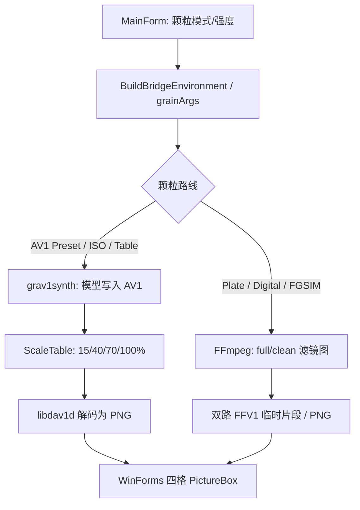
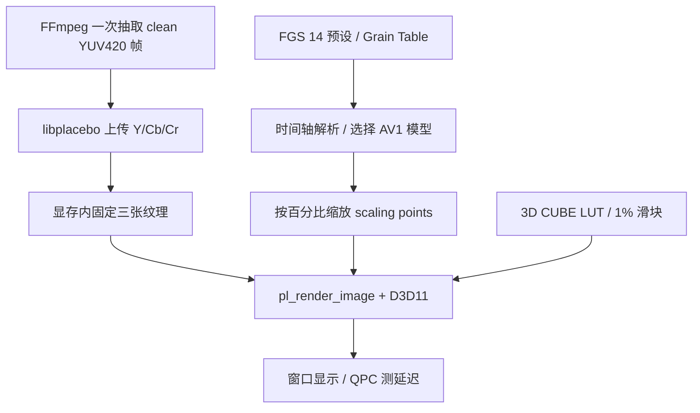

# GPU 单帧实时预览：R12 技术记录

## R12 ProRes Grain Plate 快速循环定位（Windows 待验证）

- R11 先启动双路解码器，但实际瓶颈在 Plate：视频 240–1237 ms，4K ProRes HQ Plate 3161–4544 ms，CPU 满载、GPU 接近空闲；用户移动文件至 NVMe 未改善。ProRes 不是 RTX 4080 NVDEC 支持的解码格式，这一阶段主要走 FFmpeg CPU。
- 原命令对 65 秒时间点执行 `-stream_loop -1 -ss 65 ... -i 10秒.mov`。使用合成 240 帧 ProRes 对照验证：FFmpeg 会处理之前循环的帧，CPU 重复消耗。改为启动时调用 FFprobe 读取 `codec_name/pix_fmt/r_frame_rate/nb_frames/duration`，满足 CFR ProRes 422 10bit、有效时长和帧数约束才求周期 `(nb_frames-1)/fps`，将原视频时间 `t` 映射为 `fmod(t,cycle)`。`-stream_loop -1` **保留**以免边界处抽帧失败；其它格式、无 FFprobe 或异常元数据则不缩短时间，完整保持 R11。
- 将已验证的周期通过独立参数 `--plate-cycle` 传给 GPU 窗口，用同一公式处理用户切帧；原有视频抽帧、GPU 纹理上传、Overlay 与正式编码不变。多圈循环的时间戳修约可能产生一帧左右相位差，暂不承诺与 R11 逐像素相同。
- Linux FFmpeg 6.1.1 小尺寸 ProRes 测试：65.6 秒原命令 `0.588s`，10 秒内归一化 `0.098s`，这是实验数据，**不能代替用户的 Windows 4080 / 4K 端到端测试**。
- 同时清理 R9 残留的 libplacebo 上传函数 `const int[4]` 参数警告，未改变数组值或 API 调用。

## R11 初次抽帧和切帧并行化（待 Windows 验收）

- `.NET` 入口将两次 `NativeLibraryTools.RunProcessEnvironment` 从串行改为主工作线程 + 专用后台线程并行运行，两个任务都结束后才验证两份 raw 帧与启动 GPU 程序；各自有独立命令行、文件和错误缓存，并用 `Thread.Join()` 确保异常路径不会在清理临时目录时留下仍在运行的颗粒解码器。
- GPU 窗口内部原本的 `run_frame_decoder` 拆为 `start_frame_decoder` 和 `finish_frame_decoder`。创建两个独立 FFmpeg 子进程后依次等待，进程完成时间由 `GetProcessTimes` 读取，不用后等待的墙钟误算某个解码器耗时。任一子进程失败仍保留上一帧；对每个启动成功的进程正确关闭 Windows 句柄。
- `FRAME_DECODE,video_ms,plate_ms,total_ms` 与 FGS 初次抽帧时间进入日志，仅是 **FFmpeg 抽取开销**，不代表 GPU Shader 的重绘延迟；对照 R10 用户报告的 2–3 秒，实际收益仍待 Windows 实测。滑块调整、既有 GPU Upload/Overlay 路线完全不变。

## R10 Grain Plate 真实 GPU 实时合成（RTX 4080 已验收）

- 启动：`.NET` 根据存储的像素颗粒模式 ID `1` 判断 Grain Plate，将主视频和 `.mov` 颗粒按同一时间点分别抽取 YUV420P10 原始单帧。颗粒用 `-stream_loop -1` 支持任意长度的源视频；片段实际时间同步仍需编码样本确认。
- 上传：主视频 Y/U/V 三纹理 + Grain Plate Y/U/V 三纹理。在 GPU 端于 `PL_HOOK_NATIVE`（YUV 合并后、BT.709 转 RGB 前）执行三通道 Overlay。主视频纹理在 libplacebo 平面合并时已把右对齐的 10-bit R16 采样放大 64 倍；Plate 纹理仍是直接采样的 R16 UNORM，因此只对 Plate 乘 64。1:1 裁剪的位置通过源码 `source.crop` 保存原帧起点，而非使用 Hook 局部的 `params->src_rect`，再与 `gl_FragCoord` 相加定位颗粒。
- 滑杆：15–100% / 5% 一档；G 可切换开关、滑到 0 表示关闭。`pl_shader_var(dynamic=true)` 传混合权重，拖动不启动 FFmpeg、不重新抽帧、不上传六张图片纹理。选帧时两路均重新解码并上传，属于**交互取帧**，不是连续视频播放。
- 协议：原 AV1 仍回传 JSON `Version=1`；Plate 使用 `Version=2, PixelMode=PLATE, PlateStrength=N`。主窗口严格验证档位及输入素材未变后，仅改 `trackFilmGrainStrength` / `chkGrainEnabled`。
- **边界：** `blend_vulkan` 原生滤镜按 P010 平面运行，而 libplacebo 合并 YUV 后对色度纹理上采样，并在之后应用 LUT；色度细节、LUT 与颗粒的相对次序依旧不保证与正式编码逐像素相同。用户已在 RTX 4080 验证 R10 画面显著变化、滑动流畅、选帧平移正常、回传与实际编码正确，动态效果接近，不等于完成了逐像素等价性测试。

FGS 源码基线：`master` / `f2ab7dd98922f3ab55c57b6cf012f8900b40a915`
（v5.0.56，2026-11-06）。上游参考：
[libplacebo renderer](https://libplacebo.org/renderer/)、
[libplacebo film_grain.h](https://github.com/haasn/libplacebo/blob/master/src/include/libplacebo/shaders/film_grain.h)、
[libplacebo plplay](https://github.com/haasn/libplacebo/blob/master/demos/plplay.c)、
[grav1synth](https://github.com/rampageX/grav1synth)、
[MSYS2 UCRT64 libplacebo](https://packages.msys2.org/packages/mingw-w64-ucrt-x86_64-libplacebo)。

## 当前 FGS 预览参数链（源码静态核对）

- `dotnet/FilmGrain_Studio_NET_Preview.cs`：`OpenGrainPreview()` 根据
  `ParameterGrainSelected()` 路由，AV1 建立 `FG_AV1_FORMAT / STOCK / ISO /
  CHROMA / GRAIN_TABLE` 状态，像素颗粒从 `BuildBridgeEnvironment()` 获取。
- `dotnet/FilmGrain_NativeAv1GrainReplaceCore.cs`：`TryBuildGrainArgs()`
  构造 `--preset`、`--iso [--chroma]` 或 `--grain`。
- `dotnet/FilmGrain_NativeGrainPreviewForm.cs`：`StartRender()` 临时抽样；
  AV1 模式调用 grav1synth、`Av1GrainStrengthCore.ScaleTable()`、
  `libdav1d -filmgrain 0/1`，当前显示仅比较颗粒；像素颗粒模式调用
  `RenderPixelSample()`，复用正式滤镜图但单独生成比较用的 FFV1 片段。
- `dotnet/FilmGrain_Av1GrainTableSelectionCore.cs`：
  `PresetTable()` 已内置完整预设；`ScaleTable()` 只缩放 `sY/sCb/sCr`
  的 y 值，保留 `E`/seed/`p`/AR 系数；`ShiftTable()` 修正预览时间轴。

## 当前实验模块的数据链

GPU 路线的**视频 YUV 三平面**只在初次载入时上传 GPU；连续调节不会触发
FFmpeg、grav1synth、重新解码、临时 PNG 或再次上传视频纹理。R4 的
**1% LUT** 调节仍需在 CPU 重新计算 LUT 表，libplacebo 可能将其作为新的
GPU LUT 纹理上传；不能表述为所有数据零拷贝。实时视频要另做解码器
与 D3D11/Vulkan 纹理互操作、缓存队列和同步。

## `filmgrn1` 映射（按 grav1synth 源码）

| Grain Table 字段 | libplacebo 数据 | 实验处理 |
|---|---|---|
| `E start end enabled seed update` | `pl_film_grain_data.seed` | 根据源时间点选择事件；`update=0` 继承前一个启用且更新过的模型，允许零长度更新事件。R8 预览使用原 seed 及事件起点计算逐帧推进后的 seed |
| `p` 第一至第六列 | `ar_coeff_lag/shift`, `grain_scale_shift`, `scaling_shift`, `chroma_scaling_from_luma`, `overlap` | 原值 |
| `p` 第七至十二列 | `uv_mult`, `uv_mult_luma`, `uv_offset` | 8/9 位值分别保留与处理有符号乘数 |
| `sY`, `sCb`, `sCr` | `points_y`, `points_uv` | 横坐标不动，纵坐标 `(y*percent+50)/100` |
| `cY`, `cCb`, `cCr` | `ar_coeffs_y`, `ar_coeffs_uv` | 原值，按 lag 校验长度 |

这里采用 libplacebo 的 **AV1 规格化颗粒合成**，不是任意叠加白噪声。
但是 `Film Grain Table` 定义的是颗粒模型，不含源视频的完整图像
颜色信息；同颗粒模型不保证同一幅截图逐像素完全一致。

## R3 预设与 LUT 映射

- `dotnet/FilmGrain_Av1GrainTableSelectionCore.cs` 内 `PresetTable()` 提供 14 套 v0.2.2 预设的完整 GZip 模型；`export_presets.py` 从该文件原样解压，不通过运行时外部工具重做模型。14 个解压文件与 `grav1synth/grain-files` 同名源文件的字节内容核对一致。原始预设文件 MIT 许可，见 `presets/LICENSE.txt`。
- 多事件表以 AV1 100 ns tick 时间轴选中 `E`；选中 `update=0` 事件则继承最近的启用更新模型，但随机种子仍取选中事件。全部采用 `fgs_parse_table()` 的原有严格格式验证。
- `dotnet/FilmGrain_LutCatalogCore.cs` 的 `LutStrengthCore.Bake()` 对 3D CUBE 使用：`LUT*(强度/100) + Identity*(1-强度/100)`。R3 在载入时按上述公式生成四档，强度切换只改变 `pl_render_params.lut` 及其缓存签名，不重新读取文件或上传视频原始纹理。
- 上游 `libplacebo` 的 `pl_lut_parse_cube()` 把 LUT 表值按照 CUBE `DOMAIN_MIN/MAX` 归一化，R3 的 identity 亦在归一化域内计算。只接受独立 3D LUT，尺寸 2–65；这不是 FGS 对 CUBE 的全部支持范围。与 FGS FFmpeg `lut3d:interp=tetrahedral` 的插值数学方向接近，但渲染颜色空间、合成前后顺序不同，必须单独视觉对照。
- 正式 FGS 在 `format=gbrp16le` 阶段做 LUT，再将 AV1 Grain 模型加入输出；R3 则在 libplacebo 的 GPU 合成/显示流水线中应用 LUT。因此 **LUT+颗粒混合效果不宣称等同正式编码**。

## R4 鼠标交互实现与风险

- 主 HWND 内独立建立 D3D11 子 HWND：GPU 视频与下方 GDI 深色滑块分离，主窗口使用 `WS_CLIPCHILDREN`，两边不在同一绘图表面互相覆盖。鼠标使用 `SetCapture` 保持离开轨道后继续调节。
- 颗粒 1%：仍用 `fgs_scale_model()` 做原 AV1 scaling points 的整数舍入，低强度下多个相邻百分比可能对应相同整数模型；这是 AV1 模型精度决定的，不是滑块丢事件。
- LUT 1%：保留 R3 的四份 25% 预计算 LUT。其余百分比仅维护**一份**动态 LUT 表；更改 `pl_custom_lut.signature` 触发 libplacebo 重建 LUT GPU 状态，绝不重新上传原始 YUV 纹理。与采用 101 份全量 LUT 常驻 CPU/GPU 的方案相比，R4 限制了本实验模块的额外 CPU LUT 缓冲占用，但鼠标快速拖动可能出现 LUT 纹理重建延迟，需实测。
- 性能统计保留颗粒 `BENCH_*`，额外输出 `LUT_BENCH_*`，后者故意选择非 25% 整数档位来检查动态路径，包含 shader 首次编译及 3D LUT 更新的开销。
- R4 UI 属于**独立 Win32 测试窗口**，未对现有 WinForms 插入控件、子窗口句柄或 .NET DLL。R5 经外部进程参数交换接入，不嵌入 WinForms。

## R5 FGS 交接协议（用户已测试支持的 AV1 模式）

- 用户点击 FGS “高级预览调整…” → `FilmGrain_GpuAdvancedPreview.cs` 在后台用配置的 FFmpeg 抽取一次 SDR BT.709 `yuv420p10le`；校验原始帧字节长度 → 使用原始 Grain Table 或 `Av1GrainStrengthCore.PresetTable()` 导出完整模型 → 启动独立 `fgs_gpu_preview.exe`。视频帧保留在外部进程的 GPU 纹理中；鼠标调整不再调用 FGS。
- 新参数：`--result 唯一路径`、`--grain 0..100`、`--lut 0..100`、`--grain-on 0|1`、`--lut-on 0|1`；旧位置参数继续兼容。未加载颗粒表时使用 `-` 作为禁用颗粒模型哨兵，LUT 单独可用。原来的 60 次 benchmark 可设为 `0` 跳过。
- 只有“应用到 FGS”/`Enter` 原子写出 `{"Version":1,"GrainStrength":75,"GrainEnabled":true,"LutStrength":63,"LutEnabled":true}`；`Esc`/取消/窗口关闭不写。FGS 接收后检查字段范围及源视频/颗粒/LUT 是否仍然一致，再写回相应 WinForms 控件；取消无外部变化。
- R5 颗粒主界面采用 5% 档位和 15% 下限；**R6 已改为 1–100% / 1% 精度**，不再对 GPU 回传的颗粒强度取整；LUT 全路线真实接受 0–100 任何整数，既有 1D+3D LUT 混合退化方式没有改变。
- `FgsPreset.FormatVersion=2` 令 `trackLutStrength` 改为百分比保存。既有 v1 按旧 0..4 转换为 0/25/50/75/100 后再应用，磁盘原件不会自动修改。
- 当前集成仅做基础 SDR 单帧的颗粒/LUT，不模拟其它 FGS 前处理；中间文件仅为一次性 YUV 输入和结果 JSON，用后清理，正式编码链仍走原核心。

## R6 颗粒精度与 Win32 UI

- `Av1GrainStrengthPercent` 从配置读取 1–100%，主界面 `ThemeTrackBar` 每步 1%，GPU 的 `GrainStrength` 直接赋值，旧四格预览返回值也无需 `/5` 转换。预设校验范围调整至 1–100%。其它扫描颗粒／数字颗粒仍保留原有步进和逻辑。
- `Av1GrainStrengthCore.Read`、`ScaleTable` 原先就支持 1–100%；R6 未修改 AV1 编码强度缩放数学模型，仅消除 GUI／回传的 5% 量化。GPU 键盘方向键改成 1%，基准测试用 1% 强度序列，不能与 R4 的 5% 序列直接比较。
- 独立程序编译时用 `windres` 把与主程序相同的 `Utils/FGS.ico` 原样复制资源嵌入 EXE，运行时不读取图标文件。用 GDI `CreateFontW` 指定 `Microsoft YaHei UI`，统一渲染两条滑块的标签、百分比及两个按钮，以 `DT_VCENTER` 对齐。
- 14 套预设每套新增 1–100 全档曲线取整与随机种子校验，Linux GCC `-Wall -Wextra -Werror -pedantic` 编译、运行通过。R6 的 1% 输出与参数回传已通过老P 在 Windows 的验收；R7 的 UI、选帧尚待测试。

## R7 1:1 与手动选择帧

- 已有的两条强度滑杆保持 GPU 即时渲染；第三条「选择视频帧」仅在 FGS 传入 `--video`、`--ffmpeg`、`--duration` 后出现。时间轴拖动期间只修改待选时间，松开鼠标才同步启动一次独立 FFmpeg 子进程。时间输入框、跳转、随机帧使用同一抽帧入口。
- 抽帧命令由 `CreateProcessW` 调用完整 EXE 路径，不经过 CMD／PowerShell；视频路径、FFmpeg 路径、临时 YUV 路径可带空格、中文、`&` 等合法 Windows 特殊字符。抽帧等待最多 120 秒，失败仍保留上一帧。
- 抽出新的原始帧后复用已有的 libplacebo GPU 上传流程，保留 renderer/swapchain、LUT 与当前强度。原始 `filmgrn1` 文本保留到窗口关闭，每次切帧以新的 100 ns 时间点重新解析模型与种子，避免更换时间后继续用旧帧的 Grain Table 事件。
- 画面子 HWND 启用 `CS_DBLCLKS`；双击切换适应窗口和 1:1。1:1 时从原始帧截取与窗口同样大小的中心像素矩形，绘制到同像素大小的目标矩形；鼠标拖动改变原始裁剪位置，且裁剪坐标限定在源帧范围。全程无需重解码。
- FGS 初始抽帧改为源视频的偶数宽高（GPU 原型最大 8192×8192），避免之前统一缩小到 1920 后的「1:1 只是缩小版 1:1」问题。输入奇数宽高会裁去末尾 1 像素以适配 YUV420，须区分于真实源像素。
- 滑块标签改为距轨道 13 像素的右对齐，GDI 字体改为主界面的 `Segoe UI` 9pt 并按显示器 DPI 转换字号；第三行时间轴及底部编辑框、随机、跳转、应用、取消共用该字体。窗口最小宽度为 820 像素，确保底部操作区不交叠。
- R7 已由用户在 Windows / RTX 4080 试用：1:1 模式与时间轴选帧能用于颗粒截图，且 R6 的 1% 颗粒回传早已确认正常；4K 性能和所有 UI 路线未全面验收。R7 的 MaxMid 视觉异常由 R8 定位与修正。

## R8 随机种子修复与 ISO 核查

- 老P 在 R7 的 RTX 4080 实测中确认 1:1 和选择帧可用，但在 MaxMid 65.588 秒处，GPU 0/100% 几乎看不出颗粒；相近时间的 FGS 正式编码 PNG 明显具有颗粒。天空区域的高频变化标准差：GPU 0% ≈0.43、GPU 100% ≈0.42、正式编码 ≈6.66（仅作诊断比较，非精确同帧同尺寸画质指标）。
- 根因：MaxMid 65.588 秒命中的末尾事件 `E 54800000 ... 1 0 1` 的初始 seed 是 0。R7 把 0 直接交给 libplacebo；`film_grain_av1.c` 的 16-bit LFSR 在零状态下永远不会推进，亮度随机颗粒退化为常量。正式编码的 `grav1synth/src/parser/frame.rs` 对选中片段中的每个视频包执行 `grain_seed.wrapping_add(DEFAULT_GRAIN_SEED)`，当前 `av1-grain` 常量 `DEFAULT_GRAIN_SEED=10956`。
- R8 独立 C 层增加 `fgs_parse_table_at_event()`，返回经现有严格校验的事件起点，不改变现有 `fgs_parse_table_at()` 的行为；`fgs_seed_for_frame()` 根据相对帧序号以 16-bit 回绕计算种子。FGS 从 `MediaProbeInfo.AvgFrameRate` 传 `--fps NUM/DEN`，跳帧时保留参数并更新种子。旧命令行不传帧率时默认 30fps。
- **限制**：原型只获取时间点与标称帧率，没有实际每个源包的时间戳和编码后帧序号；VFR、改变输出帧率、FRUC 等情况下不能保证与 grav1synth 完全相同的 seed 序列。R8 修复的是 `seed=0` 导致几乎无颗粒的严重问题，逐像素一致需后续同帧验证。
- ISO 正式编码路径 `FilmGrain_NativeAv1Core` / `NativeAv1GrainReplaceCore` 均将用户 ISO 传给 grav1synth，必要时经 `Av1IsoStrengthCore` 缩放，未发现像 GPU 原型一样直接以零 seed 渲染的分支。仓库内 1080p Photon-Noise ISO1600 参考表 `sY` 点只有约 1–7，ISO6400 约 5–15，MaxMid 同场次约 65–214；两者模型不同，不应按点值直接推算实际像素噪声倍数。正式 ISO 个别输出需实际成品/inspect 才能确认。

## R9 底部 UI 与独立窗口记忆

- 用 Segoe UI 9pt 的 GDI 实际字宽测量 `00:00:00.000`，加 16 像素左右内边距确定编辑框宽度；按字体 `tmHeight+6` 设置高度。时间框移到最左，随机／跳转按钮紧随其后，三者共用同一底边，既有“应用到 FGS／取消”按钮位置不变。
- `bottom_frame_controls()` 是绘制按钮、点击判定、`WM_SIZE` 和编辑框初始布局的统一坐标来源，避免按钮显示与命中区域错开。
- 关闭独立窗口时通过 `GetWindowPlacement` 保存普通窗口矩形和最大化状态至当前用户注册表 `HKCU\Software\FilmGrainStudio\GpuAdvancedPreview\WindowBounds`；启动时在首屏显示之前读取并恢复。用 `MonitorFromRect`、显示器工作区及最小尺寸规则确认位置有效，防止断开外接屏幕后窗口不可见。
- 注册表 API 需链接 `advapi32`；不保存 FGS 编码首选项，不改变 WinForms 主窗口的已有位置记忆。Windows／RTX 4080 的 DPI、最大化和多显示器行为仍待实测。
- R9a 的 FGS 调用入口使用现有 `NativeGrainPreviewForm.ChooseInitialSeconds()`，随机种子使用新 GUID 哈希；该函数在大多数长视频中避开片头、片尾，短视频安全退到可抽取的早期帧。无需修改 GPU 原型及正式编码流程。

## 验证边界

| 层级 | 实际结果 |
|---|---|
| FGS master 源码静态检查 | f2ab7dd 基线已比对，R6 修改未提交；没有触碰正式编码数学模型 |
| 上游 API/Windows 包研究 | 通过；D3D11 HWND swapchain、逐帧参数切换均有官方 API |
| C 表解析独立编译 | Linux GCC `-Wall -Wextra -Werror -pedantic` 通过 |
| FGS Grain Table 测试 | 94/94 单事件表解析/强度数学检查通过；未修改原解析函数 |
| Film Preset 时间轴测试 | 14/14 模型导出；1,207 个事件各测首/末有效 tick（2,414 次）；继承、零长度更新、禁用、越界分别做边界检查，通过 |
| 《沙丘2》双表事件检查 | Original / MOD_E3 各 1,868 事件，支持零长度事件；Linux GCC 静态解析通过 |
| Windows 原型编译 | **R5 修复 CS0160 后用户已测试，R6 1% 输出和回传已验收，R7 的 1:1 / 选帧已试用，R8 MaxMid seed 修复已由老P 确认颗粒明显**；R9 的布局和窗口记忆尚待 Windows / RTX 4080 验收 |
| RTX 4080 GPU 调节 | **R4 用户已实测**：10-bit + LUT，颗粒均值 4.545 ms、P95 6.191 ms；LUT 1% 均值 3.966 ms、P95 6.069 ms；《沙丘2》颗粒明显、无闪烁 |
| 与 FGS 现有预览视觉接近程度 | **用户主观评价**：足够接近；R3 强颗粒、LUT 调节稳定；未做逐像素对齐 |
| 连续视频 GPU 预览 | 未实施 |

首轮 R2 抽取帧为 `yuv420p` 8-bit；R3 已使用 1920×1080 `yuv420p10le`
的原生 10-bit SDR BT.709 路线在 RTX 4080 上通过用户实测。

R6 基于 `master` / `f2ab7dd`，未升级 .NET，未改 FFmpeg/NVEncC 正式编码核心、原有预览流程或 GitHub 发布状态。动态 ISO 的模型包含视频尺寸、SDR/PQ 等上下文，直接改 ISO 数字不足以构成等效 GPU 模型；目前可使用同规格 Photon-Noise `.tbl` 测试，自动生成路径暂未实现。

尚不作为 Stable 接入依据的原因是：4:2:0 chroma siting、位深/种子、
libdav1d 合成实现的像素差异，以及连续视频负载尚未逐项验证。
